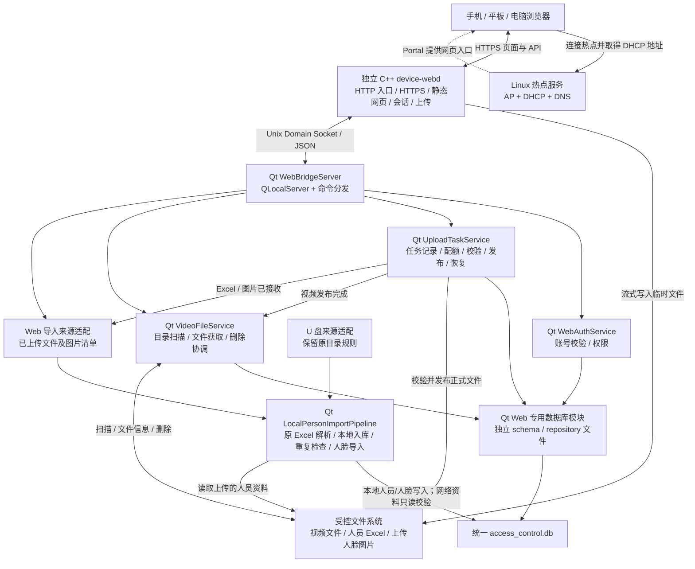

# 开发板 Wi-Fi 本地文件与人员 Excel 导入方案 V1.3

日期：2026-10-09。适用工程：MergedQtApp / RK3566。修订：保留全部页面；Web 数据库代码独立分文件；本地人员 Excel 和人脸图片导入复用 U 盘链路。

本文件是实施基线。2026-10-09 已新增独立 C++ 服务、Qt Web IPC 与独立 Web 表模块、全部保留页面及部署模板；实施位置和验证结果见 `web/README.md`。以下设计清单中的历史拟定名称以交付源码为准；板端部署和硬件验收尚未执行。最新约束优先：不改变原 Qt 业务；新增 Web 人脸防重使用网络下发的 `AppConfig::duplicateFaceCosineThreshold`，不设置独立阈值。

## 1. 方案结论与范围

采用“Linux 热点服务 + 独立 C++ Web 服务 + Qt 本地数据与文件接口 + 现有统一 SQLite”的架构。

- 手机、平板或电脑连接板端热点，通过浏览器使用设备管理网页。
- 手机地址由 DHCP 自动分配；板端 AP 接口配置稳定的本地地址。
- HTTP/HTTPS 服务器单独构建为 `device-webd`，采用 C++17，不链接 Qt，不直接访问 SQLite。
- Qt 增加本地 IPC 服务入口，管理账号验证、持久化上传任务、视频目录与删除、本地人员 Excel 和人脸图片导入。
- 沿用 `/home/cat/face_media/access_control.db`，新增必要的表，不新增第二份业务数据库。
- Web 专用表的建表/迁移写入独立 `web_schema.h/.cpp`，读写按仓储分文件，不向现有 `dbstore.cpp` 集中追加 Web DDL 和业务逻辑。
- 网页保留指定 Vue 3 / Vant 项目的全部页面、布局和导航，仅为文件管理、本地 Excel/人脸导入接入真实接口，构建后由 `device-webd` 提供。
- 上传采用流式写盘，临时文件校验通过后发布为正式媒体文件。

本版交付登录、视频上传、设备指定目录的视频列表与文件获取、视频删除、本地人员 Excel 上传、人脸图片上传、导入状态和结果查询。人员表只接受 `.xls/.xlsx`，不提供 CSV、JSON 表单人员导入。热点自动弹出入口纳入整体方案，分阶段适配目标手机。

本版不接入 MQTT，不提供播放/音量控制、空调、电梯、远程开门、截图等操作，也不将这些操作安排为本方案的后续阶段。人员 Excel 的字段映射、关联本地资料保存、人脸校验和重复检查按原 U 盘本地导入语义执行；保存表中已有规则/凭证字段不等于新增对应控制页面业务。网络人员只读取以核对冲突，不通过 Web 导入或修改。

上述不实现的业务仍保留对应页面和视觉控件，采用静态占位/禁用状态，并明确标记“本版本未接入”。页面保留不意味着后台接口存在；不发送业务请求、不执行设备动作、不显示虚假的操作成功或设备实时状态。

参考目录保持不变，前端复制到 `web/frontend` 后适配。既有 Qt 仅增加构建/启动、Web 校验/刷新入口，以及 U 盘与 Web 本地导入互斥预约；既有解析器、人员仓储、网络同步、播放及设备控制实现保持不变。

## 2. 已核实的工程基础

### 2.1 当前 Qt 工程

| 现有位置 | 已确认能力 | 本方案接入方式 |
| --- | --- | --- |
| `platform/rk3566_platform.cpp` | `databasePath()` 固定到统一 SQLite；`videoDir()` 返回现有媒体目录 | 由 Qt 确定数据库和受控文件目录 |
| `common/sql/dbstore.cpp` | Qt SQLite 封装、按线程区分连接、WAL、busy timeout | 复用连接与通用 SQL 能力；Web DDL/CRUD 放独立文件 |
| `common/storage_policy.cpp` | 媒体配额、媒体目录使用量、临时文件提交检查 | 扩展上传配额预留，兼容现有 FTP 写入 |
| `common/sql/local_personnel_store.*` | 本地 Excel 入库、本地/网络人员及卡号/密码冲突检查、已校验人脸保存 | 复用本地人员导入与人脸保存，不建立第二份人员模型 |
| `modules/facegate/FaceGateQt/import/PersonXlsParser.*`、`PersonXlsxParser.*` | `.xls/.xlsx` 读取和统一 Excel 字段映射 | 使用同一解析器、模板、行校验与警告语义 |
| `modules/facegate/FaceGateQt/import/PersonImportWorker.*`、`UsbPersonImportSource.*` | U 盘文件获取、人员入库、图片匹配和任务结果 | 分离来源适配与共享导入流程，Web 不调用 U 盘预约/查目录 |
| `modules/facegate/FaceGateQt/core/FaceInferenceWorker.*` | 本地导入图片质量校验及特征提取 | 复用本地人脸校验入口，增加 Web 专属跨库防重入口 |
| `components/multimedia/multimediademo.*` | 现有本机媒体使用与目录扫描 | 仅保持完整文件可见及使用中删除保护，不新增网页播放入口 |
| `components/file_manager/file_manager_page.*` | 本地文件浏览和删除 | 将新上传目录和受管理文件纳入协调规则 |
| `modules/facegate/FaceGateQt/database/DatabaseWorker.*` | 数据库工作线程 | 沿用线程归属规则，避免数据库操作阻塞 UI |

当前正式媒体目录：

```text
/mnt/UDISK/res/static/demoResources/images/video
```

`MultimediaDemo::onDownloadedVideoReady()` 当前会触发立即播放。网页上传完成不调用该入口，不执行立即播放或切换播放来源；本次只登记正式文件并更新网页文件清单。

现有人脸管理员凭据由 `AppConfig` 的配置读写路径维护；尚不能把它等同于已存在的数据库网页账号。V1 在同一 SQLite 中增加独立网页账号表，避免默默改变本机管理员登录行为。

### 2.2 UI 参考工程

参考目录：

```text
F:/rk3566-proj/yc_linux_qt_web_http(1)/yc_linux_qt_web_http
```

已检查 `package.json`、登录页、主布局、视频页、主题、路由、请求封装和原设计文档。

- 技术栈：Vue 3、Vant 4、Vite、Axios、Pinia、Vue Router、vue-i18n。
- 视觉：浅灰背景、白色圆角卡片、绿色主按钮、底部导航；主色 `#00b368`。
- 参考导航：设备预览、人员、电梯、空调、视频；设备设置是独立页面。
- 当前 `dist` 共 26 个文件、797,681 字节，约 0.76 MiB。此数值只是已有前端构建产物大小。
- 登录页目前只输入设备密码；V1 增加用户名。
- 视频页 `onUpload()` 目前只发送文件名和格式化大小，未发送 `File` 内容，不能作为真实上传实现直接使用。
- 请求封装默认超时 15 秒，不适合直接用于长时间视频上传。
- 当前前端使用 localStorage 中的 Bearer token；V1 调整为 Cookie 会话，路由守卫同步调整。
- 原设计文档的“Qt 内置 HTTP 服务器”和“HTTP→MQTT 桥接”不作为本方案的运行架构。保留全部页面及视觉组件，不继承未实现业务的 API、MQTT 映射或演示执行逻辑。

参考目录保持原样；生产构建与浏览器验收在本工程的前端副本中执行，详见交付说明。

## 3. 新增后的整体架构



以上新增 Qt 类名是拟定名称，实施时根据实际模块组织调整。热点服务不参与视频数据中转，浏览器直接与 `device-webd` 通信。

### 3.1 各模块的职责

| 模块 | 职责 | 持久化职责 |
| --- | --- | --- |
| 热点服务 | AP、DHCP、DNS、入口发现所需的网络配置 | 系统网络配置 |
| device-webd | 静态资源、TLS、会话、请求限额、临时文件写入、实时进度 | 写上传临时文件；不直接写数据库 |
| Qt WebBridgeServer | 本地连接认证、协议解析、命令分发、请求关联 | 不直接执行阻塞业务 |
| Qt WebAuthService | 校验出厂账号、修改网页密码、返回权限 | 网页账号表 |
| Qt UploadTaskService | 创建视频/人员文件任务、配额预留、检查点、提交、故障恢复 | 上传任务表 |
| Qt VideoFileService | 扫描指定目录、文件 ID 映射、文件获取授权、删除与清单同步 | 正式文件登记与删除状态 |
| Qt Web 数据库模块 | 独立的 Web 表结构迁移及账号/任务/文件/导入批次仓储 | 同一 SQLite 内的 web_* 表 |
| Qt LocalPersonImportPipeline | 原 XLS/XLSX 解析、本地入库、跨本地/网络冲突检查、图片匹配/校验/保存 | 现有 person/face_feature/local_* 表；Web 批次仓储记录结果 |

新增入口仅调用本地文件、数据库和现有人脸导入服务，不连接 MQTT Broker，也不向 mqttd 发布消息。网络库只用于校验冲突；不调用网络人员同步写入或网络人脸同步入口。

## 4. 技术选型与部署方式

| 部分 | V1 选型 |
| --- | --- |
| 独立 Web 服务 | C++17，CMake 独立目标 `device-webd` |
| HTTP 实现 | 首选 cpp-httplib；锁定版本，使用流式请求读取接口 |
| TLS | 与所选 HTTP 库兼容、可维护的 OpenSSL 或 Mbed TLS 构建 |
| JSON | 固定一种 C++ JSON 库；Qt 侧使用 QJsonDocument/QJsonObject |
| IPC | Linux AF_UNIX；Qt 侧 QLocalServer/QLocalSocket |
| 前端 | 沿用 Vue 3 + Vant，生产静态构建 |
| 热点 | 已有 NetworkManager 则沿用它，否则 hostapd + dnsmasq |
| 启动管理 | 板端使用 systemd 时配置独立 service；其他系统使用相应 init 管理 |

必须先核实板端架构、编译器、Qt 版本、TLS 库和无线驱动。现有 qmake 配置使用 C++17，并引用 Ubuntu 20 sysroot；不能据此假设板端已有 OpenSSL 3。

当前 cpp-httplib 上游的 OpenSSL 后端要求 3.0 以上，因此在依赖验证阶段确定兼容组合，不能直接拉取最新头文件后假设可编译。无需把 HTTP/TLS 写入 Qt，也无需自行实现 HTTP 解析器。[cpp-httplib 官方说明](https://github.com/yhirose/cpp-httplib)

开发机上构建网页，板端只安装 `dist`；不部署 node_modules，不运行 Node.js/Vite 开发服务器。网页和 API 使用同一 HTTPS 源及相对 `/api/v1` 地址。

## 5. Wi-Fi 连接、网页登录与 HTTPS

### 5.1 连接流程

1. 板端启动热点和 DHCP/DNS，AP 接口示例地址为 `192.168.50.1/24`。
2. 手机连接热点，DHCP 自动分配地址、DNS 等参数；无须手机手动配置。
3. Web 服务提供 HTTP 入口、HTTPS 网页；独立启动，即使 Qt 暂未就绪也可显示服务状态。
4. 支持 Portal 的系统显示登录入口；未显示时通过二维码或明确网址手动访问。
5. 用户在 HTTPS 页面输入出厂用户名和密码。
6. Web 服务通过 IPC 请求 Qt 校验数据库中的网页账号。
7. 成功后建立会话，进入管理界面。
8. 用户上传视频，或选择人员 Excel 和对应人脸图片，浏览视频目录、获取或删除文件；Qt 返回文件状态及本地导入结果。

子网在实施时与现有有线/无线网络检查冲突。若只提供本地管理，无须配置 NAT 或互联网出口。

### 5.2 Portal 策略

- 先交付手动/二维码入口，再适配目标 Android、iOS、Windows 的联网探测行为。
- 80 端口提供不含密码的引导页和需要的 HTTP 探测处理；正常账号提交、管理接口和上传走 HTTPS。
- 可以由自己的 HTTP 入口重定向到自己的 HTTPS 域名；不截获其他站点的 HTTPS 流量。
- 标准增强方案采用 DHCP Option 114 + Captive Portal API。Option 114 指向 API 地址，API 才提供门户网页地址，不能只填网页 URL。[RFC 8910](https://www.rfc-editor.org/rfc/rfc8910.html)、[RFC 8908](https://www.rfc-editor.org/rfc/rfc8908.html)
- 本设备是本地管理网络，登录不意味着能够访问互联网。不能为触发系统关闭登录窗口而虚假声明网络已获得互联网连接。
- 自动弹出不是所有终端都支持的保证行为，验收范围明确目标系统和版本。
- 大视频上传使用完整浏览器。系统登录小窗口与完整浏览器的会话不能假定共享；必要时完整浏览器重新登录。

### 5.3 证书与账号

正式无警告 HTTPS 路径建议使用自有真实域名的设备子域名，并在热点 DNS 中解析到板端 AP 地址；为每台设备配置独立私钥和匹配的证书。域名和证书是设备端身份，数据库账号是用户身份。

域名证书可通过 DNS 验证签发，Web 服务无须暴露公网；证书签发、更新和可信时间仍要有生产维护流程。板端长期离线时通过受控维护或更新包刷新证书，不能承诺证书永久有效。[DNS-01 验证说明](https://letsencrypt.org/docs/challenge-types/#dns-01-challenge)

自签名或私有 CA 可以用于受控终端，但终端必须提前建立信任；开发环境采用自签名证书也不代表正式用户能无警告访问。正式证书方案在生产部署阶段确定，HTTP 联调配置不得成为默默降级的生产路径。

网页账号由出厂工具写入同一 SQLite，包含用户名、加盐密码派生值、算法参数、权限和凭据版本。只在账号缺失的首次初始化执行，程序重启或升级不覆盖用户修改后的凭据。重置通过明确的出厂恢复流程完成。密码派生方案在 Qt 认证模块实施时验证，不沿用前端演示默认密码。

V1 使用 Web 服务内存中的随机会话，Cookie 设置 HttpOnly、Secure、SameSite，明确有效期；服务重启后用户重新登录。写接口增加 Origin/CSRF 检查，登录失败限速；Qt 校验业务权限。改密、注销时撤销对应会话，Qt 重连时清理无法确认有效的会话。无需新增会话数据库。

## 6. 同一数据库、独立 Web 数据库代码

统一数据库仍为 `Rk3566Platform::databasePath()` 返回的现有文件。Qt 是业务数据访问主体，Web 服务只通过 IPC 请求数据。

### 6.1 文件级职责分离

“同一个库”指同一 SQLite 文件，不代表所有建表和读写都放在 `dbstore.cpp`。拟新增文件：

```text
common/sql/web/
  web_schema.h/.cpp                    # 只负责 web_* 表、索引及版本迁移
  web_account_repository.h/.cpp        # 网页账号与凭据版本
  web_upload_repository.h/.cpp         # 上传任务、检查点和文件接收状态
  web_file_repository.h/.cpp           # 视频目录 ID 映射与删除状态
  web_person_import_repository.h/.cpp  # Excel/图片批次、清单、导入结果
```

`dbstore.h/.cpp` 继续提供现有库路径/连接初始化和通用 SQL；不加入 Web 专用 CREATE TABLE、字段迁移和 CRUD。Qt 启动时在现有库初始化之后显式执行 `WebSchema::migrate()`，迁移只由 Qt 协调一次，工作线程随后使用已经迁移完成的结构。

Web 仓储只管理 web_* 表。人员实际入库继续通过 `LocalPersonnelStore` 和共享导入流水线，不把原本地人员 SQL 复制进 Web 仓储，也不把网络人员表改成 Web 表。

### 6.2 Web 专用表与现有人员表

| 拟新增表 | 核心字段 | 用途 |
| --- | --- | --- |
| web_accounts | id、username UNIQUE、password_hash、salt、kdf_params、role、enabled、credential_version | 出厂网页账号与改密 |
| web_upload_tasks | upload_id PRIMARY KEY、kind、batch_id、owner_id、original_name、relative_temp_path、relative_final_path、expected_bytes、committed_bytes、state、error_code、created_at、updated_at、expires_at | video/person_excel/person_face 文件接收状态与恢复 |
| web_media_files | file_id PRIMARY KEY、upload_id UNIQUE NULLABLE、display_name、relative_path UNIQUE、bytes、container、state | 指定目录视频 ID 映射与正式记录，包含原有文件 |
| web_person_import_batches | batch_id PRIMARY KEY、owner_id、excel_upload_id、state、result_json、created_at、updated_at | 一份 Excel 及其图片的导入批次、部分成功结果 |
| web_person_import_assets | batch_id、upload_id、original_name、relative_path、state；批次内原名唯一 | 同批人脸图片清单、原始命名与接收完整性 |
| web_schema_versions | version、applied_at | Web 表结构迁移版本，与既有 schema 生命周期分开 |

人员表内容通过现有 Excel 行模型写入 `person` 及现有 `local_*` 关联表；人脸保存到 `face_feature` 和既有注册照目录。不新建另一份 Web 人员主表，不写 `network_*` 人员/人脸数据。

Web 文件接收任务与人员导入批次分别计状态。“Excel/图片已上传”只表示文件已接收；批次结果记录新增、覆盖、跳过/警告、失败和人脸入库数。沿用原本逐人员事务和图片分阶段提交，不再宣称整批原子提交或“任一错误全部回滚”。

对已成功的 batch_id 重复提交返回已保存结果，不重新执行导入。进行中/部分失败的批次也不自动重跑全表：原 Excel 覆盖可能包含计次/金额等业务字段，重复执行不一定无副作用。需在共享导入步骤与 Web 批次仓储间增加逐行/图片阶段检查点，人员写入与该行已提交标记尽量纳入同一线程连接、同一事务；这需要给现有本地存储增加可选任务上下文，不能只在外层接收到完成信号后记状态。进程中断后先对账，不能确定是否已提交时标记恢复待确认，禁止盲目自动重放。只有确认未执行的步骤才可继续。

表名为拟定名称。现有 config 和其他业务表保持原有用途，增加带版本的迁移；不能只靠多个入口各自建表或使用同一默认数据库连接。

实时 `received_bytes`、速度、连接状态在 Web 服务内存；`committed_bytes` 表示已经完成持久化检查点的偏移。两者不能混用。

新增数据库连接在所属工作线程创建并初始化连接级 PRAGMA；数据库和密码派生、媒体检测等耗时操作不阻塞 UI 线程。上传生命周期和正式文件登记使用短事务，绝不在整个网络传输期间持有数据库写事务。

现有 SQLite 使用 WAL + synchronous=NORMAL。V1 不承诺突然断电后最后一个数据库事务必然保留；通过重启对账恢复一致性。若产品要求已返回成功的登记在断电后也可靠保存，应评估任务连接的 FULL 同步策略、文件/目录同步以及板端存储实际行为。[SQLite WAL 持久性说明](https://www.sqlite.org/wal.html)

## 7. 文件目录与配额

拟采用目录：

```text
/home/cat/face_media/
  MergedQtApp                   # 原位置运行 Qt；统一 SQLite 也保留原位置

/home/cat/web-stage/
  device-webd                  # 独立 C++ HTTPS 服务
  dist/                        # 网页生产构建产物
  web.json                     # 服务端口及受控目录配置
  factory-account.json         # Qt 初始化 Web 账号所需的出厂摘要
  tls/                          # 证书、私钥；限制读取权限
  imports/
    <batch_id>/
      <upload_id>.<ext>.part     # Excel/图片接收中
      <upload_id>.<ext>          # 完整文件；由原 Qt 解析器/图片链路读取

/run/mergedqt/
  web.sock                      # Qt 创建的本地 IPC 套接字

/mnt/UDISK/res/static/demoResources/images/video/
  _uploads/
    <upload_id>.part             # 接收中或待登记文件
  <原始文件名>                    # 正式文件；拒绝覆盖同名文件
```

该布局是运行目录建议，实施以 Qt 返回的媒体根目录和部署配置为准。`.part` 只是未完成标记；视频扩展名限于当前受控白名单，内容须通过 GStreamer 检查，发布为保留原后缀的正式文件只是重命名，V1 不自动转码。

- 临时目录放在媒体目录所在的同一挂载文件系统，避免跨盘复制和双份临时占用。
- `_uploads` 是普通目录，不使用隐含会被过滤的隐藏目录；当前配额扫描递归统计文件，临时文件应计入实际占用。
- 本机媒体扫描和网页视频清单排除临时目录、人员导入文件；本机文件管理不允许绕过任务服务修改正在接收的文件。
- 上传中间文件使用生成的任务 ID 和受控路径；正式视频在受控目录内保留原始文件名，发布前拒绝同名覆盖并校验单段文件名。
- 初版不自动覆盖同名旧文件，不因显示名相同而删除旧内容；替换通过后续明确业务操作实现。
- `/mnt/UDISK` 未挂载、只读或卸载时拒绝新上传，不能创建目录后写到错误的底层文件系统。

上传前由 Qt 检查媒体配额、实际可用空间和安全余量，并建立任务容量预留；上传过程 Web 服务再次检查写入上限和磁盘错误。任务结束/取消/过期时释放预留。

现有 `canStoreMediaFile()` 对 `target + '.part'` 有特定扣除逻辑，新上传文件采用任务 ID 命名，不能不加适配直接调用。扩展统一的任务配额接口，避免与现有 FTP 同时接受任务时超额。

配额计算应计入“当前实际占用 + 活跃任务尚未写入的预留字节”，不能重复计算已写入的临时文件。V1 至少保证 Web 上传与 FTP 共享媒体写入准入；其余本地写入入口逐项纳入同一规则。

Excel/人脸上传目录单独设置表格大小、图片单文件大小、图片数量、行数和累计暂存配额；完成接收后在各自目录内重命名。注册照最终保存仍使用 `StoragePolicy::writeRegistrationPhoto()` 的既有配额。共享导入任务结束或图片校验回调完成前不清理图片；结束后按保留期清理，不计入视频目录。

浏览器只需选择 Excel 和图片文件，不要求手机存在 `Ycest/person`、`img` 或任何特定文件夹。以上目录是服务端内部暂存布局，不是用户端目录要求。图片原始文件名保存在清单中，匹配时用原名而不是上传 ID 文件名；同批原名冲突拒绝接收，防止静默覆盖。

## 8. 上传、发布与恢复流程

### 8.1 V1 上传方式

先实现单请求流式上传，支持任务查询、取消、失败后重新上传；预留顺序分片接口，不宣称初版已支持断点续传。

初始参数建议：最多 1 个活跃视频上传，其他任务排队或返回忙；读写缓冲约 64～256 KiB；进度查询约每秒一次。数值为配置起点，需板端测试后调整。

### 8.2 完整链路

以下流程针对视频；人员 Excel 和人脸图片进入第 8.5 节的共享导入流程。

1. 浏览器登录后提交 `kind=video`、文件名称、预期字节数，创建上传任务。
2. Qt 校验用户、存储挂载、配额，记录任务及生成文件位置；Web 服务取得任务 ID 和写入上限。
3. Web 服务独占创建 `<upload_id>.part`，流式接收并处理部分写入、超时、空间不足及连接中断。
4. 网页显示实际已发送/已接收进度；服务器接收结束不等于文件已经发布成功。
5. 接收字节数与预期匹配后，Web 服务结束写入、完成文件同步并关闭描述符，将任务提交给 Qt，禁止继续修改该文件。
6. Qt Web 工作线程检查完整性及允许的视频类型；扩展名不能代替格式校验。完整文件使用原 GStreamer 播放组件底层新增的 Discoverer 接口验证容器可解析且包含视频流；不执行播放、试播、转码或远端播放控制。该内容检查不能保证板端硬件解码器支持所有已识别编码。
7. Qt 记录 COMMITTING 和预定最终位置，再在同一文件系统内重命名，并同步相关目录。
8. Qt 在短事务中登记正式文件、将任务更新为 READY，然后更新网页视频清单。
9. 网页查询到 READY 后显示“上传成功”。原有播放/音量控件保留为未接入状态，不执行控制。

接收/提交的请求重试必须按 `upload_id` 幂等处理。重复提交同一任务返回已有结果，不生成重复媒体记录。

同一文件系统内重命名避免读取半成品，但不等于数据库与文件已经组成一个事务，也不等于自动完成断电持久化。[rename 说明](https://man7.org/linux/man-pages/man2/rename.2.html)、[fsync 说明](https://man7.org/linux/man-pages/man2/fsync.2.html)

### 8.3 状态与异常

```text
CREATED → RECEIVING → RECEIVED → VALIDATING → COMMITTING → READY
                       任一阶段按允许条件进入 FAILED / CANCELLED / EXPIRED
```

只在发布前允许取消；COMMITTING 不与删除/取消并发。Qt 服务失联后暂停创建任务，停止继续推进现有上传并保留临时文件；显示“设备业务服务暂不可用”，重连后对账。静态网页和健康信息仍可访问。

| 异常情况 | 恢复规则 |
| --- | --- |
| 网络断开，只有部分 `.part` | V1 标为失败并按过期规则清理；后续分片版本才恢复接收 |
| 接收完成，Qt 尚未登记 | 保留完整临时文件，重新校验后重试提交 |
| 已标记 COMMITTING，尚未重命名 | 校验临时文件后重试发布 |
| 已重命名，数据库还未登记 | 根据预定目标和任务 ID 校验正式文件，补登记 |
| READY 记录存在，文件缺失/存储离线 | 标记不可用，显示原因；清单不报告文件存在 |
| 残留文件没有匹配任务记录 | 隔离并按保留期清理，不凭后缀自动登记为可用 |
| HTTP 提交超时但后台已经成功 | 客户端查询同一任务，服务器返回现有 READY 结果 |

恢复过程在开放受管理媒体前执行；现有目录扫描需要识别 Web 受管理的文件，只接纳 READY 文件，保留原有非 Web 文件的使用方式。否则重命名与数据库提交之间的短暂窗口仍可能被扫描到。

正式文件删除也由 Qt 协调，不能只让 Web 服务删文件。已有 Qt 程序正在使用的文件返回忙并提示“文件正在使用，请稍后重试”，网页不能通过保留的播放控件停止设备播放；删除过程有状态记录，启动对账处理“文件已删、记录未删”等情况。

### 8.4 后续断点续传

增加顺序分片请求、服务端确认偏移、文件指纹和任务归属。恢复时以服务端确认的偏移为准，不只看临时文件长度。确认偏移前先同步数据再保存检查点；未确认的尾部截断或重新验证后处理。浏览器刷新后可能需要用户重新选择原文件。

### 8.5 仅导入本地人员 Excel，复用 U 盘解析与人脸链路

#### 8.5.1 网页操作和批次

用户点击“上传人员 Excel”选择 `.xls/.xlsx`，点击“上传人脸图片”多选对应图片；不选择文件夹、不要求 U 盘、不要求手机文件位于固定目录。人脸图片可不选，只导入人员表。

一份 Excel 与所选图片绑定同一个 batch_id。上传时保留图片原始文件名，接收完成后展示清单；用户点击“开始导入”，服务端封存批次并禁止再追加/修改文件。Excel 未接收完整、选中的图片尚未上传完成时不能开始导入。

人员字段仅从 Excel 解析，不接受 CSV 或人员 JSON 表单。创建批次和提交 batch_id 的 HTTP 请求可以使用 JSON，但 JSON 不能承载替代 Excel 的人员记录。网页账户与 Excel 中的人员账号分别管理。

#### 8.5.2 把来源与共用导入逻辑分开

现有 `PersonImportWorker::run()` 将 U 盘预约/复制和导入绑在一起，需要抽出共享 `LocalPersonImportPipeline`（拟定名称），两种来源只提供输入：

```text
U 盘入口 → UsbPersonImportSource → Excel 路径 + img 图片清单 ┐
                                                           ├→ 共享本地导入流水线
Web 入口 → WebPersonImportSource → 已上传 Excel + 图片清单 ┘

共享流程：
PersonXlsParser / PersonXlsxParser
    → LocalPersonnelStore::importSpreadsheetPersonnel
    → 按原始图片名匹配本批成功导入的本地人员
    → FaceInferenceWorker::validateLocalImportFaceImages
    → 共享本地/网络特征冲突检查（需补齐，见下文）
    → LocalPersonnelStore::replaceValidatedFaces
    → reloadGallery / loadPeople / loadStorageStats
    → 返回原导入统计、警告及失败名单
```

Web 不调用 `UsbPersonImportSource::beginImportRequest()/waitAndCopy()/endImportRequest()`，也不检查 `Ycest/person` 目录；U 盘原目录规则继续由 U 盘来源适配负责。Web 来源以封存上传清单代替目录枚举，按与 U 盘相同的原始文件名排序后交给共享匹配步骤。

Excel 仍使用现有 `PersonXlsParser::parse()` 或 `PersonXlsxParser::parse()` 和统一行模型，不重新写一套 C++ Web Excel 解析器，也不改变表头/字段语义。现有必要表头包含姓名、账号、工号、手机号、IC 卡号、二维码、设备及楼层、启用功能等；模板及可选字段完全以原解析器为准。

原表中的本地关联数据按现有入库方法保存，原表允许的覆盖语义保持一致。网页不另外提供凭证编辑、授权操作、开门、控梯或 MQTT 下发；导入数据和执行设备动作分开。

#### 8.5.3 Excel 与数据库重复/冲突校验

| 检查位置 | 当前规则与 Web 复用要求 |
| --- | --- |
| Excel 表头 | 缺必要列时解析失败；不自定义精简模板 |
| Excel 行 | 空白/示例行按原规则跳过；姓名/账号缺失、手机号不满足原规则、启用密码通行却缺规则密码等保留原警告和行号 |
| 文件内重复账号 | 按 case-fold 后的账号检查，后续重复行跳过并警告；不是整批回滚 |
| 已有本地人员 | 按 `account`（为空时回退 person_no）忽略大小写匹配，兼容 person_no；找到则沿用原覆盖更新，找不到才新增，防止重复建立本地身份 |
| 已有网络人员 | 沿用原方法的有效范围 `active=1 AND deleted=0`；账号忽略大小写、姓名及手机号按原组合条件判重复，命中则该人员失败，不转成网络导入 |
| IC 卡冲突 | 复用本地及网络卡归属查询，排除当前目标本地人员；冲突返回相关人员原因 |
| 通行密码冲突 | 表中启用相应字段时复用本地及网络密码归属查询；失败项不写入 |
| 保存失败 | 沿用逐人员事务和失败结果，其他可成功人员继续处理；不能改成全表盲目覆盖或新建重复主表 |

“避免重复”不等于拒绝所有已存在账号：原 U 盘流程对已有本地账号是更新，对符合原条件的网络重复人员是拒绝。Web 应给出相同结果。不能擅自改成只按姓名或只按手机号判重，也不能绕过本地/网络卡号与密码冲突检查。

U 盘和 Web 本地导入使用同一任务调度，避免同时导入相同账号。入库前按当前数据库状态复核冲突；网络资料并发更新时重新核对，不把任务启动时的查询快照作为永久结论。读取失败或数据库未就绪必须报错，不能当作“未找到重复”继续写入。

#### 8.5.4 人脸图片匹配、校验与保存

复用原规则：图片去掉扩展名后匹配 `^(.+)_([0-9]+)$`，即“账号_序号”，例如 `zhangsan_1.jpg`、`zhangsan_2.jpg`；账号按原 case-fold 方式匹配同批成功导入的 `LocalImportedPerson.personNo`。保留原名至匹配完成，服务器生成的存储 ID 不参与人员匹配。

账号无法唯一匹配、不符合命名或未匹配到本批成功人员的图片按原匹配/跳过语义处理，结果保留说明；不能绑定到网络人员，不能凭上传顺序分配人脸。Excel 被拒绝的人员不继续导入其图片。

有效候选通过现有本地人脸校验线程检查图片、提取特征并返回质量和失败原因，再由 `replaceValidatedFaces()` 保存注册照、替换目标本地人员的人脸记录和更新 has_face/face_file_list。使用原注册照配额，沿用原图库/人员列表刷新；图片失败不伪报整批全部失败或全部成功。

**已核实的差异：** 当前 `validateLocalImportFaceImages()` 负责图片校验/特征提取，没有对本地与网络人脸库进行特征比对。不能把跨库人脸防重写成已存在的 U 盘功能。遵循最新不改变原 Qt 业务的要求，该检查只新增于 Web 本地导入入口：

- 使用相同模型和现有 `duplicateFaceCosineThreshold` 比对当前本地、网络有效特征以及本批已接受候选；模型不兼容或图库未就绪时明确失败/等待，不跳过检查。
- 当前目标本地人员的旧人脸按原替换语义排除自身；其他本地人员或网络人员的重复人脸拒绝并返回归属/原因，不删除或覆盖对方数据。
- 同批同人的重复图片避免重复保存；同批不同人的相似人脸报告冲突，规则由新增 Web 防重步骤执行。
- 不使用 `validateSyncedFaceImages()` 的网络同步替换语义，它可能处理跨库特征替换，不能用于只导入本地人员。

该防重步骤在 Qt Web 模块中实施，复用原本地质量/提取方法，保持 U 盘入口不变；不在独立 HTTP 服务设置第二套阈值。Web 的阈值直接取网络下发使用的 config.duplicateFaceCosineThreshold；网络下发原有替换语义不变。

#### 8.5.5 状态与结果

```text
UPLOADING → READY_TO_IMPORT → PARSING → IMPORTING_LOCAL
          → VALIDATING_FACES → SAVING_FACES → DONE / PARTIAL_FAILED / FAILED
```

没有图片时跳过人脸阶段。Excel 解析失败、全无有效行、人员部分失败或图片部分失败分别返回实际结果；保持原 U 盘“成功部分保留、失败项列明”的行为，不再采用旧方案的整批回滚规则。

网页结果包含原文件名、新增/覆盖/未更新人员统计、Excel 警告及行号、重复/冲突人员原因、人脸保存数和失败图片说明。文件接收状态、人员提交检查点和人脸阶段分别持久化；只查询任务进度不会重新导入。

### 8.6 视频目录列表、文件获取与删除

视频清单以 `Rk3566Platform::videoDir()` 下实际文件为准，同时合并数据库中的任务/删除状态。必须包含部署时已有的视频和 FTP 已下载的视频，不能只显示本次 Web 上传的文件。

- 默认扫描指定目录直接包含的视频，过滤目录、临时文件、人员导入文件以及未完成发布的 Web 文件。
- 为原有文件建立可复用的文件 ID 映射，`upload_id` 可以为空；不能要求旧文件必须有上传任务。
- 返回文件 ID、展示名称、字节数、修改时间及可用/忙状态，支持刷新和分页；不提供设备任意目录浏览。
- 列表时使用实际存在性/大小核对记录；存储离线返回明确错误，不能伪装成空目录。
- 文件获取使用受鉴权 ID，通过 Web 服务流式返回文件内容；路径由 Qt 在受控目录中解析，不接受浏览器绝对路径，不允许链接指向目录外。
- 删除时重新核对 ID 对应的文件及其版本，不因同路径文件已被替换就删除另一份内容；拒绝正在上传、正在提交或被本机使用的文件。
- 删除成功后更新映射/状态、释放实际空间并刷新网页清单；本机或 FTP 改变目录后，下次扫描完成对账。

获取文件在本方案中指清单查询及文件下载，不实现板端播放控制或网页播放器业务。参考项目已有相关视觉区域保留为未接入状态。

## 9. HTTP API 草案

统一前缀 `/api/v1`；请求和响应使用明确的 HTTP 状态及统一 JSON 信封，上传数据体除外。以下是新协议，参考 UI 的旧路径通过前端 API 层集中改造，不默认逐个兼容。

| 方法与路径 | 功能 | Qt / Web 分工 |
| --- | --- | --- |
| GET `/health` | Web、Qt、存储就绪状态 | Web 提供，避免泄漏敏感配置 |
| GET `/api/v1/device/info` | 登录页设备标识、名称 | Qt 返回最小公开信息 |
| POST `/api/v1/auth/login` | 用户名和密码登录 | Qt 校验；Web 建会话 |
| GET `/api/v1/auth/session` | 当前会话及权限 | Web 返回有效会话 |
| POST `/api/v1/auth/logout` | 注销 | Web 撤销会话 |
| POST `/api/v1/auth/password` | 修改网页密码 | Qt 写库；Web 撤销旧会话 |
| GET `/api/v1/storage` | 受控目录可用空间与配额 | Qt 提供 |
| GET `/api/v1/media/files` | 实际目录视频列表、状态和元数据 | Qt 扫描并合并已有文件与 Web 登记文件 |
| GET `/api/v1/media/files/{file_id}/content` | 获取/下载指定视频文件 | Qt 校验 ID 与文件版本；Web 流式返回 |
| DELETE `/api/v1/media/files/{file_id}` | 删除正式文件 | Qt 协调执行 |
| POST `/api/v1/uploads` | 按 video/person_excel/person_face 类型创建任务和预留容量 | Qt 建任务；Web 建接收上下文；Excel/图片携带 batch_id |
| PUT `/api/v1/uploads/{upload_id}/content` | V1 二进制流上传 | Web 流式写盘，不经过 IPC |
| POST `/api/v1/uploads/{upload_id}/complete` | 视频校验发布，或封存完整 Excel/图片上传文件 | Qt 协调；人员批次未显式提交前不开始导入 |
| GET `/api/v1/uploads/{upload_id}` | 实时进度、持久化状态、错误 | Web 合并内存与 Qt 信息 |
| DELETE `/api/v1/uploads/{upload_id}` | 取消未提交任务 | Web 停写后 Qt 更新/清理 |
| GET `/api/v1/personnel/template` | 下载与 Qt 原导入一致的 Excel 模板 | 使用原模板，不新增 CSV 模板 |
| POST `/api/v1/personnel/batches` | 创建本地人员 Excel/图片上传批次 | Qt Web 批次仓储；返回 batch_id |
| POST `/api/v1/personnel/batches/{batch_id}/import` | 封存已上传文件清单并启动本地导入 | JSON 仅传批次参数，不接受人员记录；Qt 共享流水线执行 |
| GET `/api/v1/personnel/batches/{batch_id}` | 查询上传清单、人员/人脸进度和结果 | Qt 提供持久化结果 |
| DELETE `/api/v1/personnel/batches/{batch_id}` | 取消未导入批次、按安全阶段清理暂存 | Qt 协调；不删除已经提交的人员数据 |

健康接口区分 `web_ready`、`qt_ready`、`storage_ready`。Qt 不可用时相关业务返回 503；权限失败用 401/403，大小超限 413，状态冲突 409。不得把所有错误包装成 HTTP 200。

上传使用 `application/octet-stream`，文件名等信息在创建任务时提交，避免普通 JSON/表单实现把整个视频积累到内存。普通请求、上传、校验发布采用不同超时；上传超时关注连续无数据时长，不采用参考项目的统一 15 秒限制。

人员接口只接受本地人员 Excel 批次和对应人脸图片，复用原解析及存储；网络人员仅参与校验。不定义播放、截图、空调、电梯、远程门禁控制、独立凭证编辑、网络人员同步或 MQTT 转发接口。

## 10. Qt 与 C++ 服务的 IPC

Qt 创建 `/run/mergedqt/web.sock`，`device-webd` 以受控本机用户连接。限制套接字权限并检查本机连接身份；它不能被热点客户端直接访问。

V1 使用紧凑单行 JSON 加换行作为消息边界；Web IPC 使用独立协议和套接字，不接入 mqttd。设置最大帧长、最大待处理请求数及超时。视频和人员批量导入文件不放进 IPC。

示例消息仅表达业务意图：

```json
{
  "protocol_version": 1,
  "request_id": "req-001",
  "action": "upload.create",
  "principal_id": "account-001",
  "payload": {
    "kind": "video",
    "display_name": "视频1.mp4",
    "expected_bytes": 104857600
  }
}
```

协议至少支持：请求/响应关联、握手能力集、服务就绪状态、任务更新事件、超时、断线重连。请求超时不自动等于操作失败，客户端通过任务 ID 查询结果。

Qt 对 `action` 使用明确白名单，验证调用权限和状态；不提供任意 SQL、任意文件路径或任意 shell 命令接口。认证密码只在必要消息中传递，不写入日志。

数据库、Excel 解析和文件校验由工作线程处理，人脸校验由现有推理线程处理。同步等待不能阻塞 UI；HTTP 工作线程收到任务编号后查询结果。IPC 动作限定认证、文件接收、视频目录/删除、本地 Excel/人脸批次，不提供播放控制或网络人员导入动作。

## 11. Web UI 改造方案

### 11.1 保留的界面风格

复用参考项目的主题色、Vant 卡片、按钮、表单、底部导航、语言切换。C++ 服务提供静态文件和基础 API，界面仍使用 HTML/CSS/JavaScript。

登录后保留参考项目原有全部页面及导航：设备预览、人员列表/详情、电梯、空调、视频，以及独立设备设置页。保留原有主题、卡片、控件和页面结构，在视频和人员页面增加文件上传与结果区域。

只有登录配套、视频文件管理、本地人员 Excel/人脸图片导入使用真实 API。其余业务控件保留但禁用，显示“本版本未接入”；预览/控制状态用“未接入”或“—”占位，不用演示数据伪装实际设备状态。页面打开不得触发旧业务 API 或轮询。

### 11.2 页面与真实功能

| 页面 | 保留内容 | 必须补充/调整 |
| --- | --- | --- |
| 登录 | 设备标识、名称、卡片、语言切换 | 用户名；真实登录；服务未就绪提示；Cookie 会话 |
| 视频页面 | 当前播放、播放设置、上传、列表、删除等全部视觉区域 | 真实接入上传、目录扫描、获取/下载、刷新、删除、空间及任务状态；播放来源、URL、音量、播放设置保留但不执行 |
| 人员列表/详情 | 原有列表、详情、表单及其他资料区域 | 增加选择 Excel、多选人脸图片、批次清单、开始导入、结果/警告/冲突说明；不用页面表单直接提交人员记录，独立凭证/授权/控梯编辑仍未接入 |
| 设备预览 | 原页面与预览/状态区域 | 页面正常打开；预览、截图和业务状态刷新不请求后台，以未接入占位显示 |
| 电梯页面 | 原有设置和控制布局 | 全部对应业务未接入，控件禁用，不发送任何控制请求 |
| 空调页面 | 原有状态和控制布局 | 全部对应业务未接入，控件禁用，不发送任何控制请求 |
| 设备设置 | 原页面与各设置区域 | 仅登录账号改密/注销等认证配套接入；名称、热点参数及其他设备业务设置保留但未接入 |

“保留页面”覆盖路由、导航、视觉控件及静态展示；“去掉业务逻辑”覆盖旧 API 调用、MQTT 转发、模拟执行、自动轮询、状态写入与设备动作。两者同时落实，不以删除页面代替断开业务。

视频进度需区分“传输 100%”与“校验处理中”；人员导入分别显示 Excel/图片上传、表格解析、人员核对/入库、人脸校验/保存及部分失败。只选文件即可，不展示固定目录要求；图片按原“账号_序号”命名给出提示。文件获取和删除使用服务端 file_id。删除有确认；文件忙时提示稍后重试，保留的播放控件仍不可操作。

### 11.3 前端接入要求

- 使用相对 `/api/v1` 地址，开发代理指向独立服务；更新参考项目中关于 Qt HTTP 的注释。
- 普通请求与上传分开配置，真正发送 File/Blob，并显示浏览器上传进度及服务端处理状态。
- 从 localStorage token 改为 HttpOnly Cookie + 会话查询，更新 Pinia 状态和路由守卫；保留必要的 CSRF 配套。
- 发布构建关闭 mock，不发布演示默认账号凭据；演示与真实数据的切换不作为生产功能。
- 参考项目 GET 请求目前通用传参使用 data，需要改为 params；统一响应解析支持新 HTTP 错误和业务错误码。
- 保留 hash 路由以简化静态资源服务；Portal 路径与 `/api/v1`、静态资源路径分别处理。
- 字体、图标、语言包、脚本全部本地提供，不依赖 CDN 或外部接口。
- 保留原有全部页面组件、路由、导航和控件；解除不实现业务的事件执行、mounted/watch 轮询及状态更新，设置明确的禁用/未接入提示。
- 从真实 API 导出及 IPC 中删除播放控制、空调、电梯、截图、独立凭证编辑、MQTT 映射等未实现动作；前端原有模拟接口也不能使这些控件显示执行成功。
- 人员列表/详情页面保留，真实导入仅来自 Excel/对应人脸图片；不新增网络人员导入、人员删除或独立权限编辑接口。Excel 本地关联字段按原流水线处理，未取得的页面数据使用占位。

后续实施时把前端源码复制到当前工程的 `web/frontend` 并改造，不直接修改参考目录；这一步尚未执行。

## 12. 拟新增源码组织

```text
MergedQtApp/
  services/device-webd/          # 独立 C++ 工程，不加入 Qt SOURCES
    CMakeLists.txt
    src/main.cpp
    src/http/                   # 静态服务、路由、HTTP/HTTPS
    src/auth/                   # 会话与请求鉴权
    src/upload/                 # 流式接收、实时状态、任务锁
    src/ipc/                    # AF_UNIX 客户端与协议
    config/                     # 配置样例
  web/frontend/                 # 基于参考 UI 改造
  common/web/                   # Qt IPC、认证、上传、视频目录与 Web 导入来源
    WebPersonImportSource.h/.cpp # 上传清单适配，无 U 盘/目录预约
  common/sql/web/              # Web 专用数据库代码，使用同一 SQLite
    web_schema.h/.cpp           # Web 新表/索引/版本迁移独立文件
    web_account_repository.h/.cpp
    web_upload_repository.h/.cpp
    web_file_repository.h/.cpp
    web_person_import_repository.h/.cpp
  modules/facegate/FaceGateQt/import/
    LocalPersonImportPipeline.h/.cpp  # 拟抽取的 U 盘/Web 共用本地导入
    PersonImportWorker.h/.cpp         # 现有 U 盘任务改用共享步骤
    PersonXlsParser.h/.cpp            # 复用原解析
    PersonXlsxParser.h/.cpp           # 复用原解析
  common/sql/local_personnel_store.*  # 复用本地人员/人脸存储及跨库冲突校验
  common/storage_policy.*       # 扩展统一配额准入
  deploy/local-web/              # 热点、服务、证书部署样例
  docs/local_wifi_web_v1_plan.md
```

Qt 和 Web 独立构建、独立进程、独立重启。部署包同时包含兼容的 IPC 协议版本、Web 可执行程序、网页产物与 Qt 更新；协议不兼容时明确报错。

热点服务只拥有所需网络配置权限；`device-webd` 使用专用账户，授予受控媒体暂存目录及 IPC 访问权，不为上传服务提供通用 root 命令执行能力。低端口绑定通过服务管理器能力配置实现，或先用测试端口联调。

Web 页面可以在 Qt 启动期间显示，新的登录和数据库操作须等 Qt 的业务就绪。Qt 不可用时不由 Web 服务临时创建另一份数据库。

## 13. 资源预算与运行限制

已测量：参考前端构建产物约 0.76 MiB。未测量：板端热点、TLS、独立服务及新增 Qt 业务的实际内存和 CPU 峰值。

初期规划预留新增部署空间 50 MiB、运行内存 100 MiB，作为设计预算，不能视为实测值或固定上限。复用系统已有库时安装增量会变化；视频、日志、上传临时文件另算。

通过流式写盘、有界线程池、限制连接数/上传数量、进度节流和过期清理控制资源。临时文件禁止放在 tmpfs。TLS 会话和网络缓冲增加内存，但不要求把整个视频放入内存。Excel 解析/解压、图片解码和特征提取有额外峰值，需限制表格/图片数量、尺寸和并行校验，不将原视频服务预算当成人脸导入的实测上限。

实施时测量进程 RSS/PSS，并区分 Linux 页缓存与不可回收进程内存；同时测量可用内存、CPU、磁盘写入和温度。重点验证“视频播放 + 人脸识别 + HTTPS 上传”共同运行的表现，按结果调整限速与并发。

## 14. 实施阶段与验收

| 阶段 | 工作内容 | 完成标准 |
| --- | --- | --- |
| P0：平台与接口核实 | AP 能力、板端依赖、实际目录/挂载、原 Excel/人脸链路、证书方案 | 确定依赖；记录 U 盘解析、跨库冲突和部分失败基线 |
| P1：独立服务与 Qt IPC | C++ 独立目标、静态页面、健康、IPC 握手、业务就绪 | Web 与 Qt 独立启动/重启；无需 Node 运行时 |
| P2：独立 Web 数据模块与完整 UI | 独立 web_schema/仓储、出厂写入、认证、Cookie 会话；保留全部页面，解除未接入业务 | 同一 SQLite；Web DDL/CRUD 不混入 dbstore.cpp；未实现业务禁用 |
| P3：视频上传与目录管理 | 任务表、预留、流式写盘、发布/恢复、目录扫描/获取/删除 | 上传文件确实落盘；原有视频可查询/获取/删除；重复提交无重复记录 |
| P4：本地 Excel 与人脸导入 | 直接复用原解析器/仓储及质量提取；Excel/图片上传清单；原解析/本地入库/跨库冲突；人脸匹配/防重/保存；结果 | 无客户端目录要求；Excel 与资料冲突结果同 U 盘；Web 新增阈值防重，原 U 盘不变；只写本地数据；部分失败可见 |
| P5：热点、HTTPS 与 Portal | 网络服务、证书更新流程、自动入口适配、完整浏览器入口 | 目标终端连接/登录/上传可用；自动入口失败有备用方式 |

自动 Portal、正式 HTTPS 属于整体交付内容，P1～P4 的开发联调不代表它们已经交付。

核心验证场景：

- 两台手机重复原始文件名、不允许任务互相覆盖；取消和重复提交正确。
- 传输中断、服务重启、Qt 重启、完成阶段进程终止后能识别任务真实状态。
- 磁盘满、配额不足、存储未挂载/只读时，网页显示明确原因。
- 正式文件大小/校验值正确；无效视频文件不发布；上传不触发播放或控制动作。
- 原有视频、FTP 视频和新上传视频均出现在目录清单；临时文件不显示；清单不是只查上传记录。
- 获取/下载的视频内容正确；目录外路径、替换后的过期 ID 和临时文件不能被误访问/删除。
- 删除使用中的文件返回忙；删除原有或新视频后实际释放空间；本机删除与网页清单能对账。
- 上传与 FTP 共用配额；已写字节和预留容量不重复计算。
- 视频传输 100% 后仍显示处理阶段，只有 READY 才提示发布成功；Excel/图片以批次最终导入状态和逐项结果为准。
- `.xls/.xlsx` 使用原解析器；不接受 CSV/人员 JSON 表单；同一 Excel 在 U 盘/Web 的有效行、警告、字段模型一致，缺表头与无有效行行为一致。
- 同库 Web 新表全部在独立 web_schema 中迁移，Web CRUD 按仓储分文件；现有 dbstore.cpp 不累加 Web 表逻辑。
- 已有本地账号按原规则更新；网络重复人员拒绝；文件内重复账号和本地/网络卡号、密码冲突结果与 U 盘一致；查询失败不绕过防重。
- 任意手机目录选择 Excel/图片均可上传；同批原名冲突、错误命名、无法唯一匹配、被拒人员图片按共享规则反馈，不写网络人员。
- 人脸质量/特征提取、保存路径/配额与原链路一致；新增 Web 入口进行本地/网络人脸重复检查，并复用网络下发阈值；既有 U 盘行为保持不变，自己更新不误判他人冲突。
- 部分人员/图片失败保留已提交结果并显示统计；重复批次不重放入库；异常退出通过检查点对账，不能盲目重跑可能累加的 Excel 内容。
- 原有全部页面、布局和导航保留；页面打开或点击未接入控件不产生业务请求、MQTT 消息或模拟成功；未接入状态明确可见。
- API 和 IPC 仅有认证、视频文件/任务、本地 Excel/人脸批次功能，无网络人员导入、播放、空调、电梯、截图、独立凭证编辑或 MQTT 转发入口。
- 无互联网时所有页面资源可加载；HTTP 引导、HTTPS 证书和会话行为在目标浏览器验证。
- 板端并行播放/识别/上传的内存和性能符合产品要求。

断电恢复需要在板端及其实际存储上做专项测试；仅用进程退出模拟不能证明断电可靠性。

## 15. 实施前仍需现场核实的信息

以下不阻碍方案成立，P0 读取设备环境后确定：无线型号/AP并行能力、操作系统网络管理方式、板端 TLS 库版本、真实存储挂载及可用容量、证书域名与续期渠道、视频类型白名单、原 Excel 模板版本、图片格式/限额、当前跨库判重范围与人脸阈值、出厂网页账号写入流程。

参考前端已具备 UI 基础，但账号验证、真实视频上传、任务恢复和 Qt 的 Web IPC 尚未实现。本文件交付的是新增架构与实施方案。


## 16. 实施记录与最新约束

- Web 防重参数与网络人员下发共用 `config.duplicateFaceCosineThreshold`，按原范围限制到 `[0,1]`；保存前再次读取当前有效本地/网络图库核对。自己的本地更新允许，其他身份冲突拒绝；不改网络下发原有替换业务。
- 早期“对两入口同时补齐防重”“抽取原流水线”的设计，由最新“不改变原有 Qt 业务逻辑”要求覆盖。Web 复用既有函数，另加 Web 校验入口；U 盘只增加互斥预约，不修改其解析、覆盖或人脸校验结果。
- 创建批次先登记完整文件清单；全部所选文件发布完成才允许开始导入。刷新可恢复批次状态，网络丢响应查询原任务；不会创建新批次盲目重放。
- `DONE/PARTIAL_FAILED/FAILED/CANCELLED` 中间 Excel/图片可清理；`RECOVERY_REQUIRED` 保留供核对，不自动重新入库。
- 首版仅提供基本上传、人员导入与只读信息、视频目录读取/获取/删除。设备设置包括网页改密控件仍禁用，未增加对应业务接口。
- 实施清单、构建命令、工厂账号、证书和热点设置、已验证内容及待板端验收项目以 `web/README.md` 为准。本机编译/隔离测试不能替代实际 RK3566 编译与断电、识别、热点和 HTTPS 验收。
