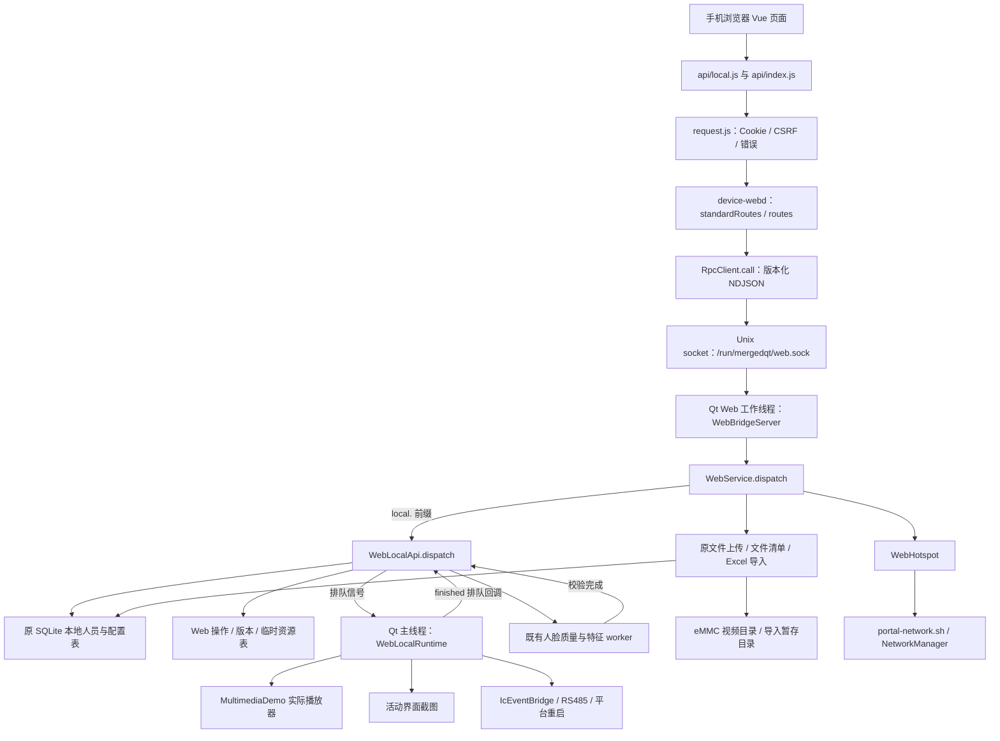
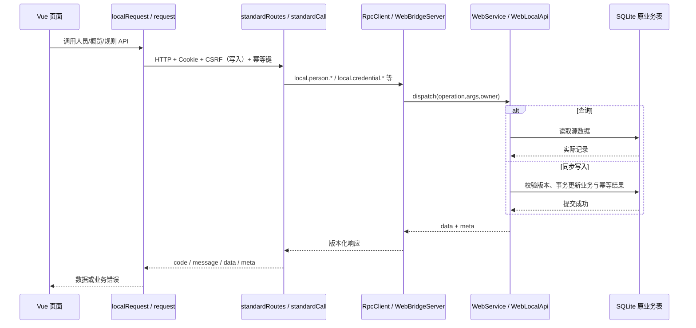
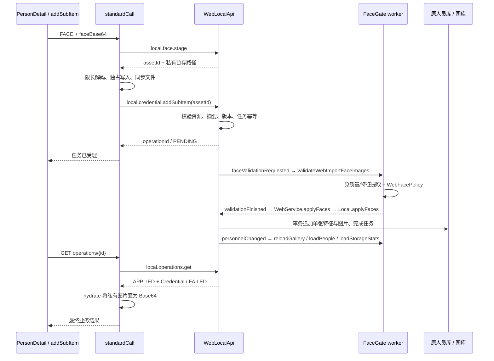
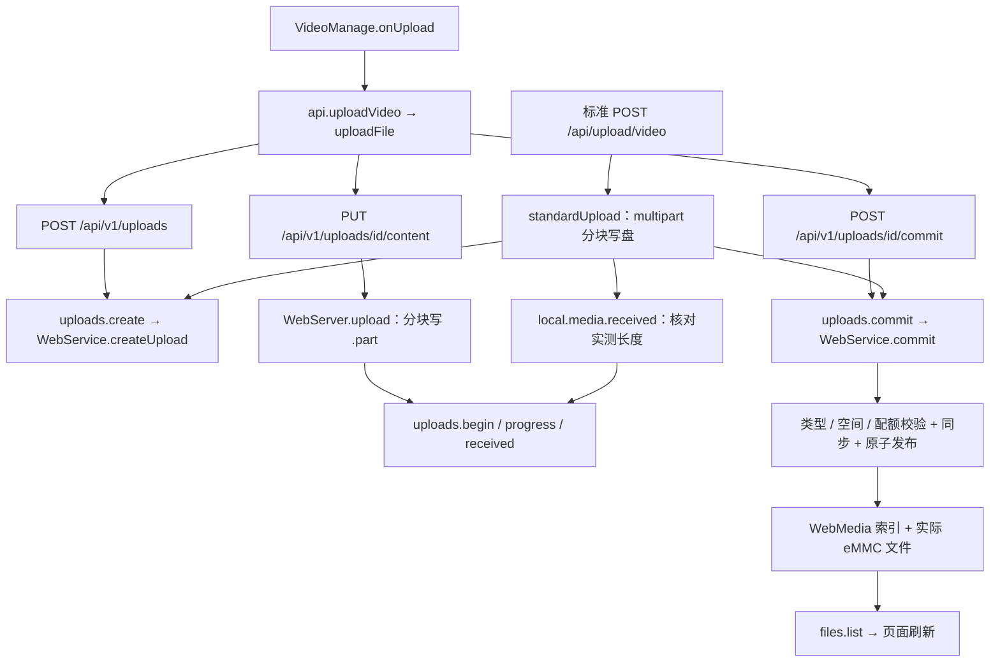
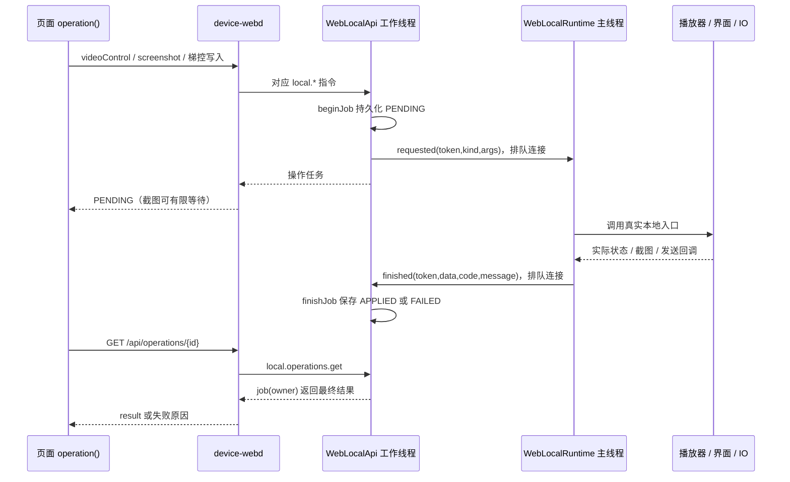

# Web API、中间层和本地业务调用拓扑

2026-10-20 扩展：[Web 有线 IP 设置](web_ip_settings_20261020.md)。新增 `GET/POST /api/device/network` → `local.device.networkConfig.get/set`，通过原异步操作结果接口查询执行结果；Qt 主线程绑定 `NetworkPage`，网卡操作在既有网络工作线程执行。

日期：2026-10-16。本文按当前源代码说明调用关系，作为 [Web 本地 API 设计](web_local_api_design_20261015.md) 和 [实施记录](web_local_api_implementation_20261015.md) 的代码导航补充。

本文最初随格式整理新增。后续浏览器引导与 WiFi 密码扩展已同步到下表；这次扩展的独立说明见 [浏览器引导与热点配置更新](web_portal_browser_wifi_20261016.md)。第 9 节保留原格式整理那一轮的验收记录和文件清单。

手机视频上传的设备进度与自动播放关系见 [视频上传与页面调整说明](web_ui_video_upload_20261016.md)：`uploads.*` → `WebService::reportVideoUpload()` → `uploadProgress` → `WebUploadPresenter`；首次发布成功后通过 `videoUploaded` → `WebLocalRuntime::execute(videoControl)` → `MultimediaDemo::applyLocalWebPlayback()` → 原 FTP 使用的 `playDownloadedVideoNow()`，等待原播放器可用后切换新视频。

## 1. 实际接入范围

标准协议中的 39 条接口已经登记路由，其中 30 条接到本地业务，9 条明确返回 HTTP 501。此外还有能力查询、操作结果查询，以及原 `/api/v1` 会话、上传、下载、人员导入接口。**接口已登记、任务已受理、文件已发布、硬件已确认是不同状态。**

Web 不订阅或等待 MQTT 的 `online_v1` 回执，不调用 MQTT 消息分派入口；online/offline 均可使用已接入功能，不以 mqttd 的运行状态作为前提。两种入口可以读取同一份设备配置、人员数据库和硬件源状态。配置键中保留的 `online_v1_...` 名称只是既有持久化字段，不表示 Web 请求经过 MQTT。

页面当前混合使用两个入口：

| 页面功能 | 当前实际入口 |
|---|---|
| 登录、会话恢复、退出、设备公开信息、SSID 修改 | `/api/v1` |
| 概览、截图、人员/凭证/楼层、梯控、播放器状态与控制、改密、立即重启 | `/api` |
| 视频列表、删除、下载、原始 File 上传 | `/api/v1`；标准视频接口同时保留 |
| Excel 与批量人脸导入 | `/api/v1/imports` + `/api/v1/uploads` |
| 空调、定时开关机、配置包、定时梯控写入、信号休眠 | 保留界面或路由，未实现项禁用/返回 501 |

## 2. 文件职责与总拓扑

下表中的缩写用于后续接口表。文件链接相对于本文所在目录。

| 缩写 | 文件 | 关键函数与职责 |
|---|---|---|
| F | [api/local.js](../web/frontend/src/api/local.js) | `localRequest()` 发送 `/api`、管理幂等键；`operation()` 轮询任务；`localApi` 对外封装业务 |
| V | [api/index.js](../web/frontend/src/api/index.js) | `api` 合并标准业务与 V1；`uploadFile()` 编排原文件上传；`session()` 恢复会话 |
| R | [api/request.js](../web/frontend/src/api/request.js) | `request()` 处理 Cookie、CSRF、响应及错误；默认前缀 `/api/v1` |
| H | [standard_api.cpp](../web/server/src/standard_api.cpp) | `WebServer::standardRoutes()` 路由白名单；`standardCall()` 参数/任务适配；`standardUpload()` multipart 视频 |
| W | [web_server.cpp](../web/server/src/web_server.cpp) | `routes()` 注册 V1 与公共安全检查；`session()`、`readJson()`、`result()`、`upload()`、`download()` |
| S | [session_store.cpp](../web/server/src/session_store.cpp) | `SessionStore::create/get/erase/eraseOwner/attempt()` 管理会话和登录频率 |
| I | [rpc_client.cpp](../web/server/src/rpc_client.cpp) | `RpcClient::call()` 通过 Unix socket 请求 Qt，验证协议版本、请求编号和返回码 |
| B | [web_bridge_server.cpp](../modules/web/web_bridge_server.cpp) | `WebRuntime` 启动 Web 工作线程；`WebBridgeServer::start/acceptConnections()` 接收 IPC、调用业务并回包 |
| Q | [web_service.cpp](../modules/web/web_service.cpp) | `WebService::dispatch()` 总入口；身份、热点、旧文件/导入业务；将 `local.` 指令转给 L |
| L | [web_local_api.cpp](../modules/web/web_local_api.cpp) | `WebLocalApi::dispatch()` 标准本地入口；`person/credential/overview/elevator`、人员事务、人脸追加、任务记录 |
| T | [web_local_runtime.cpp](../modules/web/web_local_runtime.cpp) | `WebLocalRuntime::execute()` 在主线程控制/采集；`media()` 返回线程安全快照；`complete()` 发异步完成信号 |
| N | [web_hotspot.cpp](../modules/web/web_hotspot.cpp) | `WebHotspot::synchronize/info/save()` 读取 client_id、热点信息及保存 SSID |
| D | [common/sql/web](../common/sql/web) | `WebSql`、`WebAccounts`、`WebUploads`、`WebMedia`、`WebImports`、`WebPeople`：SQL、账号及旧业务仓储 |
| P | [web_paths.cpp](../modules/web/web_paths.cpp) | `WebPaths::inside/mounted/...` 受控路径、目录/文件系统和文件类型校验 |



HTTP 服务与 Qt 是两个进程。标准 JSON 请求和业务结果通过 socket 传递；视频及图片字节通过受控文件交接。GUI 采集和播放器控制通过排队信号进入主线程，不从 HTTP 线程直接操作控件。WebLocalApi 与原导入业务运行在 Qt 的 Web 工作线程。

### 2.1 Qt 与实际业务的绑定位置

| 绑定内容 | 文件与入口 | 回传关系 |
|---|---|---|
| Web 工作线程 | B：`WebRuntime::WebRuntime()` → `WebBridgeServer::start()` → `WebService::initialize()` | socket 接入后调用 Q：`dispatch()` |
| 播放器 | [mainwindow.cpp](../mainwindow.cpp) 中 `MERGEDQT_WEB_ENABLE` 的 Web 绑定代码 → T：`bindMedia()` | 读回调调用 `MultimediaDemo::localWebPlaybackState()`；写回调调用 `applyLocalWebPlayback()` |
| 播放器实现 | [multimediademo.cpp](../components/multimedia/multimediademo.cpp) 的上述两个函数 | 读取实际播放模式、路径、音量和状态；复用现有本地播放控制 |
| 截图 | [main.cpp](../main.cpp) → T：`bindScreen()` | 多媒体界面走 `captureCompositeSnapshot()` / `currentPlayImageChanged`；其他活动界面走 `grab()` → T：`image()` |
| RS485 | [main.cpp](../main.cpp) 的 `deviceRequested` 连接 | `IcEventBridge::requestRs485Send(frame, "web:" + token)` → `rs485SendFinished` → T：`complete()` |
| 立即重启 | 同一 `deviceRequested` 连接中的 `reboot` 分支 | 先 `complete(... REBOOTING ...)`，延迟调用 `Rk3566Platform::reboot()`；重启后用 boot_id 核对 |
| 人脸校验 | [web_face_bridge.cpp](../modules/web/web_face_bridge.cpp) 与 [FaceGate MainWindow.cpp](../modules/facegate/FaceGateQt/ui/MainWindow.cpp) 的 WebFaceBridge 连接 | 请求排队到 worker 的 `validateWebImportFaceImages()`，结果回到 Q：`applyFaces()` → L：`applyFaces()` |
| 人脸质量适配 | [web_face_validation.cpp](../modules/web/web_face_validation.cpp) | 复用 `validateLocalImportFaceImages()`；[WebFacePolicy::filter()](../modules/web/web_face_policy.cpp) 使用原质量/阈值配置 |

## 3. 发送与接收的封装

### 3.1 从浏览器到 Qt

以人员查询为例，F：`personList()` 调用：

```http
GET /api/person/list?offset=0&limit=500
Cookie: device_session=...
```

H：`standardRoutes()` 转换分页参数，`standardCall("person.list", ...)` 调用 I：`call("local.person.list", args, owner)`。socket 每个请求一行 JSON，以换行结束：

```json
{"version":1,"id":"123","operation":"local.person.list","args":{"offset":"0","limit":"500"},"owner":1}
```

`owner` 来自服务端会话；浏览器不能通过请求体指定其他账号归属。B 读取这一行并将 `operation/args/owner` 交给 Q：`dispatch()`。Q 校验账号有效后去掉 `local.` 前缀，交给 L：`dispatch("person.list", args, owner)`。

Qt 成功响应的外层形式：

```json
{"version":1,"id":"123","code":200,"data":{"data":[],"meta":{"offset":0,"limit":500,"total":0,"hasMore":false}}}
```

这里两个 `data` 分属 IPC 和标准本地业务封装。I：`call()` 去掉 IPC 外层；H：`standardCall()` 再转换成浏览器响应：

```json
{"code":200,"message":"ok","data":[],"meta":{"offset":0,"limit":500,"total":0,"hasMore":false}}
```

R：`request()` 通常返回其中的 `data`；指定 `envelope: true` 时保留含 `meta` 的信封。人员列表按 `hasMore` 继续分页。

直接走 Q 的身份、热点、旧上传/文件接口使用 W：`result()` 返回 `{code,message,data}`，不保证有 `meta`。错误返回实际 HTTP 状态及 `{code,message}`；不能只检查 HTTP 请求有没有结束。

### 3.2 异步操作和幂等

F：`localRequest()` 为非 GET 标准业务请求设置 `Idempotency-Key`。H 将其转换为内部 `_key`；客户端不能直接传入保留字段。L：`beginJob()` 按账号、业务类型、键和内容摘要登记/复用任务，同键不同内容返回 409。

```json
{"operationId":"xxxxxxxx-xxxx-xxxx-xxxx-xxxxxxxxxxxx","state":"PENDING","result":{},"code":0,"message":""}
```

任务通过 `GET /api/operations/{operationId}` 查询，状态含 `PENDING/APPLIED/FAILED/UNKNOWN`。人脸、视频控制、串口发送等由完成回调更新任务；F：`operation()` 只在 `APPLIED` 时返回 `result`。截图还会由 HTTP 工作线程最多等待 8 秒，完成后直接返回图片；未完成则交给页面继续查任务。

同步人员/普通凭证写入直接返回人员或凭证，并在同一事务保存幂等结果，不需要页面轮询。它们的内部任务 `result` 保存 `{data,meta}`；人脸异步任务 `result` 是凭证聚合，视频控制是实际播放状态。因此不能把所有任务结果假定为同一种业务对象。

进程重启后未确定任务标为 `UNKNOWN`，不自动重放充值或硬件动作。立即重启任务在收到 `REBOOTING` 时仍保持 `PENDING`，下一次启动比较 Linux boot_id 后才确认已重启。

## 4. 标准协议 39 条接口逐项对应

下表输入字段为主要业务字段；`version?` 表示可选乐观锁版本，`{}` 表示空 JSON 对象。具体校验、范围和错误以表中的实现函数为准。除特别注明，HTTP 路由均在 H：`standardRoutes()`，经 `standardCall()` → I → B → Q → L；表中 IPC 列给出**实际发送的完整 operation 字符串**。

### 4.1 A：设备（9 条）

| 编号 / HTTP | 页面调用与发送内容 | IPC 指令 → 接收函数 | 返回内容 / 生效边界 |
|---|---|---|---|
| A01 `GET /api/device/info` | 标准兼容入口；当前 `Login`、设备设置使用 V：`getDeviceInfo()` 的 V1 版本；无 body | `device.info` → Q：`dispatch()` → N：`synchronize()`、`info()` | `deviceId/deviceName/wifiName/restartPending/wifiUpdateError`；标准 HTTP 额外添加 `deviceIp=config.bind`。deviceId 来自 net_cfg.ini 的 mqtt/client_id，名称为 SSID；热点读取失败时按 `YC_后五位_0000` 回退 |
| A02 `POST /api/device/verify-password` | `{username,password}`；当前登录页使用 V：`verifyPassword()` → V1 auth/login | `auth.login` → Q → `WebAccounts::authenticate()`；H 再调用 S：`create()` | Cookie + `{authenticated:true,username,csrf}`；V1 登录响应为 `{username,csrf}`。Session 由 HTTP 服务创建 |
| A03 `POST /api/device/settings/update` | `{wifiName,deviceName?,wifiPassword?}`；deviceName 若传必须等于 wifiName；当前设备页走 V：`saveWifiSsid(ssid,password)` | H 将参数改为 `{ssid:wifiName,password?:wifiPassword}`；`device.wifi.save` → Q → N：`save()` | 名称/可选新密码保存结果及断连提示；空密码保持原密码，名称不变也能单独改密码；3 秒后只重新激活对应 NM 热点连接，不回显密码 |
| A04 `POST /api/device/change-password` | `DeviceSettings` → F：`changePassword({oldPassword,newPassword})` | `local.auth.changePassword` → L：`dispatch()` → `WebAccounts::changePassword()`；H → S：`eraseOwner()` | `{changed:true,reloginRequired:true}`；撤销该账号所有会话并清 Cookie，页面重新登录 |
| A05 `POST /api/device/configPackage/upload` | 预留 multipart；当前配置包控件禁用 | **H 直接拒绝，无 RPC** | HTTP 501：配置包应用/回滚未接入，没有修改设备配置 |
| A06 `POST /api/device/screenshot` | `DevicePreview` → F：`screenshot()`，`{}` | `local.device.screenshot` → L：`dispatch/beginJob()` → T：`requested("screenshot")` → `execute()` → 主界面采集 → `image/encodedImage()` → `finished` → L：`finishJob()` | 已完成返回 `{base64Image,timestamp}`；未完成返回操作任务，F 继续轮询。采集/编码失败或超时返回对应错误 |
| A07 `GET /api/device/overview` | `DevicePreview` → F：`deviceOverview()` | `local.device.overview` → L：`dispatch()`、`overview()` | `personCount/faceCount/icCount/qrCount/observedAt/deviceIp/storageAvailable/storage`；统计来自原本地表，storage 为实际媒体目录所在文件系统，容量单位 GiB；不可用时为 null |
| A08 `POST /api/device/reboot` | 标准中的**定时开关机**入口，`{onTime,offTime}`；当前控件禁用 | `local.device.reboot` → L：`dispatch()` | HTTP 501；不是立即重启接口 |
| A09 `POST /api/device/linux-reboot` | `DeviceSettings` → F：`linuxReboot()`，`{}` | `local.device.linux-reboot` → L：`dispatch/beginJob()` → T：`requested("reboot")` → main.cpp → 平台重启 | 先返回 `PENDING`；`REBOOTING` 只表示重启已安排，boot_id 变化后确认。页面不能把最初 HTTP 200 当作已重启 |

热点链为 N → 固定 [portal-network.sh](../web/deploy/portal-network.sh) 的 `save` / `request-refresh` → device-webd 的 reload 路径 → NetworkManager 重新激活对应连接。不会为改 SSID 停止整个 HTTPS 服务。SSID 保存与热点重新激活分开报告，手机会在重新激活时断开连接。

### 4.2 B：人员（5 条）

| 编号 / HTTP | 页面调用与发送内容 | IPC 指令 → 接收函数 / 数据源 | 返回内容 |
|---|---|---|---|
| B01 `GET /api/person/list` | `PersonList` → F：`personList()`；query `offset/limit`，每页 500 | `local.person.list` → L：`dispatch()` 分页查询 person → `person()` | `Person[]` + `meta:{offset,limit,total,hasMore}`；默认 100、最大 500，页面逐页合并 |
| B02 `POST /api/person/add` | `PersonList` → F：`personAdd()`；`{name,account?,employeeNo?,department?,position?,phone?,remark?,status?}` | `local.person.add` → L：`dispatch()` → `mutatePerson()` → person、版本/幂等表 | 新建 Person，含 `id/source/version`；同键重试返回原结果 |
| B03 `PUT /api/person/update` | `PersonList` → F：`personUpdate()`；`{id,上述基础字段...,version?}` | `local.person.update` → L：`mutatePerson()` | 修改后的 Person；只修改基础字段，保留人员编号、已有凭证与消费记录；版本冲突 409 |
| B04 `DELETE /api/person/delete` | `PersonList` → F：`personDelete({id,version?})` | `local.person.delete` → L：`mutatePerson()` | `{id,deleted:true}`；原 person 软删除并失效权限，发人员/图库刷新通知 |
| B05 `GET /api/person/detail/{id}` | `PersonDetail` → F：`personDetail({id})` 的第一路请求 | `local.person.detail`，args `{id:路径值}` → L：`person()` | Person；不存在/已删除返回 404。页面还并行调用 C01，合并为 `{person,credential}` |

Person 主要字段：`id/name/account/employeeNo/department/position/phone/remark/status/source/version`。人员来源固定为本地源，不从 MQTT 回执补数据。

### 4.3 C：凭证（6 条）

| 编号 / HTTP | 页面调用与发送内容 | IPC 指令 → 接收函数 / 数据源 | 返回内容 |
|---|---|---|---|
| C01 `GET /api/credential/getByPerson/{personId}` | `PersonDetail` → F：`personDetail()` 的第二路请求 | `local.credential.get`，args `{personId:路径值}` → L：`credential()` | Credential 聚合；H：`hydrate()` 将受控人脸图片元数据转换为 `faceBase64` |
| C02 `POST /api/credential/add` | `{personId,extra?:{},version?}`；当前 UI 未显式调用此初始化入口 | `local.credential.add` → L：`mutateCredential()` → local_access_rule | 初始化缺失规则并返回 Credential；不允许非空扩展对象 |
| C03 `PUT /api/credential/update` | `PersonDetail` → F：`credentialUpdate()`；`{personId,extra:{rules},version?}` | `local.credential.update` → L：`mutateCredential()` → 原规则/时段/用量表 | Credential；按补丁修改规则，充值为显式增量且同键只执行一次。继电器新修改/未实现字段返回 501，保留已有继电器值 |
| C04 `POST /api/credential/addSubItem` | `PersonDetail` → F：`addSubItem()`；`{personId,subType,subData,version?}` | `local.credential.addSubItem` → L：`mutateCredential()`；FACE 先走 `local.face.stage`，HTTP 将 faceBase64 改写为 assetId | IC/QR 同步返回 Credential；FACE 返回任务，校验及追加入库后 result 为 Credential，F：`operation()` 等待结果 |
| C05 `POST /api/credential/removeSubItem` | `PersonDetail` → F：`removeSubItem()`；`{personId,subType,itemId,version?}` | `local.credential.removeSubItem` → L：`mutateCredential()` | 删除指定卡/二维码/人脸后返回 Credential；不覆盖其他子项。人脸 itemId 为 face_feature 主键字符串 |
| C06 `POST /api/person/faceRegisterResult` | `PersonDetail` → F：`faceRegisterResult({id})` | `local.person.faceRegisterResult` → L：`dispatch()` → 人脸特征与本地人脸任务 | `{total,successCount,failCount,pendingCount,results:[...]}`；结果项含 faceId、图片（可用时）、result、msg、registerTime。result 为成功 1、失败 0 或等待 null |

C04 的 subType / subData：

| subType | 浏览器发送 | Qt 收到 / 实际动作 |
|---|---|---|
| `IC_CARD` | `{cardId,name}` | 校验卡号格式、本地/网络卡号冲突，写 local_ic_card |
| `QR_STANDALONE` / `QR_VISITOR` | `{qrUnique,qrType,name,validFrom?,validTo?,maxUseCount?}` | 写 local_qr_code；使用原通行服务的有效期与次数判断 |
| `FACE` | `{faceBase64,name}` | H 限长解码写受控暂存；替换为 `{assetId,name}`。L 校验真实格式、摘要，排队到原特征 worker，回调后追加单张 face_feature |

Credential：`{personId,icCards,qrCodes,faces,floors,rules,usage,version}`。rules 对应原 `local_access_rule/local_timing_rule`；usage 对应 `local_access_usage` 的 `remaining_count/access_count/remaining_amount/used_amount`，保留原字段名。查询返回的 `countDataAddCount/amountDataAddAmount` 固定为 0，避免把上次充值当成下一次新命令。

### 4.4 D：人员楼层（2 条）

| 编号 / HTTP | 页面调用与发送内容 | IPC 指令 → 接收函数 | 返回内容 / 数据关系 |
|---|---|---|---|
| D01 `POST /api/personFloor/save` | `PersonDetail` → F：`personFloorSave()`；`{personId,floor:[整数...],version?}` | `local.personFloor.save` → L：`mutateCredential()` → local_floor | `{personId,floors,version}`；提交整个人员楼层集合，按当前 client_id 归一化分组 |
| D02 `DELETE /api/personFloor/delete` | `{personId,version?}`；当前页面通过 D01 空数组清空，也保留独立删除入口 | `local.personFloor.delete` → L：`mutateCredential()` | `{personId,floors:[],version}`；清空该人员全部本地楼层 |

原离线通行服务按人员汇总全部 local_floor 分组，Web 查询也保持这一规则；不是只读取一个设备分组。

### 4.5 E：电梯（10 条）

本组都由 L：`dispatch()` → `elevator()` 接收。配置读取和 RS485 写入共用原组帧/IO 能力。

| 编号 / HTTP（均 POST） | 页面调用与发送内容 | 完整 IPC operation | 返回内容 / 动作 |
|---|---|---|---|
| E01 `/api/elevator/floorLimit/set` | `ElevatorControl` → F：`floorLimitSet()`；`{floors:[{floor,action:0或1}]}`；前端将 open 转为 1 | `local.elevator.floorLimit.set` | 写 online_v1_floor_limit_bits，组帧后异步串口发送；返回任务，结果 `{saved,transportSent,hardwareConfirmed:null}` |
| E02 `/api/elevator/floorLimit/get` | F：`floorLimitGet()`；`{}` | `local.elevator.floorLimit.get` | `[{floor,status:0或1}]`；meta 标明 stateSource 为 device_config、hardwareConfirmed 为 null |
| E03 `/api/elevator/floorSchedule/set` | 预留 `{rules:[...]}`；当前页面禁用 | `local.elevator.floorSchedule.set` | HTTP 501，无独立本地定时执行器 |
| E04 `/api/elevator/floorSchedule/get` | F：`floorScheduleGet()`；`{}` | `local.elevator.floorSchedule.get` | 从 online_v1_floor_schedules 读取；`{platformSchedules:null,deviceSchedules:[...],matched:null,comparisonScope:"local",writable:false}`，不伪造平台比对结果 |
| E05 `/api/elevator/floorSchedule/delete` | 预留 `{hashList:[...]}`；当前页面禁用 | `local.elevator.floorSchedule.delete` | HTTP 501 |
| E06 `/api/elevator/floorSchedule/resend` | 预留 `{}`；当前页面禁用 | `local.elevator.floorSchedule.resend` | HTTP 501 |
| E07 `/api/elevator/elevatorMode/set` | F：`elevatorModeSet()`；完整 9 个布尔开关，见下文 | `local.elevator.elevatorMode.set` | 写 online_v1_elevator_mode，叠加楼层配置组帧并发送；任务结果同 E01 |
| E08 `/api/elevator/elevatorMode/get` | F：`elevatorModeGet()`；`{}` | `local.elevator.elevatorMode.get` | 完整 9 开关；meta 为配置来源，非硬件状态确认 |
| E09 `/api/elevator/screenSleep/set` | 预留 `{enable}`；当前页面禁用 | `local.elevator.screenSleep.set` | HTTP 501，信号休眠执行能力未接入 |
| E10 `/api/elevator/screenSleep/get` | 预留 `{}`；当前页面不请求 | `local.elevator.screenSleep.get` | HTTP 501，未提供虚构休眠状态 |

9 个模式字段：`masterSwitch/delay/parking/driver/independent/ext1/ext2/ext3/ext4`。E01/E07 经 [Rs485FloorFrameBuilder](../ic_board/rs485_floor_frame_builder.cpp) 合并已有楼层和模式配置 → T：`requested("rs485")` → main.cpp 的 IcEventBridge → 完成回调。`saved=true` 只证明配置落库，`transportSent=true` 只证明发送层报告成功，硬件是否执行仍为未知。

既有定时梯控执行器位于 MQTT 业务中，本轮不移动、不复用 MQTT 消息入口，也不启动第二套定时器。因此定时规则目前只读。

### 4.6 F：空调（2 条）

| 编号 / HTTP（均 POST） | 页面状态 / 输入 | IPC 指令 → 接收函数 | 返回 |
|---|---|---|---|
| F01 `/api/device/airControl/set` | 预留控制补丁；`AirControl.vue` 当前禁用提交、不发送此请求 | `local.device.airControl.set` → L：`dispatch()` | HTTP 501，无本地空调驱动 |
| F02 `/api/device/airControl/get` | 预留 `{}`；当前页面不读取虚构遥测 | `local.device.airControl.get` → L：`dispatch()` | HTTP 501 |

### 4.7 G：视频（5 条）

| 编号 / HTTP | 页面调用与发送内容 | IPC 指令 → 接收函数 | 返回内容 / 实际效果 |
|---|---|---|---|
| G01 `POST /api/upload/video` | 标准 multipart，file + 可选 name/size/duration；当前 VideoManage 实际走 V：`uploadVideo()` 的 V1 原始字节上传 | H：`standardUpload()` → `uploads.create` → `uploads.begin` → `local.media.received` → `uploads.received` → `uploads.commit` → `files.list`；Q 接收 uploads/files，L 接收 media.received | HTTP 分块写 .part，核对实际字节，Qt 校验并原子发布后返回真实文件项 `{id,name,bytes,modified_ms,state}`；此路由不额外补 size/duration |
| G02 `GET /api/playFile/list` | 标准兼容入口；当前页面 V：`playFileList()` → V1 files | `files.list` → Q：`files()` → WebMedia 索引实际目录 | 标准返回文件数组，额外 size 为 KiB 文本、duration 为 null；V1 返回 `{files:[...]}`，V 再格式化尺寸，时长显示“—” |
| G03 `DELETE /api/playFile/delete` | `{id}`，兼容 fileId；当前页面 V：`deletePlayFile()` → V1 files/{id} | `files.delete` → Q：`dispatch()` → WebMedia 删除状态及真实文件删除 | 标准返回 `{id,deleted:true}`；V1 返回 `{deleted:true}`。下载租约/Qt 打开的文件会阻止删除，返回 423 |
| G04 `POST /api/device/getPlayInfo` | `VideoManage` → F：`getPlayInfo()`；`{}` | `local.device.getPlayInfo` → L：`dispatch()` → T：`media()` → 实际播放器快照 | `available/observedAt/videoType/videoPath/videoUrl/name/videoVolume/playbackState/deviceLog/desiredVideoType`；没有真实播放器源时返回 503 |
| G05 `POST /api/device/videoControl` | `VideoManage` → F：`videoControl()`；`{videoType,videoVolume?,videoUrl?,videoPath?,file?}` | `local.device.videoControl` → L：`dispatch/beginJob()` → T：`requested("videoControl")` → `execute()` → `applyLocalWebPlayback()` | 返回任务；主线程每 200ms 检查真实状态，满足目标才 APPLIED，最多检查 40 次。result 是真实 PlayInfo；不能把请求值原样当成功回执 |

videoType 为 `LIVE/RECORDED/NONE`，音量 0–100；本地路径限制在受控媒体目录内，直播地址按原校验处理。播放器状态通常每秒由 T：`refreshMedia()` 采样，控制等待时另行刷新。

媒体目录（部署中为 `/mnt/UDISK/res/static/demoResources/images/video`）可以位于板载 eMMC 根分区。HTTPS 访问的是设备本地文件，**不要求该目录或 `/mnt/UDISK` 有独立挂载点**；P：`mounted()` 保留兼容名称/参数，实际校验目录、路径、读写和文件系统可用性。文件发布仍保留空间、配额、同步及原子重命名检查。

## 5. 额外 HTTP 接口与内部指令

### 5.1 两个辅助 HTTP 接口

| HTTP | 前端入口 | IPC → 本地函数 | 接收结果 |
|---|---|---|---|
| `GET /api/device/capabilities` | F：`capabilities()`，各页控制可用性 | `local.device.capabilities` → L：`capabilities()` → T：`capabilities()` | 已接入功能、播放器/串口就绪标记、允许编辑规则字段、bootId、mqttRequired:false；不检测 mqttd |
| `GET /api/operations/{uuid}` | F：`operation()` 的轮询 | `local.operations.get`，args `{id:uuid}` → L：`job(id,owner)` | `{operationId,state,result,code,message}`；仅允许当前账号读取其任务；图片结果仍经 H：`hydrate()` |

### 5.2 仅 HTTP 服务内部使用的 IPC

这些不是可任意透传 operation 的 HTTP 接口。浏览器只能调用白名单路由，不能提交任意 IPC 指令或内部路径。

| IPC operation | 发送位置 / args | 接收位置 / 返回 |
|---|---|---|
| `local.face.stage` | H：`standardCall()`；`{}` | L：`dispatch()` 登记 owner 归属的临时资源，返回 `{data:{assetId,path},meta:{}}`；path 仅给 HTTP 进程 |
| `local.face.discard` | H：`standardCall()` 在人脸提交后或异常清理；`{assetId}` | L：`dispatch()` 按归属清理未被业务占用的资源 |
| `local.media.received` | H：`standardUpload()`；`{id,size:实测接收字节}` | L：`dispatch()` 核对任务归属、接收状态和真实文件长度，调整预留长度 |
| `uploads.begin` | W：`upload()` / H：`standardUpload()`；`{id}` | Q：`dispatch()` → WebUploads，返回内部 `{part_path,size}` 并进入 RECEIVING |
| `uploads.progress` | W：`upload()` 的传输阶段；`{id}` | Q 按实际暂存文件长度更新进度，返回公开上传任务 |
| `uploads.received` | W：`upload()` / H：`standardUpload()` 收到完整文件后；`{id}` | Q 校验实际长度等于任务长度，进入 RECEIVED，返回公开上传任务 |
| `uploads.failed` | W/H 的传输异常清理；`{id}` | Q 清理未完整暂存文件并登记 FAILED，返回 `{failed:true}` |

## 6. 原 /api/v1 接口逐项对应

以下路由均在 W：`WebServer::routes()`。除 HTTP 本地处理项，链路均为 I：`call()` → B → Q：`dispatch()`。V1 用于当前会话、文件与导入流程；新标准人员页使用第 4 节接口。

| HTTP | 页面 / 发送内容 | IPC operation → Qt 函数 | 返回给页面 |
|---|---|---|---|
| `GET /api/v1/device/info` | V：`getDeviceInfo()`；无 body | `device.info` → N：`synchronize/info()` | 设备号、SSID、更新状态；不额外加入标准接口的 deviceIp |
| `POST /api/v1/device/wifi` | V：`saveWifiSsid()`；`{ssid,password?}` | `device.wifi.save` → N：`save(ssid,password)` → 固定脚本 save；新密码经标准输入交接 | 热点设置保存及重激活提示，不返回密钥；空密码保持原值 |
| `GET /api/v1/health` | 启动/诊断 | `health` → Q：`dispatch()` | `{ready:true,version:1}` |
| `GET /api/v1/captive` | 门户发现 | 无 RPC，HTTP 直接处理 | `{captive:false,user-portal-url:origin + "/portal"}`，引导打开完整浏览器 |
| `POST /api/v1/auth/login` | Login → V：`verifyPassword()`；`{username,password}` | `auth.login` → WebAccounts::authenticate；S：create | Cookie 与 `{username,csrf}` |
| `GET /api/v1/auth/session` | 路由守卫 / V：`session()` | 无 RPC，S：get | 当前 username、csrf；R：setCsrf 恢复请求令牌 |
| `POST /api/v1/auth/logout` | Layout → V：`logout()`；`{}` | 无 RPC，S：erase | 清 Cookie，data 为 `{}` |
| `POST /api/v1/uploads` | V：`uploadFile()`；`{name,size,kind,batch_id?}` | `uploads.create` → Q：`createUpload()` → WebUploads | 公开上传任务，含任务 id；kind 为 video/person_excel/person_face |
| `PUT /api/v1/uploads/{id}/content` | V：`uploadFile()`；浏览器 File 原始字节 | W：`upload()` → `uploads.begin/progress/received`，失败时 `uploads.failed` | 接收后的公开任务；HTTP 只向 Qt 给定的 part_path 分块写入 |
| `GET /api/v1/uploads/{id}` | V：`uploadStatus()`、不确定上传结果核对 | `uploads.status` → Q：`publicTask()` | 同一任务的当前状态/进度/错误 |
| `POST /api/v1/uploads/{id}/commit` | V：`uploadFile()`；`{}` | `uploads.commit` → Q：`commit()` | 文件验证/发布后的任务；READY 表示已可用 |
| `POST /api/v1/uploads/{id}/cancel` | V：`cancelUpload()`；`{}` | `uploads.cancel` → Q：`dispatch()` | `{cancelled:true}`；活跃传输/已发布状态不能强行取消 |
| `GET /api/v1/files` | VideoManage → V：`playFileList()` | `files.list` → Q：`files()` → WebMedia | `{files:[{id,name,bytes,modified_ms,state}]}` |
| `GET /api/v1/files/{id}/content` | V：`downloadUrl(id)` 给浏览器下载地址 | W：`download()` → `files.get` → Q → WebMedia::get | HTTP 流式文件内容；内部 path 不作为 JSON 暴露；持有下载租约 |
| `DELETE /api/v1/files/{id}` | V：`deletePlayFile()`；`{}` | `files.delete` → Q → WebMedia + 实际文件 | `{deleted:true}`，文件忙 423 |
| `GET /api/v1/persons` | 旧兼容人员入口，当前 PersonList 使用标准 B01 | `persons.list` → WebPeople::list | 旧版基础人员清单；不含标准凭证聚合 |
| `GET /api/v1/persons/{id}` | 旧兼容详情入口 | `persons.get` → WebPeople::get | 旧版基础人员详情 |
| `POST /api/v1/imports` | PersonnelImport → V：`createImport()`；`{manifest:[{name,size,kind}]}` | `imports.create` → Q：`dispatch()` → WebImports::create/get | OPEN 导入批次；必须恰好 1 份 Excel，可含人脸图片，完整清单先确定 |
| `GET /api/v1/imports/{id}` | V：`importStatus()` | `imports.status` → WebImports::get | 批次状态及结果/错误 |
| `POST /api/v1/imports/{id}/start` | V：`startImport()`；`{}` | `imports.start` → Q：`dispatch()` → 定时排队 `importBatch()` | 封存/启动后的批次；之后查询状态，不重复导入 |
| `POST /api/v1/imports/{id}/discard` | V：`discardImport()`；`{}` | `imports.discard` → Q → `cleanupBatch()` | `{cancelled:true}`；只允许未封存批次，活跃上传需先结束 |

批量导入保持 [PersonnelImport.vue](../web/frontend/src/components/PersonnelImport.vue) → 原 XLS/XLSX 解析器 → `LocalPersonnelStore::importSpreadsheetPersonnel()` 的逻辑；不将 Excel 导入替换为逐条标准接口。图片校验仍走既有 worker，按原批量导入规则写入。单张 C04 FACE 使用独立追加分支，不覆盖人员其他人脸。

## 7. 关键路径时序图

新增的公共浏览器引导不经过 Qt RPC：HTTP 80 的探测请求和 `GET /portal` → W：`portalResponse()` → `portal.html/js/css`；`GET /portal-config.json` 返回 `{origin,loginUrl,guideUrl}`。用户点击后请求完整浏览器访问固定 origin，再进入原登录/API 链路。自动门户不再直接跳转登录页。

### 7.1 普通查询与事务写入



### 7.2 单张人脸注册与图库刷新



人脸 HTTP 请求上限 1 MiB，解码图片最多 512 KiB；Qt 校验 JPEG/PNG 和最大 1600 万像素。IPC 不携带图片字节。模型未就绪、质量失败或图库冲突均按真实结果返回，不借用平台回执。

### 7.3 当前页面视频上传与标准 multipart 的汇合



V1 原始 File 上传不在浏览器改名或压缩。HTTP 返回不确定时，V：`uploadFile()` 先查询同一任务，必要时提交同一任务，避免盲目创建另一份上传。

### 7.4 播放、截图与串口的异步回传



播放器回传实际播放状态；截图先采集再在线程池编码；串口回传保存/发送事实且 hardwareConfirmed 为 null。立即重启复用该请求桥，但最终成功需要下一次启动核对 boot_id。

## 8. 排查调用链的位置

| 现象 | 优先核对代码 / 日志 |
|---|---|
| 页面请求路径或字段不对 | 页面函数 → F/V 包装 → R；先辨认 `/api` 与 `/api/v1` |
| HTTP 401 / 403 | W：公共前置校验、session；S：会话；写入需 Origin/CSRF，查询型 POST 同样受保护 |
| “设备服务不可用” / RPC 503 | I：`call()` 的 operation/socket/stage 日志；B 的 socket 是否启动、Q 是否初始化；不先检查 mqttd |
| 业务参数/版本冲突 | H：`checkArguments()`，L：`allowed()` / `change()` / `beginJob()` 及对应业务函数 |
| HTTP 200 但动作未完成 | 检查 data 是否含 operationId；查任务 state/result/code/message，继续追 T 的真实完成回调 |
| 图片不可读 / 过大 | H：`imageBytes/hydrate()`、L 的受控资源及原人脸校验回调 |
| 视频不可用 | Q：`files/checkBudget/createUpload/commit()`，P 的目录校验；媒体路径可以是 eMMC 普通目录 |
| 梯控配置已保存但设备没有动作 | L：`elevator()` → 公共组帧 → main.cpp → IcEventBridge 发送回调；硬件确认目前未知 |
| 定时规则写入/空调等返回 501 | 属于第 4 节明确未接入能力，无需等待平台下发消息 |

服务自动启动的控制台输出可由 `journalctl -u device-webd.service -f` 查看；Qt 端 `[WEB]` 日志跟随 Qt 所在服务/启动控制台。Web 日志不记录请求体密码、人脸或视频内容。

## 9. 本轮格式整理与验收

格式整理覆盖 Web C++、Vue/JavaScript、门户 Shell 与辅助 Python：展开密集函数/分支、统一缩进和换行、分隔函数与注释、补齐函数职责和必要阶段说明。四个既有大文件只整理新增 Web 代码段。未更换项目依赖或引入产品格式化依赖。

### 9.1 任务核对

| 要求 | 核对结果 |
|---|---|
| 新增 Web 代码的换行、缩进、函数/注释分隔 | 已完成；保留原业务分支、参数和定时值 |
| 每个函数的说明、函数内必要阶段注释 | 已完成；核对 C++ 声明/定义、前端命名函数/API 包装、Shell helper 和 Python 函数；匿名回调按必要阶段说明 |
| 原有 MQTT 和其他业务不变 | 已完成；48 个纳入核对的 C++ 文件去注释/空白后代码标记一致，包含四个既有大文件的全文件核对 |
| 前端与脚本只改格式/说明 | 已完成；23 个 JS/Vue 文件脚本/编译模板/样式 AST、4 个 Python 文件去文档字符串 AST、3 个 POSIX Shell 规范化命令一致 |
| 每条 API 的请求、IPC 指令、文件/函数、响应关系 | 已完成；39 条标准接口、2 条辅助接口、21 条 V1 路由逐项列明，内部资源/上传指令单列 |
| API 与中间层拓扑解析 | 已完成；总拓扑及查询事务、人脸、文件上传、设备异步路径图 |
| 修改文件完整列举 | 见 9.3；修改 55 个、新增本文 1 个、删除 0 个 |

### 9.2 验证结果与范围

| 检查 | 结果 / 证据 |
|---|---|
| 代码一致性 | C++ 48、前端 23、Python 4、Shell 3 项文件均通过；见 [C++/Python 审计](../.web-build/web-format-cpp-python-audit.json)、[前端/Shell 审计](../.web-build/web-format-frontend-shell-audit.json) |
| Qt/SQLite 集成 | 通过：人员 CRUD、事务、版本、充值幂等、卡/二维码/人脸、原 Excel、本地通行用量、播放/截图/串口源桥、改密、eMMC 普通目录与容量；见 [测试日志](../.web-build/qt-tests/web-format-tests.log) |
| 独立服务器单元测试 | deviceweb unit checks passed；Windows 测试不执行生产 Linux Unix socket/安全随机数平台分支 |
| 前端生产构建 | 通过；见 [构建日志](../.web-build/frontend-web-format-build.log) |
| 热点脚本回归 | 通过无 WiFi/AP 能力、上联/网段冲突、NM 持久化、FORWARD/DNS、刷新/清理、Qt 隔离等检查；使用替身网络命令，不修改开发机网络 |
| Chromium 页面回归 | 通过导航/离线图标、概览/截图、人员/凭证、播放结果、改密、原始文件及完整导入清单、刷新恢复、CSP/控制台日志；见 [结果](../.web-build/browser-web-format/browser-results.json) |
| ARM64/Linux/TLS 服务器 | OpenSSL 静态依赖交叉编译及链接通过，覆盖 Linux 专属 HTTP 流上传和 Unix socket 源码；产物 `.web-build/device-webd-format-arm64-tls` |
| 改动边界 | 与本轮开始前的源码摘要逐一比较，无范围外变更；见 [源文件审计](../.web-build/web-format-source-audit.json) |

这里的 Qt 和浏览器验证使用隔离数据库/目录及设备回调测试源，未连接物理开发板；未执行完整 BSP/GStreamer/RKNN 应用链接或实机串口、WiFi、TLS 验收。它们用于确认本轮格式整理没有改变已有代码和可回归行为。构建、测试、审计产物都放在开发缓存目录，不加入产品代码。

### 9.3 本轮修改文件清单

以下仅列出与本轮开始时相比实际变化的源文件，不把已经符合格式、检查后未变化的文件计为修改。构建生成的 `dist`、可执行文件、日志及格式化工具缓存不计入源文件清单。

#### Qt 原文件中的 Web 代码段（4 个）

- [components/multimedia/multimediademo.cpp](../components/multimedia/multimediademo.cpp)
- [components/multimedia/multimediademo.h](../components/multimedia/multimediademo.h)
- [main.cpp](../main.cpp)
- [mainwindow.cpp](../mainwindow.cpp)

#### SQL Web 仓储（7 个）

- [common/sql/web/web_account_repository.cpp](../common/sql/web/web_account_repository.cpp)
- [common/sql/web/web_account_repository.h](../common/sql/web/web_account_repository.h)
- [common/sql/web/web_import_repository.cpp](../common/sql/web/web_import_repository.cpp)
- [common/sql/web/web_media_repository.cpp](../common/sql/web/web_media_repository.cpp)
- [common/sql/web/web_person_repository.cpp](../common/sql/web/web_person_repository.cpp)
- [common/sql/web/web_upload_repository.cpp](../common/sql/web/web_upload_repository.cpp)
- [common/sql/web/web_upload_repository.h](../common/sql/web/web_upload_repository.h)

#### Qt Web 模块（15 个）

- [modules/web/web_bridge_server.cpp](../modules/web/web_bridge_server.cpp)
- [modules/web/web_bridge_server.h](../modules/web/web_bridge_server.h)
- [modules/web/web_face_bridge.h](../modules/web/web_face_bridge.h)
- [modules/web/web_face_policy.cpp](../modules/web/web_face_policy.cpp)
- [modules/web/web_face_policy.h](../modules/web/web_face_policy.h)
- [modules/web/web_face_validation.cpp](../modules/web/web_face_validation.cpp)
- [modules/web/web_hotspot.cpp](../modules/web/web_hotspot.cpp)
- [modules/web/web_hotspot.h](../modules/web/web_hotspot.h)
- [modules/web/web_local_api.cpp](../modules/web/web_local_api.cpp)
- [modules/web/web_local_api.h](../modules/web/web_local_api.h)
- [modules/web/web_local_runtime.cpp](../modules/web/web_local_runtime.cpp)
- [modules/web/web_local_runtime.h](../modules/web/web_local_runtime.h)
- [modules/web/web_paths.cpp](../modules/web/web_paths.cpp)
- [modules/web/web_service.cpp](../modules/web/web_service.cpp)
- [modules/web/web_service.h](../modules/web/web_service.h)

#### HTTP 服务器（10 个）

- [web/server/include/console_log.h](../web/server/include/console_log.h)
- [web/server/include/rpc_client.h](../web/server/include/rpc_client.h)
- [web/server/include/session_store.h](../web/server/include/session_store.h)
- [web/server/include/web_server.h](../web/server/include/web_server.h)
- [web/server/src/main.cpp](../web/server/src/main.cpp)
- [web/server/src/rpc_client.cpp](../web/server/src/rpc_client.cpp)
- [web/server/src/session_store.cpp](../web/server/src/session_store.cpp)
- [web/server/src/standard_api.cpp](../web/server/src/standard_api.cpp)
- [web/server/src/web_server.cpp](../web/server/src/web_server.cpp)
- [web/server/tests/session_test.cpp](../web/server/tests/session_test.cpp)

#### 前端（11 个）

- [web/frontend/src/api/index.js](../web/frontend/src/api/index.js)
- [web/frontend/src/api/local.js](../web/frontend/src/api/local.js)
- [web/frontend/src/components/LangSwitch.vue](../web/frontend/src/components/LangSwitch.vue)
- [web/frontend/src/i18n/index.js](../web/frontend/src/i18n/index.js)
- [web/frontend/src/router/index.js](../web/frontend/src/router/index.js)
- [web/frontend/src/views/device/DevicePreview.vue](../web/frontend/src/views/device/DevicePreview.vue)
- [web/frontend/src/views/device/DeviceSettings.vue](../web/frontend/src/views/device/DeviceSettings.vue)
- [web/frontend/src/views/elevator/ElevatorControl.vue](../web/frontend/src/views/elevator/ElevatorControl.vue)
- [web/frontend/src/views/person/PersonDetail.vue](../web/frontend/src/views/person/PersonDetail.vue)
- [web/frontend/src/views/person/PersonList.vue](../web/frontend/src/views/person/PersonList.vue)
- [web/frontend/src/views/video/VideoManage.vue](../web/frontend/src/views/video/VideoManage.vue)

#### 部署脚本（3 个）

- [web/deploy/device-web-start.sh](../web/deploy/device-web-start.sh)
- [web/deploy/install-portal.sh](../web/deploy/install-portal.sh)
- [web/deploy/portal-network.sh](../web/deploy/portal-network.sh)

#### 测试和辅助工具（5 个）

- [web/tests/browser_check.py](../web/tests/browser_check.py)
- [web/tests/make_fixture.py](../web/tests/make_fixture.py)
- [web/tests/portal_network_check.py](../web/tests/portal_network_check.py)
- [web/tests/qt_web_tests.cpp](../web/tests/qt_web_tests.cpp)
- [web/tools/provision_account.py](../web/tools/provision_account.py)

#### 新增文档（1 个）

- [docs/web_api_middleware_topology_20261016.md](web_api_middleware_topology_20261016.md)

原 MQTT 源文件、原 XLS/XLSX 解析器、本地人员仓储、顶层 `scripts/start_face_media.sh`、原启动服务配置、第三方库和包依赖文件均保持本轮开始时的内容。
