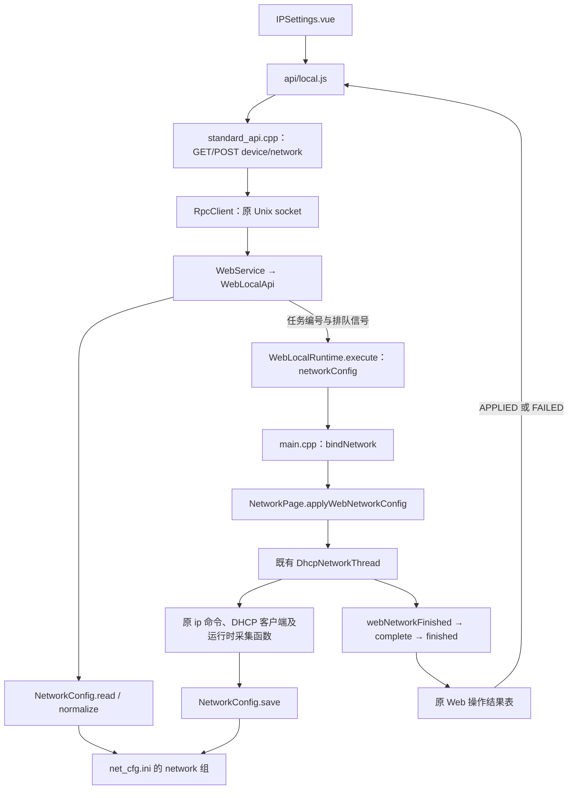

# Web 有线 IP 设置

日期：2026-10-20。

## 页面和保存规则

底部“设备”菜单改为“设置”，原路由 `/home/device` 保留。设置页新增“IP设置”入口，对应 `/home/network`。支持动态 DHCP、静态 IPv4、子网掩码、可选默认网关与 DNS。网卡名称从配置读取并只读，不允许浏览器指定任意接口；无线、热点、回环、点对点接口不可作为修改目标。

进入页面、浏览器刷新、点击刷新、保存完成回读，均重新读取设备 `net_cfg.ini`，不使用 localStorage 保存网络参数，也不以热点地址代替有线 IP。DHCP 输入框显示配置中最后保存的租约参数，未取得地址时显示“—”。

使用与 Qt 后台一致的 `[network]` 配置键：

```ini
[network]
use_config=true
auto_connect=true
iface=eth0
dhcp=false
ip=192.168.3.55
netmask=255.255.255.0
gateway=192.168.3.1
dns=1.1.1.1 8.8.8.8
web_managed=true
```

`iface` 沿用原配置，缺省 `eth0`。`web_managed` 是本轮增加的显式联网标记，仅在 Web 应用网络并成功保存时写入；避免下一次启动时原 offline 清理路径清空用户通过 Web 配置的有线 IP。未通过 Web 设置过网络的设备默认 false，继续执行原模式规则；原 MQTT 功能开关和 MQTT 代码不修改。

重启后的应用仍沿用原自动连接入口与全局自动连接开关；Web 管理的配置通过共享网络工作线程恢复。DNS 支持最多四个 IPv4 地址，多个地址用空格或逗号输入，保存时规范为空格分隔。

DHCP 客户端启动成功但短时间内未取得地址时：保存 `dhcp=true`，清除旧静态地址，返回 `waitingForDhcp=true`；页面提示等待分配，不显示“IP 已应用”。后续沿用原 Qt 两秒 DHCP 同步定时器，将实际取得的 IP、掩码、网关和 DNS 写回同一组配置键。无网线或客户端启动失败返回明确失败，不伪造地址。

## HTTP 与 Qt 链路

| 方法与路径 | Qt 指令 | 功能 |
|---|---|---|
| `GET /api/device/network` | `local.device.networkConfig.get` | 从 INI 读取保存值 |
| `POST /api/device/network` | `local.device.networkConfig.set` | 校验并创建异步网络应用任务 |
| `GET /api/operations/{id}` | `local.operations.get` | 查询任务最终结果，沿用原接口 |

POST 输入示例：

```json
{"dhcp":false,"ip":"192.168.3.55","netmask":"255.255.255.0","gateway":"192.168.3.1","dns":"1.1.1.1 8.8.8.8"}
```

DHCP 输入：`{"dhcp":true}`。服务端只采用配置中的网卡，不接受请求传入 `iface`、任意命令或路径。原 Cookie、CSRF、幂等键、账号归属检查继续生效。网络操作超时预算 60 秒；前端轮询等待最多 70 秒。



## 与原有功能的边界

- Web 和 Qt 后台共用 `NetworkPage` 的网络工作线程，防止同时修改网卡；冲突时明确返回繁忙或操作已被取代。
- IP、掩码、网关、DNS 在任何系统命令执行前完成校验。拒绝使用热点网段 `192.168.10.0/24` 作为有线静态地址，避免破坏手机热点访问。
- 静态设置只有在实际 IP、掩码、可选网关达到目标且 INI 保存成功后才报告成功。系统修改后发生错误会返回对应失败说明，未实现自动回滚。
- 静态配置只操作目标接口的地址及路由，DNS 写入方式沿用后台 `/etc/resolv.conf`；WiFi 热点地址、热点连接、证书、服务脚本均不修改。
- 保存只更新 `[network]` 相关键，不修改 MQTT、FTP 和其他组。原有后台编辑、DHCP 自动恢复、网络成功后的原通知链保留。
- GUI 控件与结果回传在主线程；网卡命令、DHCP 等待和落盘在共享网络线程。HTTP/IPC 不同步等待网卡操作结束。

## 验证与交付

已进行生产前端构建、Chromium 手机布局与交互回归、Qt 集成测试、独立服务器单元测试、ARM64 Linux HTTPS 服务编译。Qt 测试编译真实 NetworkPage 和新增适配入口；系统命令、设备键盘与弹窗在隔离目标中禁用，接口应用结果使用替身，未在当前开发机修改真实网络。

回归包括 INI 默认读取、静态保存与刷新、外部配置变化后刷新、DHCP 模式切换、等待租约提示、输入拒绝、未登录拒绝、异步结果、重复提交、无本地控制入口失败、其他配置组保留，以及原视频、人员、热点和图标流程。

需要更新 Qt 程序、device-webd 和完整 dist。网页包：`.web-build/dist-web-ip-20261020.tar.gz`，包含全部网页资源及校验清单。实际板端网卡、DHCP 上级服务器、NetworkManager 对有线上行的管理行为，需要上板验证；当前隔离测试不代替真实网卡应用测试。


## 本轮文件清单

修改 21 个已有文件，新增 5 个文件；完整重建 dist 的 33 个资源文件。

| 类型 | 文件 |
|---|---|
| 修改 | `components/settings/networkpage.cpp` |
| 修改 | `components/settings/networkpage.h` |
| 修改 | `docs/web_api_middleware_topology_20261016.md` |
| 修改 | `main.cpp` |
| 修改 | `modules/web/web.pri` |
| 修改 | `modules/web/web_local_api.cpp` |
| 修改 | `modules/web/web_local_runtime.cpp` |
| 修改 | `modules/web/web_local_runtime.h` |
| 修改 | `web/frontend/src/api/local.js` |
| 修改 | `web/frontend/src/i18n/locales/en.json` |
| 修改 | `web/frontend/src/i18n/locales/th.json` |
| 修改 | `web/frontend/src/i18n/locales/vi.json` |
| 修改 | `web/frontend/src/i18n/locales/zh.json` |
| 修改 | `web/frontend/src/router/index.js` |
| 修改 | `web/frontend/src/views/Layout.vue` |
| 修改 | `web/frontend/src/views/device/DeviceSettings.vue` |
| 修改 | `web/server/src/standard_api.cpp` |
| 修改 | `web/tests/browser_check.py` |
| 修改 | `web/tests/qt_web_tests.cpp` |
| 修改 | `web/tests/qt_web_tests.pro` |
| 修改 | `web/tests/test_platform.cpp` |
| 新增 | `common/network_config.h` |
| 新增 | `common/network_config.cpp` |
| 新增 | `web/frontend/src/views/device/IPSettings.vue` |
| 新增 | `web/tests/network_test_compat.h` |
| 新增 | `docs/web_ip_settings_20261020.md` |
