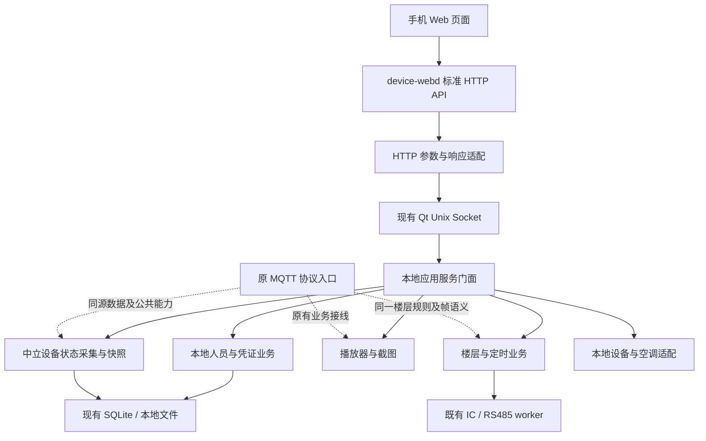

# Web 本地 API 与业务接入设计

> 日期：2026-10-15  
> 版本：设计稿 v1.0  
> 状态：接口与实施设计，尚未实现本文件描述的新增能力。  
> 目标工程：MergedQtApp；沿用现有 device-webd、Qt Unix Socket 和统一 SQLite。  
> 本轮交付：本文档；不修改 MQTT、Qt、Web 或启动脚本的实现。

## 1. 设计依据与最终约束

参考文档：

1. [原设计文档](<F:/rk3566-proj/yc_linux_qt_web_http(1)/yc_linux_qt_web_http/设计文档.md>)：第 10 节为标准 HTTP 协议，第 4～9 节描述页面行为。
2. [原 API 与数据结构详细说明](<F:/rk3566-proj/yc_linux_qt_web_http(1)/yc_linux_qt_web_http/API与数据结构详细说明.md>)：第 3 节为前端数据结构参考；第 6 节明确联调以设计文档第 10 节为准。
3. 当前工程源码及本次会话已确认的设备号、SSID、鉴权、部署方式。

优先级：本次明确的用户要求 > 本文档明确记录的项目适配 > 原设计第 10 节 > 原前端 Mock。

### 1.1 Web 不受 offline / online 模式限制

- offline_v1、online_v1、online_v2 均可使用 Web；没有“必须启用 offline 才能使用”的判断。
- Web 的可用性取决于 Qt 本地业务、有效账号、热点/局域网连接和相关硬件能力，不取决于 Broker、MQTT IPC、订阅主题或平台在线状态。
- Web 请求不检查 MQTT 进程或连接状态；即使从未收到平台指令，也能主动查询和执行本地操作。
- 当前部署继续遵循：有可用 WiFi/AP 才启动门户；热点失败不影响 Qt。本设计不改变既有网络部署条件。
- “完全离线”表示不依赖云平台、互联网、MQTT、FTP 下载和远程账号服务；手机与设备之间仍通过热点局域网通信。
- LIVE 地址若位于外网，播放仍需要该地址可达；这属于该媒体源的条件，不得反过来限制 Web 或本地录播功能。

### 1.2 源数据与传输协议分离

Web 不订阅 MQTT event，不解析 MQTT 日志，不缓存最后一次 MQTT 回执，不伪造平台 request，不调用 MQTT 消息分派器。

正确的数据来源是播放器、当前界面、硬件采集、同一个数据库和本地配置。MQTT 和 Web 是这些能力的两个入口；字段需要一致的部分由中立的数据模型、转换和业务服务保证。

读取原有 `net_cfg.ini` 的 `[mqtt]/client_id` 是读取设备身份配置，不等于建立 MQTT 连接。读取名称带 `online_v1_` 的历史配置键也不等于依赖 MQTT 运行。

本设计只要求 Web 与 MQTT 的请求、取数、控制和返回流程分开。不新增针对 mqttd 的检查、启停或启动脚本改造；它是否运行不属于 Web API 的前置条件，也不作为专门验收项目。

### 1.3 保留已确认行为

- 设备号继续使用真实 `[mqtt]/client_id`；设备名继续显示热点 SSID。
- 默认 SSID 为 `YC_<client_id 后五位>_0000`，自定义 SSID 持久化保留。
- 热点地址为 `192.168.10.1/24`，使用实际接口名，允许 p2p0、wlan0、USB WiFi 等，不新增 wlan 优先策略。
- 采用 NetworkManager 共享热点，保留 DNS 重定向和 FORWARD 隔离。
- Qt 就绪信息稳定 3 秒后再检测热点；网页保存 SSID 后延迟 3 秒，只重新激活该热点连接。
- 继续使用账号和密码、HTTPS、HttpOnly Cookie 会话及 CSRF 校验，不退回 Mock 默认密码或 localStorage Token。
- 现有视频上传/下载/删除、人员 Excel/图片导入、原 MQTT 与 U 盘业务行为保持兼容。

## 2. 源码核对与实际缺口

下表中的“已有”只说明存在入口或数据，不代表标准 HTTP API 已全部接通。

| 领域 | 已核实的源码/入口 | 结论与实施缺口 |
|---|---|---|
| HTTP 与鉴权 | `web/server/src/web_server.cpp`、`session_store.cpp` | 已有 `/api/v1`、Cookie、CSRF、文件流；需增加标准路径适配和统一错误信息 |
| Qt IPC | `modules/web/web_bridge_server.cpp`、`web_service.cpp` | 已有白名单分派，当前主要为同步请求；新增异步操作需独立完成回调，不能阻塞 Web 工作线程 |
| 本地人员基础读取 | `common/sql/web/web_person_repository.cpp` | 已查 person 表；当前列表/详情未完整返回凭证、规则、楼层 |
| 本地人员存储 | `common/sql/local_personnel_store.*` | 已有 person/face_feature/local_*；主要写入口是 Excel 聚合导入，不是可直接复用的通用 CRUD |
| 实际通行 | `ic_board/local_access_service.*`、`ic_worker.cpp` | 本地卡、二维码、密码、人脸权限校验可不经 MQTT；保存必须对接这些源表 |
| 人脸提取与防重 | `web_face_bridge.*`、`web_face_validation.cpp`、`FaceInferenceWorker` | 已有人脸质量/特征和跨库防重；单张凭证录入及持久化注册结果需补齐 |
| 截图 | `MultimediaDemo::captureCompositeSnapshot()`、`currentPlayImageChanged` | 已有视频/UI 合成与异步编码；需 Web 请求关联、超时和当前活动页面适配 |
| 播放源数据 | `components/multimedia/multimediademo.*` | 已有 LIVE 目标、实际播放、轮播、停止、音量；需中立完整快照及操作完成信号 |
| MQTT 播放快照 | `components/settings/mqtt/mqttservice.h` 的 `PlayInfoState` | 可参考字段；不能作为 Web 唯一状态容器，不能要求 MqttManager 存在 |
| 楼层状态/规则 | MQTT 当前使用 DbStore 的 `online_v1_floor_*` 配置键 | 数据在本机；部分校验、128 位编解码、组帧函数处于 mqttmanager.cpp 匿名作用域，外部不能直接调用 |
| 特殊模式 | `Rs485FloorFrameBuilder::elevatorModeState()`、`saveElevatorModeState()` | 有公共本地读写与高 8 位覆盖能力；Web 必须沿用原位序和保护规则 |
| RS485 | `IcEventBridge::requestRs485Send()`、`rs485SendFinished`、`Rs485DriverPort` | 可复用实际串口；请求投递成功不代表发送成功，也不代表电梯机械动作成功 |
| 定时梯控执行 | `MqttManager::onOnlineV1FloorScheduleTick()` | 当前执行器由 MqttManager 创建，且检查 online_v1 topic；必须解除该运行依赖 |
| 屏幕休眠 | `StandbyLockPage`、`shell/ModeController` | 有设置 UI、人体感应和模式切换；不能据此认定已实现“无电梯信号 180 秒休眠” |
| 主板重启 | `Rk3566Platform::reboot()` | 已有本地重启入口；需响应完成后触发和重启后状态核实 |
| 定时开关机 | `Rk3566Platform` 有时间/RTC 同步能力 | 尚未确认定时关机、掉电后唤醒全链路；RTC 对时不能替代唤醒闹钟/硬件支持 |
| 空调 | 当前 Web AirControl 为占位；多媒体存在演示用空调图标定时器 | 尚未确认真实空调控制和遥测入口；不得把演示值作为室温或运行状态 |
| 设备身份 | `mqttpage.cpp` 的固定 client_id 初始化；真实 net_cfg.ini | Web 直接读取已有设备号，不从 MQTT 回执取 ID，不在 API 内调用 MQTT 页面初始化；缺失时明确返回未就绪 |
| 网络清理 | `NetworkPage::setFeatureSettings()` / `applyNetworkConfig()` | offline 可清理所选接口 IP；必须保护门户实际接口，不能清掉热点地址 |

### 2.1 模式判断的一个重要区别

现有 `protocolModeFromFeatures()` 对 offline_v1 和 online_v1 都可能返回字符串 `offline`。因此不能用 `mqtt/protocol_mode=offline` 判断“应该禁用 MQTT”，更不能据此禁用 Web。

Web 请求分发不读取这些模式开关来决定是否放行。MQTT 原路由选择仍由现有 feature 配置管理；业务能力是否可用通过硬件/服务能力查询判断。

## 3. 总体结构与公共层职责



### 3.1 拟新增组件

以下名称为设计名，当前工程中尚不存在这些类，不得在实施记录中写成已完成。

| 设计组件 | 建议位置 | 责任 |
|---|---|---|
| `LocalApiFacade` | `modules/web/` | 将已鉴权的 HTTP/RPC 请求分派到本地服务，处理参数、关联和响应 |
| `DeviceStateProvider` | `common/device/` | 读取身份、实际热点接口/IP、存储统计、能力和源状态；无 MQTT 依赖 |
| `MediaStateProvider` / `LocalMediaController` | `components/multimedia/` 的中立接口 | 从实际播放器取得快照，在 UI 所属线程执行播放/停止/音量 |
| `WebRuntimeBridge` | `modules/web/` | Web worker 与 UI/硬件 worker 的异步连接；不拥有播放器和串口 |
| `LocalPersonService` / `LocalCredentialService` | `common/sql/` 中立业务层 | 事务化 CRUD、规则、楼层与源表映射，不写 network_* 或 MQTT outbox |
| `LocalElevatorService` / `FloorStateRepository` | `ic_board/` | 本地查询、校验、持久化、组帧、实际发送结果关联 |
| `LocalFloorScheduleExecutor` | `ic_board/` | 不依赖 MQTT 的单一定时执行器，常驻 Qt 业务生命周期 |
| `LocalPowerService` / `ScreenSleepService` / `AirDeviceAdapter` | 中立设备业务层 | 对接实际平台/显示/空调驱动；未实现时明确返回能力缺失 |
| `LocalOperationStore` | 同一 SQLite 的辅助表 | 幂等请求、异步操作、执行结果、注册结果和审计；不复制人员主数据 |

公共层不引用 HTTP、MQTT 报文、Topic 或 Session。Web 和 MQTT 使用的同一数据应有同一采集者或同一仓储，不维护两个“当前状态”。

### 3.2 原 MQTT 的保护边界

- 不改变原 Topic、报文格式、消息 ID、QoS、平台同步、扣次、FTP 或回执时机。
- Web 不调用 `MqttManager::dispatchPayloadMessage()`、`sendPlayInfoNow()` 或网络人员同步入口。
- 优先接现有中立信号、公共仓储和硬件入口，主程序只增加并行桥接。
- 若已有逻辑仅存在于 MQTT 私有实现中，必须在实施前明确公共化接线方案；不能靠调用私有 handler 或复制第二套定时器规避。
- 特别是定时梯控：最终必须只有一个中立执行器。若公共化需要调整原 MQTT 的本地委托接线，限定为保持原业务语义的最小替换，单独列出变更并做 MQTT 回归；不是重写 MQTT 协议业务。本轮只记录该耦合及目标，不修改任何 MQTT 文件。

## 4. 标准协议与现有服务兼容

### 4.1 路径、方法与鉴权

- 标准对外路径采用原设计的 `/api/...`，39 项接口见第 5 节。
- 保留现有 `/api/v1/...` 登录、上传、导入、文件和热点接口；适配到同一个本地业务，不迁移既有任务 ID。
- 标准接口和现有接口共用 Cookie、账号、CSRF、Origin、请求限额和错误处理，不能出现一个路径有鉴权、另一个路径绕过的情况。
- 新页面标准调用使用 `/api` 客户端；既有上传/导入暂保留 `/api/v1` 客户端，共用会话/CSRF，避免直接修改全局 baseURL 破坏已接入能力。
- 生产关闭 Mock。前端离线资源全部本地提供。
- 除公开基础设备信息、登录、现有健康/引导入口外，全部接口须登录。标准中的 POST 查询同样按现有规则携带 CSRF。

### 4.2 统一响应和执行语义

```json
{
  "code": 200,
  "message": "ok",
  "data": {},
  "requestId": "web-generated-id"
}
```

标准响应不携带 MQTT method、Topic、平台消息 ID。`requestId` 只关联本地 HTTP 操作。

| HTTP/业务码 | 含义 |
|---|---|
| 200 | 查询成功；或操作请求已被接受。操作是否完成由 `execution.state` 表示 |
| 400 / 422 | 参数/字段语义错误 |
| 401 / 403 | 会话无效、无权限或 CSRF 校验失败 |
| 404 | 本地资源不存在 |
| 409 | 版本冲突、同幂等键不同内容、资源忙或所有权冲突 |
| 413 | 单次请求/响应超限，需要分项获取或文件通道 |
| 501 | 本设备尚无所请求的业务能力，如未接入空调驱动 |
| 503 | 已支持能力暂未就绪，如串口未打开、媒体目录不存在或所在文件系统不可用/只读 |
| 504 | 等待实际本地执行结果超时，不能据此宣称动作未发生 |

查询结果可附加 `observedAt`、`available`、`source`、`revision`，不得以演示默认值补齐未知实测数据。

标准规定 data 为数组的接口仍返回数组；采集和分页元信息放在信封 `meta`，不擅自将数组改成 `{floors:...}` 或 `{persons:...}`。

操作结果示例：

```json
{
  "code": 200,
  "message": "已保存，等待设备应用",
  "data": {
    "operationId": "local-op-id",
    "execution": {
      "state": "PENDING",
      "saved": true,
      "transportSent": false,
      "hardwareConfirmed": null
    }
  },
  "requestId": "web-generated-id"
}
```

`execution.state` 取 `PENDING / APPLIED / FAILED / UNKNOWN`。配置持久化、串口发送完成、硬件反馈确认是三个不同事实。没有硬件确认协议时 `hardwareConfirmed=null`，界面写“配置已保存/指令已发送”，不写“电梯动作已完成”。

为兼容当前 `code===200` 解包习惯，异步受理返回 200 并在 data 标明 PENDING；前端不得将其直接提示为执行成功。长任务通过本地 operationId 查询。

### 4.3 本次项目适配，明确区别于原文档

| 原设计项 | 本项目决定 |
|---|---|
| 仅密码登录并返回 token | 标准登录路径接受 `{username,password}`，复用现有账号认证，设置 Cookie 并返回 csrf；缺少 username 返回 400，不隐式选择账号 |
| 设备名独立编辑 | deviceName 仍等于 SSID；标准设置接口接受 wifiName，deviceName 若同时传入须一致 |
| device/info 返回热点密码 | 公开响应不返回热点口令；wifiPassword 不提供明文。设备设置页保留现有 SSID 修改能力 |
| 设置接口修改热点密码 | 本次已有范围仅 SSID；传入实际密码变更须明确返回 501，待后续实现，不能假报已保存 |
| Qt 内嵌 HTTP | 保留独立 device-webd + Qt Socket，无需更换服务器架构 |
| Mock 的 credential/save、elevator/get | 不作为标准后端契约；前端适配到标准分项接口 |
| airControl/get 的 GET/POST 差异 | 以标准为准：POST |
| floorSchedule/set 的 schedules/rules 差异 | HTTP 用 `{rules:[...]}`，本地服务按统一模型转换；不将差异泄漏给执行器 |
| floorSchedule 的平台副本 | 本机版本不创建平台副本，按第 7.4 节处理 |
| 200/201 重启状态 | 对当前前端统一外层 code=200，data.state 表示 REBOOTING/COMPLETED；重启完成必须核对 bootId 变化 |
| 文档示例 IP 192.168.1.1 | 使用已部署的实际热点 IP 192.168.10.1 |

这些是显式适配，不宣称原文档每个字节都已经实现。超出此前已接入范围的能力，按表中缺口实施和验收。

## 5. API → 页面调用 → 本地入口 → 返回对应表

状态：**已有**=可直接复用部分实现；**新增**=需要新增门面/事务/HTTP 接线；**缺口**=尚未确认实际执行能力。设计入口名均为拟新增，括号内标注可复用源码。

本节共 39 项标准接口，覆盖原设计第 10.2～10.8 节。表内返回值均指统一信封中的 `data`。

### 5.1 设备、登录与预览：9 项

| ID | 标准 API | 页面 / 调用 | 请求 | 本地入口与源数据 | 返回 / 现状 |
|---|---|---|---|---|---|
| A01 | `GET /api/device/info` | Login、DevicePreview、DeviceSettings → getDeviceInfo | 无 | DeviceStateProvider.identityAndPortal；真实 client_id、WebHotspot、门户实际接口 | DeviceInfo；已有基础字段，补实际 IP |
| A02 | `POST /api/device/verify-password` | Login → verifyPassword | `{username,password}`（项目适配） | 现有 WebAccounts::authenticate + SessionStore | `{authenticated,username,csrf}` + Cookie；已有认证，新增别名 |
| A03 | `POST /api/device/settings/update` | DeviceSettings → deviceSettingsUpdate | `{wifiName,deviceName?}` | WebHotspot::save → 固定 NM helper；不调用 MQTT | DeviceInfo + restartPending；已有 SSID，新增标准适配 |
| A04 | `POST /api/device/change-password` | DeviceSettings → changePassword | `{oldPassword,newPassword}` | 当前账号本地 KDF 校验/更新；使旧会话失效 | `{changed:true,reloginRequired:true}`；新增 |
| A05 | `POST /api/device/configPackage/upload` | DeviceSettings → uploadConfigPackage | multipart：file，文件名含 ycest | LocalConfigPackageService：流式接收、校验、暂存、受控应用 | `{name,size,status,message,operationId}`；新增，不能只解压即报完成 |
| A06 | `POST /api/device/screenshot` | DevicePreview.refresh → screenshot；按 8/10/20/30 秒轮询 | `{}` | WebRuntimeBridge → 当前活动根界面与播放器合成 → 异步编码；不经 MqttPage | `{base64Image,timestamp}`；已有采集，新增桥接 |
| A07 | `GET /api/device/overview` | DevicePreview.loadOverview → deviceOverview | 无 | DeviceStateProvider：本地人员/凭证聚合、实际 AP IP、视频目录所在文件系统 | Overview；新增聚合 |
| A08 | `POST /api/device/reboot` | ElevatorControl.saveBoard → reboot | `{onTime,offTime}`，HH:mm | LocalPowerService 定时开关机配置与实际唤醒硬件 | BoardPower + execution；缺口，暂 501，不以仅存时间代替可执行能力 |
| A09 | `POST /api/device/linux-reboot` | ElevatorControl.doReboot → linuxReboot | `{}` | LocalPowerService → 响应刷出后调用 Rk3566Platform::reboot | `{id,bootId,state:"REBOOTING"}`；已有平台调用，新增操作关联 |

### 5.2 人员：5 项

| ID | 标准 API | 页面 / 调用 | 请求 | 本地入口与源数据 | 返回 / 现状 |
|---|---|---|---|---|---|
| B01 | `GET /api/person/list` | PersonList.load → personList | 无；分页参数作为兼容扩展 | LocalPersonService.list；person，deleted=0；默认仅本地人员 | Person[]；已有基础读取，补字段与有界分页 |
| B02 | `POST /api/person/add` | PersonList.onAdd → personAdd | `{name,account?,employeeNo?,department?,position?,phone?,remark?}` | LocalPersonService.create；本地 person、唯一编号；不调用 applyFullPersonnel | Person；新增事务化创建 |
| B03 | `PUT /api/person/update` | PersonDetail.savePerson → personUpdate | `{id,...变更字段,version?}` | LocalPersonService.patch；白名单更新，不替换凭证、不重置用量 | Person；新增 |
| B04 | `DELETE /api/person/delete` | PersonList.onDelete / PersonDetail.onDeletePerson → personDelete | `{id,version?}` | 本地软删除与权限失效；复用既有删除语义并刷新图库 | `{id,deleted:true}` + execution；已有 DatabaseWorker::deletePerson 可参考，补完整凭证处理 |
| B05 | `GET /api/person/detail/{id}` | PersonDetail.load → personDetail | 路径 id | LocalPersonService.get；person 基础资料；凭证另调 C01 | Person；已有基础详情，标准路径适配与完整字段新增 |

### 5.3 凭证与注册结果：6 项

原设计未完整指定所有子项参数；下表将其明确为本项目实施契约。

| ID | 标准 API | 页面 / 调用 | 请求 | 本地入口与源数据 | 返回 / 现状 |
|---|---|---|---|---|---|
| C01 | `GET /api/credential/getByPerson/{personId}` | PersonDetail.load → credentialGet | 路径 personId | LocalCredentialService.get；local_ic_card/local_qr_code/local_access_rule/local_timing_rule/local_floor/face_feature | Credential；新增完整投影 |
| C02 | `POST /api/credential/add` | PersonDetail 首次初始化 → credentialAdd | `{personId,extra?}` | LocalCredentialService.ensure；创建本地聚合，不插入第二套 credential 主库 | Credential；新增，重复初始化幂等，不清空已有项 |
| C03 | `PUT /api/credential/update` | PersonDetail.save → credentialUpdate | `{personId,extra:{rules},version?}` | 本地规则校验与差量事务；更新 local_access_rule/local_timing_rule，对账用量 | Credential；新增，见第 7.2 节 |
| C04 | `POST /api/credential/addSubItem` | PersonDetail.addCard / onFaceFile / addQr → credentialAddSubItem | `{personId,subType,subData}` | IC_CARD 写本地卡；FACE 走既有质量/防重/特征 worker；QR_* 写本地二维码 | Credential + operationId/execution（人脸）；已有提取链，新增单项业务 |
| C05 | `POST /api/credential/removeSubItem` | PersonDetail.removeItem → credentialRemoveSubItem | `{personId,subType,itemId,version?}` | 本地撤销指定项；FACE 同步删除识别特征并刷新图库；不调用 network deletePersonnel | Credential + execution；新增 |
| C06 | `POST /api/person/faceRegisterResult` | PersonDetail.loadFaceRegister → faceRegisterResult | `{id}`，即 personId | LocalOperationStore 的本地校验/入库结果 + 实际 face_feature；不等 Imagesresult | FaceRegisterResult；新增持久化投影 |

子项规则：IC_CARD 的 subData 为 `{cardId,name}`；FACE 为 `{faceBase64,name}`；QR_* 为 `{qrUnique,qrType,name,validFrom?,validTo?,maxUseCount?}`。subType 取 `IC_CARD / FACE / QR_STANDALONE / QR_VISITOR`。itemId 由服务端返回，对卡为规范化 cardId，对二维码为 qrUnique，对人脸为本地 faceId。

### 5.4 人员楼层：2 项

| ID | 标准 API | 页面 / 调用 | 请求 | 本地入口与源数据 | 返回 / 现状 |
|---|---|---|---|---|---|
| D01 | `POST /api/personFloor/save` | PersonDetail.confirmFloor → personFloorSave | `{personId,floor:[...],version?}` | LocalCredentialService.saveFloors；local_floor，device_id 固定为本机 | `{personId,floors,version}`；新增 |
| D02 | `DELETE /api/personFloor/delete` | PersonDetail 清空楼层 → personFloorDelete | `{personId,version?}` | 同一服务清空本机楼层，不删除人员或其他规则 | `{personId,floors:[],version}`；新增 |

### 5.5 电梯：10 项

| ID | 标准 API | 页面 / 调用 | 请求 | 本地入口与源数据 | 返回 / 现状 |
|---|---|---|---|---|---|
| E01 | `POST /api/elevator/floorLimit/set` | ElevatorControl.saveFloorLimit → floorLimitSet | `{floors:[{floor,action}]}` | LocalElevatorService.setFloors；共享配置 → 原位序组帧 → IcEventBridge | FloorLimit + execution；已有状态/IO，新增公共业务 |
| E02 | `POST /api/elevator/floorLimit/get` | ElevatorControl.load → floorLimitGet | `{}` | FloorStateRepository.get；读取当前设备配置，不发 floorLimit.query | FloorLimit；新增 HTTP/投影 |
| E03 | `POST /api/elevator/floorSchedule/set` | ElevatorControl.saveSchedule → floorScheduleSet | `{rules:[Schedule...]}` | LocalElevatorService.replaceSchedules；同一规则库；空数组清空 | FloorSchedules + execution；新增本地入口/中立执行器 |
| E04 | `POST /api/elevator/floorSchedule/get` | ElevatorControl.load → floorScheduleGet | `{}` | 读取本地规则及执行状态 | FloorSchedules；新增；无云端副本，见第 7.4 节 |
| E05 | `POST /api/elevator/floorSchedule/delete` | ElevatorControl.removeSchedule → floorScheduleDelete | `{hashList:[...]}` | 按本地规则 hash 删除指定项，保留其余规则与执行标记 | FloorSchedules；新增 |
| E06 | `POST /api/elevator/floorSchedule/resend` | ElevatorControl 重新应用 → floorScheduleResend | `{}` | 重新加载已持久化本地规则并应用当前配置；不向 Broker 重发 | FloorSchedules + execution；新增；不重置本分钟执行去重标记 |
| E07 | `POST /api/elevator/elevatorMode/set` | ElevatorControl.setMode → elevatorModeSet | 全量 Mode 开关 | LocalElevatorService.setMode → 公共模式仓储和既有高 8 位覆盖 → 原串口 | Mode + execution；已有公共仓储，新增入口 |
| E08 | `POST /api/elevator/elevatorMode/get` | ElevatorControl.load → elevatorModeGet | `{}` | Rs485FloorFrameBuilder::elevatorModeState；转换 bool | Mode；已有读取，新增 API |
| E09 | `POST /api/elevator/screenSleep/set` | ElevatorControl.setSleep → screenSleepSet | `{enable}` | ScreenSleepService；信号板事件时间与显示控制，不替代 SR505 模块切换 | `{enable,idleSeconds:180}` + execution；缺口，需独立实现 |
| E10 | `POST /api/elevator/screenSleep/get` | ElevatorControl.load → screenSleepGet | `{}` | 同一休眠服务配置及当前能力 | `{enable,idleSeconds:180}`；缺口；未接通不能从 UI 默认值返回 true |

### 5.6 空调：2 项

| ID | 标准 API | 页面 / 调用 | 请求 | 本地入口与源数据 | 返回 / 现状 |
|---|---|---|---|---|---|
| F01 | `POST /api/device/airControl/set` | AirControl.commit → airSet | `{airOn?,isLoopOn?,mode?,fun?,temperature?,plan?}` | AirDeviceAdapter；设备真实串口/总线驱动及本地定时执行 | AirState + execution；缺口，无驱动返回 501 |
| F02 | `POST /api/device/airControl/get` | AirControl.load → airGet | `{}` | 同一适配器的真实遥测/设置快照；非 MQTT airPlan 缓存 | AirState；缺口；无能力与暂时离线区分 |

### 5.7 视频与播放：5 项

| ID | 标准 API | 页面 / 调用 | 请求 | 本地入口与源数据 | 返回 / 现状 |
|---|---|---|---|---|---|
| G01 | `POST /api/upload/video` | VideoManage.onUpload → uploadVideo | multipart file；name/size/duration 为元数据，服务端实测 | 复用现有上传任务、.part、内容校验和原子发布，不走 MQTT/FTP | PlayFile；已有可靠上传，新增标准入口；不得完整缓存视频 |
| G02 | `GET /api/playFile/list` | VideoManage.load → playFileList | 无 | WebService::files/现有媒体目录索引；实际文件 | PlayFile[]；已有列表，补真实时长或 null |
| G03 | `DELETE /api/playFile/delete` | VideoManage.onDelete → deletePlayFile | `{id}`；可接受 fileId 作兼容别名 | 现有 files.delete 与占用保护；按稳定 ID，不按 MQTT 临时序号 | `{id,deleted:true}`；已有删除，新增标准路径 |
| G04 | `POST /api/device/getPlayInfo` | VideoManage.loadPlayInfo → getPlayInfo | `{}` | MediaStateProvider 读取 UI 所属线程的当前快照，不调用 sendPlayInfoNow | PlayInfo；新增中立快照/API |
| G05 | `POST /api/device/videoControl` | VideoManage.saveSettings → videoControl | `{videoType,videoVolume?,videoUrl?,videoPath?,file?}` | LocalMediaController → 既有轮播/LIVE/停止/音量入口；无 FTP 参数 | PlayInfo + execution；已有执行能力，新增中立入口与完成判定 |

## 6. 查询与返回结构约定

### 6.1 DeviceInfo 与 Overview

```json
{
  "deviceId": "YCEEQZ12345ABCDE",
  "deviceName": "YC_ABCDE_0000",
  "wifiName": "YC_ABCDE_0000",
  "deviceIp": "192.168.10.1",
  "restartPending": false
}
```

DeviceInfo 的 IP 从门户实际接口采集，不读取被 offline 清空的 eth0 IP。不得硬编码 wlan0，也不得把历史配置中的上行 IP 当作热点 IP。

```json
{
  "deviceIp": "192.168.10.1",
  "personCount": 3,
  "faceCount": 2,
  "icCount": 1,
  "qrCount": 2,
  "storage": {"total": 8.0, "used": 3.6, "usedPercent": 45.0},
  "storageAvailable": true,
  "observedAt": "2026-10-15T18:30:00+08:00"
}
```

统计默认与标准本地人员列表同一范围：person.deleted=0；人员停用不等于删除。人脸只统计这些人员已实际保存且特征有效的 face_feature；IC/QR 统计对应 active 项。待处理或失败人脸不计为已注册。

存储统计针对视频目录 `/mnt/UDISK/res/static/demoResources/images/video` 所在实际文件系统，不将目录递归大小冒充磁盘占用；按 GiB 换算并在页面标清单位。按 2026-10-16 确认的 eMMC 部署方式，该目录可以直接属于板载根分区 `/dev/mmcblk0p3`，不要求 `/mnt/UDISK` 独立挂载。目录或文件系统不可用、只读或没有读写权限时返回 storage=null、storageAvailable=false；不得以其他目录容量或默认数字替代。

### 6.2 Person / Credential / Rules

```json
{
  "id": 12,
  "name": "张三",
  "account": "zhangsan",
  "employeeNo": "001",
  "department": "物业部",
  "position": "管理员",
  "phone": "13800000001",
  "remark": "",
  "status": 1,
  "source": "local",
  "version": 5
}
```

person.id 是本地 person 主键，不复用平台 personId。status 映射 enabled 的 1/0。account 与历史 person_no 的读写规则在本地仓储统一，禁止接口随意改写唯一编号。

```json
{
  "personId": 12,
  "icCards": [{"cardId": "A1B2C3D4", "name": "门禁卡"}],
  "faces": [{"faceId": "local-face-31", "faceBase64": "data:image/jpeg;base64,...", "name": "人脸1"}],
  "qrCodes": [{"qrUnique": "81234567", "qrType": "QR_STANDALONE", "name": "通行码"}],
  "rules": {
    "time": false, "timingRules": [],
    "count": false, "countDataTotal": 0, "countDataAddCount": 0,
    "amount": false, "amountDataTotal": 0, "amountDataAddAmount": 0, "amountDataUnitPrice": 0.5,
    "duration": false, "durationDataStartTime": "", "durationDataEndTime": "",
    "relay": false, "relayStates": [], "relayOnTime": 0,
    "controlElevator": false, "controlElevatorDataValueType": 1,
    "remoteCall": false, "remoteCallDataCurrentDayCallCount": 0, "remoteCallDataEveryDayUpdateCallCount": 0,
    "cardPassword": false, "cardPasswordDataPassword": ""
  },
  "floors": [-2, 1, 3],
  "version": 5
}
```

8 个规则开关采用详细说明中的 bool + 详情字段，不能按原设计早期示例把 count/amount/duration 同时解释成数字开关。楼层是整数集合，范围 -8～-1、1～120，去重并排序，不包含 0。

规则 UI 可展示全部字段，但缺少底层执行支持的字段必须由能力信息标记并在提交时明确拒绝，不能只保存 raw_json 就宣称已生效。

### 6.3 人脸注册结果

```json
{
  "total": 2, "successCount": 1, "failCount": 0, "pendingCount": 1,
  "results": [
    {"faceId": "local-face-31", "faceBase64": "data:image/jpeg;base64,...", "result": 1,
     "msg": "", "registerTime": "2026-10-15T18:30:00+08:00"},
    {"faceId": "local-face-32", "faceBase64": "data:image/jpeg;base64,...", "result": null,
     "msg": "等待特征提取", "registerTime": null}
  ]
}
```

1=质量/防重/特征/文件/数据库均完成并已通知图库刷新；0=明确失败；null=待处理。汇总数必须相加等于 total。结果由本地任务产生并持久化，Qt 重启后可查询，不等 MQTT Imagesresult。

faceId 是优先匹配键；为兼容原页面保留 faceBase64，凭证和注册结果由同一图像记录序列化。原 MQTT 的 faceHash 算法和网络人员标识不做修改。

### 6.4 FloorLimit / FloorSchedules / Mode

FloorLimit 的标准 HTTP data 为楼层数组；本地内部可以使用包含 floors 的快照结构，由适配层解包。

```json
{
  "code": 200,
  "message": "ok",
  "data": [{"floor": -2, "status": 0}, {"floor": 1, "status": 1}],
  "meta": {"stateSource": "device_config", "hardwareConfirmed": null, "revision": 7}
}
```

标准楼层状态按原设计使用数字 1=开放、0=限行；页面适配层转换成 open/limit 标签。不可把原前端字符串直接写入 128 位状态。设置操作的 execution 元信息同样位于信封 meta，查询的 data 数组类型保持不变。

```json
{
  "platformSchedules": null,
  "deviceSchedules": [
    {"hash": "local-rule-id", "action": 1, "time": "08:00", "weekDays": [1,2,3,4,5], "floors": [1,3]}
  ],
  "matched": null,
  "comparisonScope": "local",
  "revision": 3
}
```

Mode 为 masterSwitch、delay、parking、driver、independent、ext1～ext4 共 9 个 bool 字段。输入允许明确的 bool 或 0/1，经单一适配归一化；返回统一为 bool。

### 6.5 AirState

```json
{
  "airOn": 1, "isLoopOn": 0, "mode": "cool", "fun": "low",
  "temperature": 25, "currentTemp": null, "humidity": null, "brand": null, "status": null,
  "plan": {
    "week1": {"timeOn": "08:00", "timeOFF": "18:00", "mode": "cool", "fun": "low", "temperature": 25}
  },
  "telemetryAvailable": false,
  "observedAt": null
}
```

仅在适配器存在且确实读到设置时返回该结构；整个能力未实现返回 501。设置值和实测值分开，实测未知返回 null，不使用多媒体演示温度。计划 week1～week7 为周一至周日，week8 为每天；未设置时间按标准保留字符串 `"null"`，内部统一转换为可空时间。

### 6.6 PlayFile / PlayInfo

```json
{"id":"stable-file-id","name":"welcome.mp4","size":"12.4 MiB","bytes":13002342,"duration":"00:15"}
```

文件 ID 沿用现有稳定标识，视为不透明字符串；不改回 MQTT 扫描时临时生成的 1、2、3。size 是展示值，bytes 用于计算；未取得真实时长时 duration=null。

```json
{
  "name": "welcome.mp4", "videoType": "RECORDED", "videoVolume": 60,
  "videoPath": "welcome.mp4", "videoUrl": "", "deviceLog": "正常播放中",
  "playbackState": "PLAYING", "observedAt": "2026-10-15T18:30:00+08:00"
}
```

videoType 统一大写 RECORDED/LIVE/NONE。来源是实际业务模式/播放器状态，不能仅用“当前录播文件为空”推断为 NONE，因为此时可能处于 LIVE。暂停、下载暂停、切换识别页面和启动探测使用 playbackState 补充；请求目标可另附 desiredState，不能把目标当作实际已播放。

deviceLog 只返回经选择的播放状态/错误，不返回 MQTT 原始报文、FTP 口令或完整系统日志。

## 7. 本地业务一致性与关键执行设计

### 7.1 状态采集同源，按需取快照

- 主线程从实际 UI/播放器采集小型不可变快照，通过排队信号交给 Web worker。
- 初始化时主动采集一次，不能依赖第一次 MQTT 查询或下一次状态变化后才有数据。
- 录播变化、LIVE 状态、实际音量、暂停/停止、错误等事件更新同一 MediaStateProvider。
- 本地状态缓存标记 observedAt/revision/available；缓存仅为源状态快照，不能作为另一套业务真值。
- 数据库统计采用同一连接内的短读事务；写后失效缓存并更新 revision。
- Web 对运行模式不分支；online 模式下 MQTT 改变的源状态也会自然反映到页面。

### 7.2 人员、规则与用量

- 标准人员 API 管理本机 person/face_feature/local_*。平台 network_* 不混入相同数字 ID 空间，不由本地 CRUD 修改。
- 人员列表分页扩展使用 query 的 offset/limit（默认 offset=0、limit=100，单页最多500）；data 仍为 Person[]，meta 返回 total/offset/limit/hasMore。页面继续加载至 hasMore=false，不将现有 LIMIT 5000 的截断当成完整人员清单。
- 同一物理人员在本地和平台存在时，沿用现有跨库卡号、密码、人脸冲突校验；不因 Web 请求切换到网络人员写入。
- 网络人员管理若将来需要展示，应新增显式 source/只读投影，不能假借标准本地 ID 修改平台权威数据。
- 不直接把完整 `importSpreadsheetPersonnel()` 当作编辑接口：该实现会整体替换多张子表并处理新增次数/金额，可能覆盖凭证、重置或重复累计用量。
- 新增窄事务方法：更新资料不碰凭证；更新规则不删除 IC/QR/楼层；删除一个凭证不重置其他凭证和余额。
- countDataAddCount、amountDataAddAmount 等是有副作用的增量，必须以请求幂等键去重，不能页面刷新后再累计。
- 同一个数据库事务内核对版本和执行差量；Web、Excel、实际通行扣减并发时不得以旧快照覆盖最新余额。
- `LocalPersonnelStore::initialize()` 有将非空 person_json 归类为 Excel 来源的历史兼容逻辑。Web 来源标记要保持 manual/明确来源，不能未经核对新增 `web` 后又被该迁移改写；必要的来源迁移单独实现，不改变旧 Excel 行为。
- 删除人员先使本地通行失效，提交后刷新识别图库；清理文件只能处理该人员受控目录，进行中校验任务要取消/作废。
- 部分凭证保存失败不能对外返回整体已生效；给出实际成功项、失败项和可恢复状态。

### 7.3 人脸、二维码与凭证有效性

- 人脸复用 `validateLocalImportFaceImages()` 的质量/提取能力及现有 Web 跨库防重路径；使用同一 AppConfig 阈值，不增加独立默认阈值。
- 保存前再次核对源图库；提交后通过既有数据库 worker 刷新本地/网络识别快照，不能只写图片而不更新识别库。
- 全部图片字节与注册结果存本地，不请求 face.requestImages，也不等待平台返回原图。
- QR_STANDALONE、QR_VISITOR 元数据写本地 qr_unique、有效期、次数和规则；扫码必须能进入 LocalAccessService 实际查验。
- 当前 IcWorker 已先尝试本地二维码再按模式分流；Web 生成二维码前需沿用该解析器接受的内容编码。qrcode 库只生成图像，随机字符串生成图片不等于已具备可通行权限。
- 原有带签名的离线楼层码/时间码继续按原协议处理，不混同为本地人员 qr_unique，不更改密钥或验证规则。

### 7.4 电梯状态、定时与单一执行器

- 沿用现有 128 位楼层配置及映射：正楼层 1～120、地下 -8～-1；公共帧构造仍经 Rs485FloorFrameBuilder / 既有发送出口。
- 历史 `online_v1_floor_limit_bits`、`online_v1_floor_schedules`、`online_v1_floor_schedule_bits`、`online_v1_floor_schedule_last_minute` 暂保留名称和数据语义；不另建一套 Web 真值。
- 规则 hash 在设备本地生成/验证，保持规则规范化结果稳定；不要求平台生成 ID。删除仅作用 hashList 中的项。
- 标准 platformSchedules 与 matched 在无平台副本时返回 null；页面展示“本机规则”，不显示平台一致性告警。不能复制 deviceSchedules 后伪称已与平台核对。
- `/resend` 表示重新加载/应用本机保存规则，三种运行模式下一致，不依赖 Broker。
- 定时执行器常驻 Qt 本地业务生命周期；关网页、停门户服务后，已保存定时仍必须按时执行，不由 Web 请求或 MQTT 消息触发其生命周期。
- 当前 MqttManager 中的定时器不能与新执行器并存，依靠读取同一 last_minute 并不足以消除并发重复下发。必须落实唯一执行者和可审计的接线迁移。
- 保持原每分钟去重、规则数组顺序、同分钟同楼层后项覆盖前项语义；时间回拨、Qt 重启和规则删除的处理需沿原算法补充本地验收。
- 串口操作用 `web:<operationId>` 等本地来源标签关联 rs485SendFinished；不能用“已发 Qt 信号”当作发送成功。
- 模式占用的 113～120 楼保护、主开关关闭后的恢复语义必须与原协议一致。
- Web 与平台同时写同一全局电梯配置时串行提交，以设备实际提交的最新版本为准；返回最新 revision，发现编辑旧版本时提示刷新，不能静默覆盖。

### 7.5 播放与截图

- 本地播放直接使用已发布媒体的稳定 ID/文件名；file 与 videoPath 同时提供时必须指向同一文件。禁止浏览器指定任意绝对路径。
- 上传成功只表示可用文件发布完成，不自动插播、不自动切换模式；播放必须由明确 videoControl 请求触发。
- LIVE/NONE/RECORDED 调用播放器现有状态机，不从 Web 重写 GStreamer 管线；LIVE 首帧、错误、轮播恢复仍按原策略。
- 当前 `onMqttVolumeChanged()` 内有真实硬件/面板处理。实施时提供中立本地音量入口，Web 不调用 MqttService 的回执构造或挂起确认逻辑。
- Web 请求本身不生成 MQTT 控制请求或补发回执。online 模式下原有状态通知是否上报仍遵循 MQTT 原策略，不能反向阻塞 HTTP。
- 预览返回当前实际活动界面。多媒体页可复用合成截图；人脸页/设置页应采集实际可见根界面，不能切页面来截图，也不能一直返回隐藏的多媒体页。
- 手机端从上传视频 Canvas 截帧是封面，与设备当前屏幕截图是两个功能。
- 截图请求合并并限频，同一时刻至多一笔采集/编码；失败明确返回错误。命中旧缓存须标明 capturedAt，不将旧图 timestamp 改成当前时间。

### 7.6 Web 本地流程的独立边界

- 原启动脚本、MQTT 服务和连接策略保持原样；本 API 设计不要求检查、停止或调整它们。
- Web Runtime、标准路由和本地服务均不使用 MQTT 连接状态、在线告警或 IcEventBridge::networkAvailable() 作为准入条件。
- 设备身份直接读取已有真实 client_id；保持原算法及已生成值，Web 不通过 MQTT 查询生成或更新身份。
- Web 只把本地采集、事务或硬件完成结果返回 HTTP；不等待平台发指令，不把一次 MQTT 发布成功当作本地执行成功。
- 原网络设置与热点服务继续沿用；若实际出现 offline 网络清理误删门户地址，作为明确的兼容问题单独定位，不借此重构网络启动流程。
- `MERGEDQT_WEB_ENABLE=1` 保留，已有门户启动条件仍是 Qt/Web 就绪与有效热点；Web API 不增加 online/offline feature 限制。

## 8. 异步、数据大小与线程边界

### 8.1 不阻塞 Qt 和其他接口

- WebService/数据库在现有 Web worker；UI/播放器只在其所属线程；推理在既有推理 worker；串口由 IcWorker 独占。
- 查询源快照建议 2 秒以内；截图/串口请求使用本地关联及不超过 8 秒的业务等待预算；超过预算返回明确任务状态/超时，不用 UI 线程同步等待。
- 既有 Qt IPC 最大帧约 1 MiB、连接读请求定时 10 秒；新异步接口必须设计成延迟完成回调或“受理+轮询”，不能在 WebService 里嵌套事件循环或阻塞等待自己所在事件循环的信号。
- 长人脸处理、配置包、媒体校验使用 operationId 和持久化结果，不能把现有 socket 超时简单拉长来掩盖阻塞。
- 同一设备的媒体切换、同一人员写入、全局电梯配置写入分别串行；只读查询不排在大文件传输后面。

### 8.2 图片与文件不挤入 IPC

当前通用 JSON 请求限制为 128 KiB，不能直接承接文档中的 200～300 KiB 图片 Base64；Base64 还会增加体积。需要单独实现图片路由限额和文件暂存，不能只解除全局限制。

- 普通参数保持现有小 JSON 限额；单张图片路由建议 JSON 上限 1 MiB、解码图片上限 512 KiB，并验证解码尺寸与真实类型。
- 大文件沿现有流式上传任务；HTTP 端将人脸字节写入受控暂存，IPC 只传服务端生成的资源句柄、owner、业务参数。
- 截图/人脸响应由设备受控图像文件或缓存句柄转换为 HTTP Base64；IPC 只返回小型元数据，不传整批 Base64。
- 单次图像响应建议上限 8 MiB；超过上限明确 413 并采用分项/分页资产获取扩展，不能静默截断人脸列表。
- 资源句柄有 owner、允许目录、类型、尺寸、TTL 校验；浏览器永远不能把任意板端路径当作资源句柄。
- 临时文件在提交/失败/取消后清理，重启后按任务状态恢复，保留现有磁盘配额与 .part 保护。

### 8.3 辅助接口（不是原 39 项的一部分）

| 扩展接口 | 用途 | 约束 |
|---|---|---|
| `GET /api/device/capabilities` | 返回已接通的截图/人员/凭证/梯控/休眠/开关机/空调能力、允许字段、启动 bootId | 登录后查询；仅反映实现和硬件，不因 offline/online 模式隐藏 Web |
| `GET /api/operations/{id}` | 查询本地长操作 state、结果、错误和实际执行事实 | 账号归属校验；用于人脸、媒体切换、重启、配置包；不得公开其他账号任务 |

能力未实现时界面显示“此设备未接入”，而不是显示关机/0℃/空规则等伪状态；已实现但暂不可用显示具体未就绪原因。这不是运行模式限制。

## 9. 幂等、持久化与错误恢复

- 新增/充值/凭证录入/重启/硬件设置使用本地 `Idempotency-Key`（设计扩展），作用域为账号+接口+键；记录请求摘要、operationId 和结果。
- 同键同内容返回既有结果；同键不同内容返回 409。网络超时后先查询原操作，不自动新建操作或重复增加次数。
- 在同一 SQLite 中新增必要的操作/注册结果辅助表，由独立迁移版本管理；不创建第二份人员库，不改 MQTT 同步消息表。
- 新配置与实际应用结果分别记录。发送失败可以保留 saved 配置并返回失败，但不得向用户隐瞒 saved=true、transportSent=false 的区别。
- 机械动作未知或超时不盲目自动重发；恢复时首先查询本地操作/设备可读状态。
- Qt/HTTP 进程重启不重新执行 UNKNOWN 的充值、重启、硬件操作；人脸任务按实际落盘/特征状态判定可恢复阶段。
- 公共配置跨 Web/MQTT 并发使用统一串行入口或版本检查；各线程使用 DbStore 独立连接，不跨线程共享 QSqlDatabase。
- 登录/改密复用出厂 KDF 参数，改密更新当前账号并撤销原会话；不涉及卡密码、MQTT 密码或热点密码。
- 配置包只处理受控配置/UI 资源：校验 ycest 文件名、真实格式、解压大小/条目限额、路径穿越与链接，暂存验证后原子替换/可回滚；不把任意压缩包作为 root 脚本执行。

## 10. 实施顺序与每阶段交付

### P0：公共边界与标准适配

1. 整理 39 项路由与现有 /api/v1 的映射，统一会话/CSRF/错误和标准参数；保留已接入功能。
2. 建立本地身份读取、源状态、媒体快照和运行桥；Web API 不调用 MQTT 页面/消息处理器取得数据。
3. 核实标准路由与本地服务没有 MQTT 状态或运行模式准入判断；原启动脚本和 MQTT 生命周期不纳入改造。
4. 实施前确定定时梯控公共化方案和最小接线清单，不先复制 MQTT 私有处理器。

### P1：真实只读页面

1. 预览：设备概览、当前界面截图、轮询/手动刷新、离页停止轮询。
2. 视频：当前播放状态、稳定文件 ID、真实大小和可用时长。
3. 人员：完整本地资料、凭证、规则、楼层及本地人脸结果。
4. 电梯：设备保存的楼层/规则/模式，明确 stateSource；未实现休眠/空调返回能力缺失。

### P2：人员与凭证操作

1. 窄事务 CRUD、子项增删、规则与楼层；先完成差量/幂等及用量保持测试。
2. 复用单张人脸质量、防重、特征和图库更新，持久化注册结果。
3. 实际离线卡、二维码、密码、人脸通行验证，不以页面保存成功代替生效。

### P3：电梯与媒体控制

1. 本地 floorLimit、特殊模式及实际串口结果；公共编码保持兼容。
2. 唯一定时梯控执行器不依赖 MQTT，网页/门户关闭后继续执行。
3. 本地播放、停止、音量、可达的 LIVE 源，反馈实际状态而不是请求目标。

### P4：设备实际能力补齐

1. 核实并实现“无电梯信号 180 秒休眠”的显示/恢复路径。
2. 有硬件支持后实现定时开关机；无支持时保持明确 501，不制造虚假成功。
3. 有明确空调驱动/协议后接真实设置、遥测和计划执行；演示图标不作为接入依据。
4. 配置包及改密独立验收，不顺带改变已确认的热点密码/设备名范围。

阶段完成要列实际修改文件、已实现标准接口、仍为 501 的能力、本地测试和板端验收结果；不能把本设计稿的表格当成实现完成清单。

## 11. 验收对应表

下表为后续必须执行的验收，本轮没有执行这些设备操作。

| 场景 | 条件 / 动作 | 通过标准 |
|---|---|---|
| 从未有平台回执 | 清除测试快照，启动后不发送任何平台指令 | Web 直接取得实际设备状态，截图可主动更新 |
| 三种模式 | 分别 offline_v1、online_v1、online_v2 | 同一 Web 接口可调用；不以模式拒绝；物理能力差异如实返回 |
| 无互联网 | 断开上行，手机只连热点 | 本地资源、登录、人员、截图、录播、已支持控梯均工作 |
| 源状态一致 | Qt 本地改变音量/播放，或平台在在线模式改变源状态 | Web 读到相同实际值，无 MQTT 回执依赖，无第二套状态漂移 |
| 当前页面截图 | 切到多媒体、人脸、设置页面分别查询 | 返回实际可见界面；不改变屏幕当前页面，不误用旧截图 |
| 图片限额 | 200～300 KiB 图片、多张人脸、大截图 | 不触发 IPC 超帧；超限返回明确错误；其他查询仍响应 |
| 本地人员真实生效 | 创建/编辑本地人员、卡/二维码/人脸与楼层 | 重启后保留，真实通行使用更新结果；不产生网络人员同步消息 |
| 幂等及用量 | 重复同一请求、响应丢失、通行扣减并发 | 不重复新增/充值、不重置用量、不覆盖并发扣减 |
| 删除与防重 | 删除人员/单凭证、重复卡号/密码/人脸 | 实际失效、图库刷新、冲突规则沿用原标准 |
| 单一定时梯控 | 保存后关网页、停 device-webd，不向设备发送平台消息 | Qt 仍在时定时执行；同一到时任务不重复发帧 |
| 模式切换 | 三种模式切换及 Qt 重启 | 规则真值一致；执行器唯一；不重复初始化或重复执行 |
| 发送/硬件反馈 | 串口断开、发送超时、无硬件 ACK | saved/sent/confirmed 区分正确，不假报机械动作成功 |
| 休眠/空调/开关机缺口 | 在无驱动或无能力设备请求 | 明确 501/503，界面不显示演示实测值或成功提示 |
| 热点保护 | 切换 offline，实际门户接口为 p2p0 或 wlan0 | 热点 IP 不被清理，SSID 更新按原 3 秒流程，Qt 不受阻塞 |
| 既有回归 | 视频流式上传/下载/删除、Excel/图片导入、U 盘与在线 MQTT | 已确认业务不退化；标准别名不绕过鉴权或破坏任务 ID |
| 重启恢复 | 人脸处理中、硬件操作未知时重启 Qt/设备 | 结果可查询，不盲目重放，不写出虚假的注册成功 |

最终“完全离线可用”的判据是：不依赖平台指令、云端请求或 MQTT 回执，所有标记为已支持的本地业务均能经标准 HTTP 接口调用并通过真实板端验收；各运行模式下 Web 均可使用，原 MQTT 行为保持不变。无须特定检查 MQTT 进程。尚无硬件能力的接口必须继续作为未完成项列出。

## 12. 源码定位索引

| 源文件 | 核对用途 |
|---|---|
| [web/server/src/web_server.cpp](../web/server/src/web_server.cpp) | 当前路由、128 KiB 参数限制、鉴权和流式文件 |
| [web/server/src/rpc_client.cpp](../web/server/src/rpc_client.cpp) | IPC 小帧、限时调用、结构化请求 |
| [modules/web/web_bridge_server.cpp](../modules/web/web_bridge_server.cpp) | Web Runtime、Socket 和线程分派 |
| [modules/web/web_service.cpp](../modules/web/web_service.cpp) | 现有人员/文件/导入/热点业务入口 |
| [modules/web/web_hotspot.cpp](../modules/web/web_hotspot.cpp) | client_id 就绪、SSID 与延迟重激活 |
| [common/sql/local_personnel_store.cpp](../common/sql/local_personnel_store.cpp) | 本地数据表、Excel 聚合更新、用量与来源兼容 |
| [common/sql/web/web_person_repository.cpp](../common/sql/web/web_person_repository.cpp) | 当前本地人员只读投影 |
| [ic_board/local_access_service.cpp](../ic_board/local_access_service.cpp) | 真实本地卡/二维码/密码/人脸权限与用量 |
| [ic_board/ic_worker.cpp](../ic_board/ic_worker.cpp) | 本地扫码优先处理、实际串口与运行模式 |
| [ic_board/ic_event_bridge.h](../ic_board/ic_event_bridge.h) | 硬件请求/完成事件 |
| [ic_board/rs485_floor_frame_builder.cpp](../ic_board/rs485_floor_frame_builder.cpp) | 位序、模式仓储及输出保护 |
| [components/multimedia/multimediademo.cpp](../components/multimedia/multimediademo.cpp) | 实际媒体状态机、音量、合成截图 |
| [modules/web/web_face_validation.cpp](../modules/web/web_face_validation.cpp) | 既有 Web 本地提取和跨库人脸防重 |
| [modules/facegate/FaceGateQt/database/DatabaseWorker.h](../modules/facegate/FaceGateQt/database/DatabaseWorker.h) | 原图库刷新、人员启停、软删除 |
| [components/settings/mqtt/mqttmanager.cpp](../components/settings/mqtt/mqttmanager.cpp) | 仅用于审计历史配置/规则语义与耦合，禁止作为 Web 请求依赖 |
| [components/settings/mqtt/mqttservice.h](../components/settings/mqtt/mqttservice.h) | 仅用于核对已有播放字段含义 |
| [components/settings/mqttpage.cpp](../components/settings/mqttpage.cpp) | 设备身份初始化的现有耦合位置 |
| [components/settings/networkpage.cpp](../components/settings/networkpage.cpp) | offline 上行清理与热点接口保护点 |
| [scripts/start_face_media.sh](../scripts/start_face_media.sh) | 仅作既有 Qt/Web 环境准备参考，不属于本轮 API 改造范围 |
| [web/deploy/device-web-start.sh](../web/deploy/device-web-start.sh) | 现有热点与 Web 独立启动条件 |

