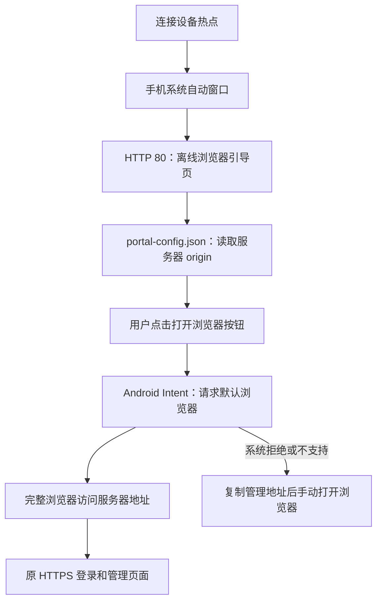

# 浏览器引导、热点密码与网页登录更新

日期：2026-10-16。保留原 MQTT、人员/视频业务、本地 API、Qt 自动启动及可选门户服务的隔离关系。

## 1. 热点自动窗口的入口变化

原流程：手机连接 WiFi → HTTP 探测 → 302 到 HTTPS 登录页，仍在手机系统的受限窗口中操作。

新流程：手机连接 WiFi → HTTP 探测返回独立浏览器引导页 → 用户点击“打开浏览器并进入设备管理” → 请求完整浏览器访问服务器固定地址 → 原登录页及管理功能。

`WebServer::run()` 的 HTTP listener 不再发出登录 302，而是调用 `portalResponse()`。探测请求的不同 Host、路径、查询参数不会改变目标服务器地址。HTTPS `/portal` 提供同一引导页，`/api/v1/captive` 的 user-portal-url 也指向 `/portal`。

`portal-config.json` 公开返回 `{origin,loginUrl,guideUrl}`，取值只来自已校验的 web.json；其中 loginUrl 为 `origin + "/#/login"`。安卓按钮生成 VIEW/BROWSABLE Intent，直接带入 origin，不写死 IP、端口或厂商包名；非安卓使用普通 HTTPS 登录链接。资源全部随 dist 离线部署，不请求外部网站。

页面加载时不自动循环唤起应用，不把“发出请求”显示为“浏览器已成功打开”。是否允许 Intent 由手机系统窗口控制；小米 14 的真实唤起效果需要实机验收。没有网页通用方式保证所有系统窗口都跳到完整浏览器，因此保留只读地址、复制按钮及手动复制提示。引导页不提交登录账号或密码。

## 2. 中文 SSID 与热点密码

读取 SSID 的 `read_ssid()` 显式设置 `LC_ALL=C.UTF-8`，包括网页查询和修改失败时的原名称备份；其他机器状态判定仍用 C locale。Qt 原来的 `QString::fromUtf8()` 保留。此次板端输出已经确认提供 C.UTF-8，名称无需再次转换或重新保存。

| 调用入口 | 请求 | 执行与结果 |
|---|---|---|
| 页面 `api.saveWifiSsid(ssid,password)` → `POST /api/v1/device/wifi` | `{ssid,password?}` | `WebService::dispatch("device.wifi.save")` → `WebHotspot::save(ssid,password)` |
| 标准 `POST /api/device/settings/update` | `{wifiName,deviceName?,wifiPassword?}` | 适配为同一 device.wifi.save；deviceName 若传仍须等于 wifiName |
| Qt → 辅助脚本 | 原 `save SSID` 或 `save SSID --password-stdin` | 可选新密码通过标准输入的一行交接，不出现在 Qt 进程启动参数中 |
| 脚本 → NetworkManager | 同一次 modify 更新 SSID 和可选 wifi-sec.psk，密码标志为持久保存 | 原密码不会返回给网页；新密码留空保持原值；64 位十六进制 PSK 也可使用 |
| 保存后 | 原先的 3 秒延迟 → request-refresh → ExecReload → refresh | 只重新激活对应热点连接；手机用新设置重连，Qt 和 Web 服务继续运行 |

密码在前端、Qt、辅助脚本分别校验：8–63 位可打印 ASCII，或 64 位十六进制密钥；禁止控制字符。名称继续限制为 1–32 UTF-8 字节。可以名称不变只改密码；没有任何改动时不触发保存。

脚本不会把新密码写回 factory AP_PASSWORD 或另外创建密码文件。密码保存在现有专用 NetworkManager 连接，后续 prepare 复用连接，保留用户新密码。自定义 SSID 文件持久化失败时，原中文名称、密码和密码标志一起恢复；实际重新激活失败则通过原 wifiUpdateError 报告，不声称已经重新连接成功。

## 3. 记住网页登录密码与眼睛按钮

登录表单使用 username/current-password 字段及原生 submit 语义，保留现有 Cookie、CSRF、账号校验和会话期限。眼睛按钮是独立非提交按钮，仅切换 password/text，不修改输入值。

“记住密码”默认未勾选；勾选偏好通过 `device-remember-password` 保存。认证成功且已勾选时，支持 PasswordCredential 的浏览器会收到保存请求；下一次访问，支持读取时请求已保存凭据并填充，仍由用户点击登录。其他浏览器由原生表单密码管理接管。浏览器可能要求用户确认，不支持或拒绝保存不会阻塞本次登录。

localStorage 不保存用户名、明文密码或登录令牌；只保存是否勾选。勾选取消后不再主动请求读取/保存，但不能代替用户删除浏览器已经存储的密码。保存失败和登录失败均不会把口令记录到页面持久存储。密码回填异步完成时不会覆盖用户已经输入的账号或口令。

## 4. 验证与部署

| 检查 | 结果 |
|---|---|
| 前端生产构建 | 通过；完整 dist 含三份独立门户资源，登录页已移除浏览器保存提示文字 |
| 独立服务器单元与真实双 HTTP listener | 通过；探测域名/路径返回 200 引导页而非登录 302；固定目标地址不受查询参数影响；资源和 captive 发现正确；门户拒绝写入 |
| Qt/SQLite 回归 | 通过原人员/Excel/媒体业务，以及中文 SSID、新密码经 stdin 交接、无密码回显、无效密码拒绝、3 秒延迟及失败反馈 |
| 门户 Shell 隔离回归 | 通过中文读回、密码修改/64 位 PSK/空值保留、原名称和密码回滚、重启持久化、热点检测、防火墙/DNS、刷新及 Qt 隔离 |
| Chromium 页面回归 | 通过引导页/安卓 Intent 地址生成；记住密码保存请求和回填、眼睛按钮；热点密码校验及仅改密码；实际点击视频/Excel/图片入口触发文件选择事件；原上传、人员、播放、改密及离线图标 |
| ARM64/Linux/TLS | 服务器交叉编译及链接通过 |
| 改动边界 | 原 MQTT、Qt 启动脚本、服务配置、证书配置、Excel 解析器和本地人员仓储未改动 |

浏览器测试使用隔离 Qt API 回应和密码管理器替身；验证了页面调用与流程，不代表已经在小米 14 上确认应用唤起或系统密码库授权。Shell 使用替身网络工具，不修改开发机网络。完整 Qt BSP/GStreamer/RKNN、实际热点重连和手机系统行为仍需板端/手机验收。

真实双 listener 回归还发现退出时主/门户线程可能重复调用同一 HTTP listener 的 stop；已由 run() 统一收尾门户线程，stop() 仅通知主服务退出，避免重复停止竞争，不改变服务启停方式。

证据位于开发缓存：`.web-build/portal-browser-ui/browser-results.json`、`.web-build/server-make/portal-browser-tests.log`、`.web-build/qt-tests/portal-browser-tests.log`、`.web-build/portal-browser-source-audit.json`。构建和测试缓存不计入源文件清单。

部署本次功能需要同时替换重新构建的 Qt、device-webd、完整 dist，并更新 `/usr/local/sbin/portal-network.sh`。dist 必须包括 `portal.html/portal.js/portal.css`。2026-10-21 两个门户管理脚本已统一迁入 `/usr/local/sbin`；首次迁移时需同步部署新版 `device-webd.service`、`device-web-start.sh` 与 `start_face_media.sh`，按原流程重新加载服务并重启已更新程序。证书和 `/home/cat/web-stage/portal.env` 保持原部署位置。单独迁移脚本路径无需重新构建服务器或 dist。

## 5. 本轮任务及文件核对

热点浏览器引导、中文 SSID、热点密码修改、记住密码及眼睛按钮、移除记住密码提示均已完成。本轮修改 21 个已有文件，新增 5 个文件，删除 0 个。

### 修改

- [docs/web_api_middleware_topology_20261016.md](../docs/web_api_middleware_topology_20261016.md)
- [modules/web/web_hotspot.cpp](../modules/web/web_hotspot.cpp)
- [modules/web/web_hotspot.h](../modules/web/web_hotspot.h)
- [modules/web/web_service.cpp](../modules/web/web_service.cpp)
- [web/BOARD_RUN.md](../web/BOARD_RUN.md)
- [web/README.md](../web/README.md)
- [web/deploy/portal-network.sh](../web/deploy/portal-network.sh)
- [web/frontend/src/api/index.js](../web/frontend/src/api/index.js)
- [web/frontend/src/i18n/locales/en.json](../web/frontend/src/i18n/locales/en.json)
- [web/frontend/src/i18n/locales/th.json](../web/frontend/src/i18n/locales/th.json)
- [web/frontend/src/i18n/locales/vi.json](../web/frontend/src/i18n/locales/vi.json)
- [web/frontend/src/i18n/locales/zh.json](../web/frontend/src/i18n/locales/zh.json)
- [web/frontend/src/views/auth/Login.vue](../web/frontend/src/views/auth/Login.vue)
- [web/frontend/src/views/device/DeviceSettings.vue](../web/frontend/src/views/device/DeviceSettings.vue)
- [web/server/include/web_server.h](../web/server/include/web_server.h)
- [web/server/src/standard_api.cpp](../web/server/src/standard_api.cpp)
- [web/server/src/web_server.cpp](../web/server/src/web_server.cpp)
- [web/server/tests/session_test.cpp](../web/server/tests/session_test.cpp)
- [web/tests/browser_check.py](../web/tests/browser_check.py)
- [web/tests/portal_network_check.py](../web/tests/portal_network_check.py)
- [web/tests/qt_web_tests.cpp](../web/tests/qt_web_tests.cpp)

### 新增

- [docs/web_portal_browser_wifi_20261016.md](../docs/web_portal_browser_wifi_20261016.md)
- [web/frontend/public/portal.css](../web/frontend/public/portal.css)
- [web/frontend/public/portal.html](../web/frontend/public/portal.html)
- [web/frontend/public/portal.js](../web/frontend/public/portal.js)
- [web/frontend/src/utils/loginCredentials.js](../web/frontend/src/utils/loginCredentials.js)
