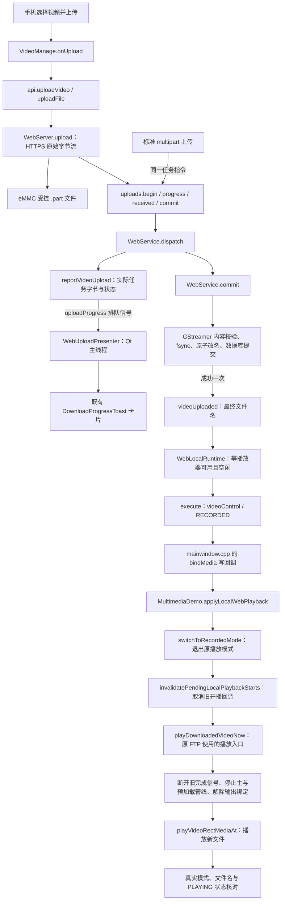

# Web 页面调整与视频上传后的设备播放

日期：2026-10-16。

## 本轮行为

1. 手机在视频页“选择本地视频文件 → 上传到设备”后，Qt 设备显示与原 FTP 相同样式的进度卡片。卡片依次显示接收、校验、完成或中断。接收达到声明字节数时仍最多显示 99%，只有视频内容检查、文件原子发布和数据库登记全部成功后才显示 100%。
2. 视频发布成功后，Qt 切换播放这次上传的视频。失败的上传不触发播放，重复提交同一个 READY 任务也不重复启动播放。
3. 新建人员弹窗增加右上角关闭按钮；人员页增加 NFC-读卡二维码，可点击放大并保存原始 JPG。
4. 楼层开放/限行改用响应式圆点网格；选中表示开放。保留原 B8～B1、1～120 共 128 个权限位及提交方式，仅调整布局。
5. 视频播放来源横向排列并允许换行；增加音量滑块留白；保存设置按钮位于上传区域与视频列表之间。
6. “设备预览”菜单改为“多媒体”，移除页面顶部标题和设置入口；默认刷新与首个选项改为 5 秒；存储已用与总量保留两位小数。

## 接收进度与自动播放拓扑

### 对应代码

| 文件、函数 | 作用 |
|---|---|
| `web/server/src/web_server.cpp`，`WebServer::upload()` | 保留原流式写盘；原 16 MiB 进度检查之外，增加超过 1 秒后的检查，兼容小文件与慢速网络。 |
| `web/server/src/standard_api.cpp`，`standardUpload()` | 标准 multipart 上传也回报同一 Qt 任务进度。 |
| `modules/web/web_service.cpp`，`reportVideoUpload()` | 从受控视频任务读取名称、已接收字节、预计字节；人员 Excel 与人脸图片不显示视频进度卡片。 |
| 同文件，`dispatch()`、`commit()` | 接收开始、进度、完整接收、校验、发布、取消、失败通知；只有首次发布成功发出自动播放信号。 |
| `main.cpp` | 将 `uploadProgress` 排队连接到总窗口的 `WebUploadPresenter`，提示在设备总窗口显示。 |
| `modules/web/web_upload_presenter.h/.cpp` | 直接复用原 `DownloadProgressToast` 样式，分别记录并发任务；结果短时显示后自动隐藏，失联超过 90 秒清理。失联计时使用单调时钟。 |
| `modules/web/web_local_runtime.cpp` | 排队保存最新发布视频；等待现有切换结束和多媒体模块允许启动，交给 `execute(videoControl)`；核对真实播放状态并记录切换失败。 |
| `components/multimedia/multimediademo.cpp`，`applyLocalWebPlayback()` | 复用已有模式切换和 FTP 播放入口，不创建另一套播放器。指定文件时取消模式切换排队的旧开播动作，避免先播列表首项。 |
| 同文件，`localWebPlaybackState()` | 增加 `canStartLocalPlayback`，沿用启动释放、模块暂停、FTP 下载暂停和可见性门控。 |

如果多媒体模块当前因人脸界面等原因暂停，不强行启动隐藏的解码管线；新视频等待模块恢复后播放。多个视频连续发布时，等待期间保留最近完成的文件。

原 MQTT 消息入口、FTP 下载回调、播放器底层销毁/创建实现均未改动。播放器切换仍由原有 GStreamer 控件停止旧管线并按原逻辑准备新管线；不使用 `delete` 后立即重建另一套播放控件。

网页视频列表中的“下载”仍表示设备向手机发送文件，该动作不触发设备自动换片。

## NFC 图片

`web/NFC-readCard.jpg` 保持原文件；副本位于 `web/frontend/public/NFC-readCard.jpg`，构建后成为 `dist/NFC-readCard.jpg`。预览窗口提供“保存到本地”链接，以原始 JPG 文件下载；手机保存目录由浏览器决定。

## 验证和部署

本地验证包括生产前端构建、Chromium 手机布局与交互测试、Qt 上传任务/数据库/进度控件测试、服务器单元测试，以及 ARM64 Linux HTTPS 服务编译。Qt 测试使用固定内容校验替身和播放器控制替身，验证传输字节、校验前不播放、发布幂等、暂停期间等待及恢复后播放；不能替代板端 GStreamer 解码和硬件管线切换验证。

部署需要同时更新编译后的 Qt 程序、`device-webd` 和完整 `web/frontend/dist/`。新的完整网页包为 `.web-build/dist-web-ui5-20261016.tar.gz`，内含 `dist/` 和 `dist/SHA256SUMS`，包括门户引导资源与 NFC 图片。只复制部分旧 JS 或遗漏 public 资源会导致功能不完整。

上板后核对：正在播放旧视频时从手机上传新视频，观察设备接收/校验提示，成功后核对新视频播放；再测试无效文件和中断传输不会换片，并检查 LIVE 切换、本地视频切换、预加载管线及模块返回后的播放。硬件播放行为需要在开发板上完成最终验证。

## 本轮文件清单

以下 23 个已有源码、测试与文档修改，4 个文件新增；另外完整重建 `web/frontend/dist/` 的 31 个资源文件。缓存目录中的构建工具、测试截图、测试日志及审计文件不属于部署源码。

| 类型 | 文件 |
|---|---|
| 修改 | `main.cpp` |
| 修改 | `components/multimedia/multimediademo.cpp` |
| 修改 | `modules/web/web.pri` |
| 修改 | `modules/web/web_local_runtime.h` |
| 修改 | `modules/web/web_local_runtime.cpp` |
| 修改 | `modules/web/web_service.h` |
| 修改 | `modules/web/web_service.cpp` |
| 新增 | `modules/web/web_upload_presenter.h` |
| 新增 | `modules/web/web_upload_presenter.cpp` |
| 修改 | `web/server/src/web_server.cpp` |
| 修改 | `web/server/src/standard_api.cpp` |
| 修改 | `web/frontend/src/config/index.js` |
| 修改 | `web/frontend/src/views/device/DevicePreview.vue` |
| 修改 | `web/frontend/src/views/person/PersonList.vue` |
| 修改 | `web/frontend/src/views/elevator/ElevatorControl.vue` |
| 修改 | `web/frontend/src/views/video/VideoManage.vue` |
| 修改 | `web/frontend/src/i18n/locales/zh.json` |
| 修改 | `web/frontend/src/i18n/locales/en.json` |
| 修改 | `web/frontend/src/i18n/locales/vi.json` |
| 修改 | `web/frontend/src/i18n/locales/th.json` |
| 新增 | `web/frontend/public/NFC-readCard.jpg` |
| 修改 | `web/tests/browser_check.py` |
| 修改 | `web/tests/qt_web_tests.cpp` |
| 修改 | `web/tests/qt_web_tests.pro` |
| 修改 | `web/tests/test_platform.cpp` |
| 修改 | `docs/web_api_middleware_topology_20261016.md` |
| 新增 | `docs/web_ui_video_upload_20261016.md`（本文） |

部署网页包：`.web-build/dist-web-ui5-20261016.tar.gz`。ARM64 Linux HTTPS 服务验证产物：`.web-build/device-webd-ui5-arm64-tls`。文件级审计：`.web-build/ui5-change-audit.json`。
