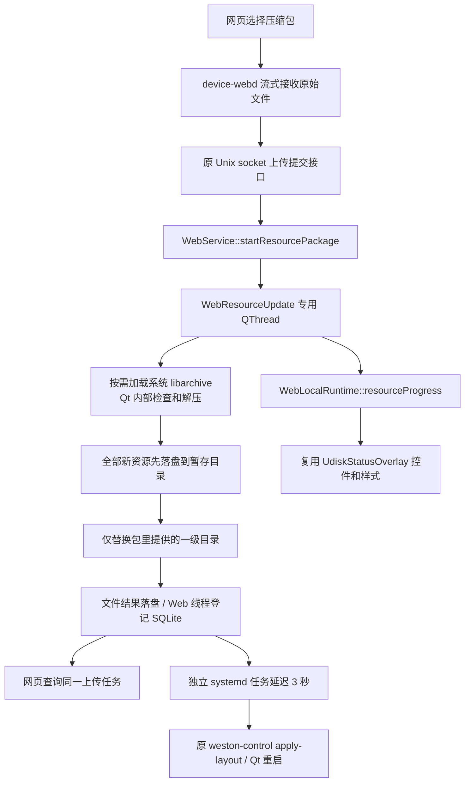

# Qt 内部 Ycest 资源更新

2026-10-21：资源解压、目录替换和回滚已迁入 Qt/C++，旧 Python 更新脚本已删除。

## 运行链路



服务器只接收文件、调用原 IPC，不引入 libarchive，不执行解压命令。
解压不调用 Python、tar、unzip 或 unrar。Qt 正常启动不主动加载 libarchive；
只在查询资源更新能力或实际更新时检查该库，库不可用时仅拒绝资源更新。

## 格式与目录规则

网页继续支持 ZIP、TAR、TAR.GZ/TGZ、RAR4/RAR5，使用真实文件头识别格式，
上传缓存以 `.part` 结尾不影响识别。已验证常规 ZIP、带 data descriptor 的 ZIP、
TAR.GZ、RAR4、RAR5、RAR5 固实压缩、中文文件名和空目录。
加密包、链接及特殊文件不接受。

压缩包根目录为 `Ycest/`；最终路径固定为：

```text
/mnt/UDISK/res/static/demoResources/images/
```

| 包内内容 | 设备结果 |
| --- | --- |
| 只有 `Ycest/logo/` | 整体替换 `images/logo/`，保留 pic、tl、video |
| 有 logo、pic | 分别替换这两个目录，缺失的目录保留 |
| 新增其他一级目录 | 新建对应目录并递归复制全部内容 |
| 提供空目录 | 对应目标目录被替换为空目录 |

不会生成 `images/Ycest/`，不改变原挂载方式。压缩包最大 512 MiB、展开最大 2 GiB、
最多 20,000 个条目，目标存储预留 64 MiB。ZIP 中央目录另限制为 16 MiB。

## Qt 模块与线程

| 文件 / 入口 | 功能 |
| --- | --- |
| `modules/web/web_resource_update.h/.cpp` | 原生归档读取、路径/格式/容量校验、流式解压、目录事务、恢复和重启调度 |
| `WebResourceUpdate::execute` | 文件业务唯一实现；正式 QThread 与隔离测试复用 |
| `WebResourceUpdate::available` | 按需检查系统 libarchive 接口，不修改资源或重启 |
| `WebService::startResourcePackage` | 保存原上传任务状态，启动专用低优先级工作线程 |
| `WebService::finishResourcePackage` | 回到原 Web 线程登记 SQLite 和清理大缓存；工作线程不访问数据库 |
| `modules/web/web_local_runtime.h` | 资源进度跨线程信号，沿用既有 UI 桥接 |
| `components/udisk_status/udisk_status.h/.cpp` | 新增直接接收资源进度的入口，复用原标签、进度条、颜色和布局 |
| `main.cpp` | 在 AppShell 上创建同类覆盖层，所有模式下可显示更新进度 |

设备覆盖层使用独立实例，不轮询或改写 `/tmp/udisk_status.json`，不发送 U 盘状态信号。
进度覆盖接收、检查、解压、替换、完成和失败；旧任务的延迟隐藏不会隐藏新任务。
原 U 盘监听脚本、原视频上传卡片、播放器和 MQTT 本轮保持不变。

## 更新事务与重启

新资源先完整解压到 `images/.ycest-update/stage`，校验和写盘全部成功后，
只备份及替换本次提供的一级目录。逐目录移动保留落盘日志；未提交失败执行回滚。
启动恢复兼容旧更新日志，只回滚未提交目录或核对已提交结果，不重放旧压缩包。

成功后保留原 `systemd-run --on-active=3s` 独立任务，调用
`/usr/local/sbin/weston-control apply-layout <images>/logo/ycest_cfg.ini`。
解压/替换失败不安排重启；重复提交和恢复也不重复安排重启。
重启调度失败仍保留 `state=READY` 表示文件已经更新，另返回 `restartScheduled=false`。

请求、Cookie/CSRF、上传任务编号和查询 API 保持原样。只有完成文件事务并登记 SQLite 后，
`GET /api/v1/uploads/<id>` 才返回 READY。

## 页面文案

- 资源导入卡片下移除旧 `pkgTip` 提示。
- 上传确认：`点击确认后，设备即将更新`。
- `pkgDone` 固定为 `更新完成！`，不展示目录清单。
- `pkgRestarting`：`设备即将重启，请稍候`。
- `pkgRestartFailed`：`资源已更新，但设备未刷新，请检查设备服务。`。
- `ycestRequired`、`pkgNameYcest` 的文字使用 `Ycest`。

## 编译与部署

1. 编译 Qt 时需要 libarchive 的 `archive.h`、`archive_entry.h` 开发头文件；
   `modules/web/web.pri` 已登记新模块。构建环境与目标系统的 libarchive 由设备方准备。
2. Qt 使用 QLibrary 按需加载 Linux `libarchive.so.13`，不把它编入 Web 服务器，
   也不要求为普通 Qt 启动增加解压服务或 Python 环境。
3. 部署重新编译的 Qt 和完整 `web/frontend/dist`；服务器二进制和原服务单元无需因本轮变更重建。
4. `web/deploy/install-portal.sh` 移除了 Python 检查、RAR 脚本检查及脚本安装，
   只清理旧门户专用 `/home/cat/web-stage/ycest-resource-update.py` 文件。
5. 更新后的 Qt 不再读取或调用该脚本；未运行安装器的设备也无需保留旧脚本。

## 验证

- 造包脚本仅供开发测试，所有解压及更新调用真实 Qt/C++ 实现，设备不部署测试 Python。
- 原生归档测试验证 ZIP/TAR/RAR、中文/空目录、缺失目录保留、路径穿越/链接/损坏/加密拒绝、
  data descriptor ZIP、超限长度、提交前后恢复，以及不重复安排重启。
- Qt 集成额外验证第二目录发布失败时全部回滚、真实工作线程进度、事件循环保持响应、
  U 盘覆盖层复用且不发 U 盘事件、旧隐藏计时器不覆盖新任务。
- 浏览器使用生产 dist 验证确认文字、完成文字和重启调度失败的固定提示。
- 未在实际开发板执行本轮升级验证。


## 本轮修改文件

修改 22 个源码/测试/文档文件，新增 2 个 Qt 文件，删除旧生产 Python 脚本；完整重建 dist。

| 类型 | 文件 |
| --- | --- |
| 修改 | `components/udisk_status/udisk_status.cpp` |
| 修改 | `components/udisk_status/udisk_status.h` |
| 修改 | `docs/web_ycest_rar_20261020.md` |
| 修改 | `docs/web_ycest_resources_20261020.md` |
| 修改 | `main.cpp` |
| 修改 | `modules/web/web.pri` |
| 修改 | `modules/web/web_local_api.cpp` |
| 修改 | `modules/web/web_local_runtime.h` |
| 修改 | `modules/web/web_service.cpp` |
| 修改 | `modules/web/web_service.h` |
| 修改 | `web/BOARD_RUN.md` |
| 修改 | `web/README.md` |
| 修改 | `web/deploy/install-portal.sh` |
| 修改 | `web/frontend/src/i18n/locales/en.json` |
| 修改 | `web/frontend/src/i18n/locales/th.json` |
| 修改 | `web/frontend/src/i18n/locales/vi.json` |
| 修改 | `web/frontend/src/i18n/locales/zh.json` |
| 修改 | `web/frontend/src/views/device/DeviceSettings.vue` |
| 修改 | `web/tests/browser_check.py` |
| 修改 | `web/tests/qt_web_tests.cpp` |
| 修改 | `web/tests/qt_web_tests.pro` |
| 修改 | `web/tests/resource_package_check.py` |
| 新增 | `modules/web/web_resource_update.cpp` |
| 新增 | `modules/web/web_resource_update.h` |
| 删除 | `web/deploy/ycest-resource-update.py` |

### dist 资源变更

| 类型 | 文件 |
| --- | --- |
| 更新 | `web/frontend/dist/index.html` |
| 新哈希文件 | `web/frontend/dist/assets/AirControl-Cb10H_2Q.js` |
| 新哈希文件 | `web/frontend/dist/assets/DevicePreview-DeWebWki.js` |
| 新哈希文件 | `web/frontend/dist/assets/DeviceSettings-DEAkqSlb.js` |
| 新哈希文件 | `web/frontend/dist/assets/DeviceSettings-WHV0yQ1o.css` |
| 新哈希文件 | `web/frontend/dist/assets/ElevatorControl-BQ5hiNmc.js` |
| 新哈希文件 | `web/frontend/dist/assets/IPSettings-CpFgPJRz.js` |
| 新哈希文件 | `web/frontend/dist/assets/LangSwitch-Cdc-1IwI.js` |
| 新哈希文件 | `web/frontend/dist/assets/Layout-DdzouKCL.js` |
| 新哈希文件 | `web/frontend/dist/assets/Login-DfvBKabM.js` |
| 新哈希文件 | `web/frontend/dist/assets/PersonDetail-CppWv9g4.js` |
| 新哈希文件 | `web/frontend/dist/assets/PersonList-DPCFtkCk.js` |
| 新哈希文件 | `web/frontend/dist/assets/VideoManage-C_e236my.js` |
| 新哈希文件 | `web/frontend/dist/assets/function-call-DAztgL0b.js` |
| 新哈希文件 | `web/frontend/dist/assets/index-CS2impcr.js` |
| 清理旧哈希文件 | `web/frontend/dist/assets/AirControl-P1rKH1Hg.js` |
| 清理旧哈希文件 | `web/frontend/dist/assets/DevicePreview-Bv4HX9kT.js` |
| 清理旧哈希文件 | `web/frontend/dist/assets/DeviceSettings-Cd-P8jNL.js` |
| 清理旧哈希文件 | `web/frontend/dist/assets/DeviceSettings-D4MrVhJb.css` |
| 清理旧哈希文件 | `web/frontend/dist/assets/ElevatorControl-CQnlol_Q.js` |
| 清理旧哈希文件 | `web/frontend/dist/assets/IPSettings-DJrBppUv.js` |
| 清理旧哈希文件 | `web/frontend/dist/assets/LangSwitch-t-56u9eI.js` |
| 清理旧哈希文件 | `web/frontend/dist/assets/Layout-CuqEiO7z.js` |
| 清理旧哈希文件 | `web/frontend/dist/assets/Login-BH8v1ZCX.js` |
| 清理旧哈希文件 | `web/frontend/dist/assets/PersonDetail-Dof-_zI5.js` |
| 清理旧哈希文件 | `web/frontend/dist/assets/PersonList-DgBiLSB7.js` |
| 清理旧哈希文件 | `web/frontend/dist/assets/VideoManage-bNBbsK59.js` |
| 清理旧哈希文件 | `web/frontend/dist/assets/function-call-DHISZmwI.js` |
| 清理旧哈希文件 | `web/frontend/dist/assets/index-DMVlZlYk.js` |
