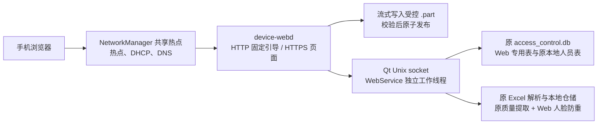

<!--
 @file README.md
 @brief 本地 Wi-Fi Web 功能的实施、构建、部署与验收说明。
 @author Du lin
 @date 2026-10-09
-->
# 本地 Wi-Fi Web 功能交付说明

本实现按 `docs/local_wifi_web_v1_plan.md` 及 [Web 本地 API 设计](../docs/web_local_api_design_20261015.md) 接入。最新接入范围、限制与验证见 [本地 API 实施记录](../docs/web_local_api_implementation_20261015.md)。手机连接热点，通过设备网页登录并上传视频、Excel 本地人员及人脸图片，浏览、下载和删除指定目录视频。独立 C++ 服务没有 Qt、SQLite 或 MQTT 依赖；统一 SQLite 的写入继续由 Qt 负责。



## 实施文件与原业务边界

| 位置 | 内容 |
| --- | --- |
| `server/` | 独立 C++17 `device-webd`，CMake 构建；HTTP/HTTPS、会话、白名单 API、Unix IPC、流式上传/下载 |
| `frontend/` | 参考工程的完整页面副本；保留导航和布局，连接基本文件与人员接口 |
| `../modules/web/` | Qt IPC、上传状态/目录操作、批次协调、路径和配额检查、Web 防重、导入互斥 |
| `../common/sql/web/` | Web 建表/迁移和账号、任务、批次、媒体、本地人员只读仓储，分别独立文件 |
| `deploy/` | 专用热点、HTTP/HTTPS、Qt Web 入口的 systemd/config 模板，不自动部署 |
| `tools/provision_account.py` | 工厂生成密码摘要，由 Qt 在空 `web_accounts` 时初始化 |
| `tests/` | 独立 Qt/SQLite/原 Excel 集成测试、原模板 XLSX 生成、浏览器验收 |

既有文件只增加以下接入点：`qt_ycest.pro` 引入 `web.pri`；`main.cpp` 增加可开关的 WebRuntime；`MainWindow.cpp` 接 Web 专属人脸校验与资料刷新；`FaceInferenceWorker.h` 增加新入口和信号；`PersonImportWorker.*` 增加 U 盘/Web 导入互斥。原 `dbstore.cpp`、Excel 解析器、本地/网络人员仓储和网络下发人脸实现保持不动。当前媒体模块只新增本地 Web 读取/控制入口，原 MQTT 消息入口不改。

当前已接入本地播放/音量、图片广告、截图/概览、人员与凭证编辑、楼层/特殊模式、定时梯控新增/删除/保存、网页登录改密和 Ycest 资源包更新。空调、信号休眠和定时开关机按能力禁用并返回 501。Web 不依赖 MQTT 回执，不按 offline/online 模式限制，也不检查 mqttd。定时梯控使用 Web 独立执行器、兼容原规则格式和共享存储，MQTT 源码及原定时器保持原样；媒体选择共用原 net_cfg.ini，图片按小图选项进入 pic 或 video。详见[2026-10-22 接入记录](../docs/web_schedule_media_20261022.md)。网页媒体上传成功后沿用本地自动播放流程；资源包仅替换提供的目录，并在更新成功后自动重启 Qt。

新增源码和配置有文件说明；接口、关键状态及资源归属有注释。JSON 使用 `_comment` 元数据。第三方头文件/许可证保持原上游内容；依赖安装目录、构建结果和生成文件不修改注释，且不纳入源文件交付。

## 数据和导入规则

- 统一库：`/home/cat/face_media/access_control.db`。Web 表仅在 `web_schema.*` 迁移，不创建第二份人员库。SQL 在 Web 工作线程使用原按线程连接规则。
- 视频：`/mnt/UDISK/res/static/demoResources/images/video`，直接使用开发板 eMMC 上的普通目录，无需独立挂载或外挂存储。临时文件位于其 `_uploads/*.part`，同一文件系统校验、同步并重命名；正式文件不覆盖同名视频。
- 媒体目录必须真实存在、路径合法且可读写，所在文件系统须就绪且非只读；上传仍检查剩余空间和原有配额。容量统计读取视频目录所在分区。旧 `MERGEDQT_WEB_MEDIA_MOUNT` 配置保留兼容，不再用它判断是否允许访问。
- 列表扫描真实目录，包含旧文件和 FTP 文件，隐藏临时文件；下载使用固定大小缓冲。删除保护当前下载及 Qt 进程实际打开的视频文件。
- 上传状态：`CREATED → RECEIVING → RECEIVED → VALIDATING → COMMITTING → READY`。错误/取消分别记录；已发布提交幂等，接收不能重传同一任务。断线查询原任务，再决定取消/新上传。
- 人员中间文件：`/home/cat/web-stage/imports/<batch-id>/`；批次创建登记完整清单，Excel/所选图片全部 READY 后才封存。只接受 `.xls/.xlsx`，直接使用原 Qt 解析器和 `importSpreadsheetPersonnel()`，保留表头、行警告、本地覆盖、网络重复及卡号/密码冲突规则。
- 人脸图片保持原名/原字节，按 `账号_序号` 匹配本批成功本地人员；不要求客户端目录。图片质量/提取及正式注册照保存复用原入口和 `replaceValidatedFaces()`。
- **Web 人脸防重使用网络下发同一个 `config.duplicateFaceCosineThreshold`，限制范围 `[0,1]`，没有新默认阈值或 Web 独立参数。** 核对有效本地、网络及本批人脸，自身更新允许，其他身份冲突拒绝；保存前重读图库复核。原 U 盘与网络下发行为不改。
- 人员按原逐人部分成功方式保存，结果列出新增/更新/失败/图片警告。进行中重启标记 `RECOVERY_REQUIRED`，禁止自动重放，避免累加原表中业务字段。应人工核对已入库部分后新建批次。
- 成功、部分失败、明确失败、放弃批次清理中间文件；不确定批次保留现场。启动恢复可核对未完成发布；不宣称进程重启测试等同于实际断电测试。

## 构建

标准 API 前缀为 `/api`，响应 `{code:200,message,data,meta}`；原 `/api/v1` 上传、导入、会话和热点接口继续兼容。失败使用实际 HTTP 状态及 `message`。登录后使用 HttpOnly/SameSite=Strict/Secure Cookie；修改操作校验部署 origin 和内存 CSRF token。会话空闲 15 分钟、绝对期限 8 小时，长文件传输定期刷新活动期限；不在 localStorage 保存口令或登录令牌。

| 方法与路径 | 内容 |
| --- | --- |
| `GET /device/info`, `/health`, `/captive` | 公开基础标识、业务就绪、入口信息 |
| `POST /device/wifi` | 登录后提交 `{ssid}`；仅改热点名称，返回后 3 秒重新激活 NetworkManager 热点 |
| `POST /auth/login`, `GET /auth/session`, `POST /auth/logout` | 出厂账号登录、刷新恢复会话、登出 |
| `POST /uploads` | `kind/name/size` 创建任务；人员文件增加 `batch_id` |
| `PUT /uploads/:id/content` | 原文件字节，`application/octet-stream`、准确 Content-Length |
| `GET /uploads/:id`, `POST /uploads/:id/commit`, `/cancel` | 查状态、校验发布、取消未发布任务 |
| `GET /files`, `GET /files/:id/content`, `DELETE /files/:id` | 实际目录列表、下载、删除；标识绑定文件版本，拒绝旧列表误删 |
| `GET /persons`, `/persons/:id` | 原本地人员基础资料只读 |
| `POST /imports` | `manifest:[{name,kind,size}]` 登记一份 Excel 和所选图片完整清单 |
| `GET /imports/:id`, `POST /imports/:id/start`, `/discard` | 原批次状态、一次性导入、放弃 OPEN 批次/清理缓存 |

前端需要 Node/npm 仅在开发机使用，板上只部署 `dist`：

```sh
cd web/frontend
npm ci
npm run build
```

独立服务默认强制 HTTPS，需要 C++17、CMake ≥3.18、POSIX/pthread 和 **OpenSSL ≥3.0**。使用板端工具链或匹配 ARM64 sysroot 编译；Qt 工程原有 OpenSSL 不需要修改。Ubuntu 20 旧 sysroot 可能只有 OpenSSL 1.1，须为新 daemon 提供单独 OpenSSL 3 开发/运行环境，不能把主机库混入 ARM64，也不要替换原 Qt 的库。

```sh
cmake -S web/server -B build-device-webd -DCMAKE_BUILD_TYPE=Release
cmake --build build-device-webd -j2
ctest --test-dir build-device-webd --output-on-failure
```

交叉编译增加 `-DCMAKE_TOOLCHAIN_FILE=<现有板端工具链文件>` 和相应 `OPENSSL_ROOT_DIR`。测试程序须在匹配目标系统运行。

Qt 工程继续用原 qmake/板端构建方式，新模块已登记进 `qt_ycest.pro`，继续需要原 GStreamer/RGA/InspireFace/RKNN 等依赖；视频上传检查另需 `gstreamer-pbutils-1.0` 开发包及板端对应 GStreamer 插件。新增依赖未增加第二个 Qt 服务，也没有把 HTTP 库加入 Qt。

视频内容校验在 Qt Web 工作线程调用原 `gst_player_widget.cpp` 底层新增的 GStreamer Discoverer 接口，要求完整文件可解析且存在视频流；不可用时返回部署错误，不将非视频文件发布。此检查不播放或转码，不保证所有格式都能由板端硬件解码。Excel 压缩包和图片尺寸预检对 Web 上传设置资源上限，不改变原 U 盘解析器。

本机开发可用 `-DDEVICEWEB_TLS=OFF` 构建，但配置必须 `development_http=true`、`bind=127.0.0.1`、同一 `http://127.0.0.1:<port>` origin、`portal_port=0`。真实业务使用 daemon 同源提供构建网页；Vite 只做界面开发。Windows 构建仅验证独立服务源码/单元检查，真实 IPC/流式上传要求 Linux。

逐条可执行步骤见 [开发板运行步骤](BOARD_RUN.md)。Ycest 更新已迁入 Qt 内部 C++ 模块，按需调用系统 libarchive，设备不再需要 Python 更新脚本。libarchive 头文件与系统库由设备方准备，服务器二进制不引入该库。Qt 使用专用工作线程完成校验、解压和目录事务，并复用 U 盘覆盖层展示设备进度，详见 [Qt 资源更新说明](../docs/web_ycest_resources_20261020.md)。

## 自动启动与板端部署

生产统一使用 root，热点地址固定 `192.168.10.1/24`。手机访问 `https://192.168.10.1`，HTTP 80 引导到 HTTPS。用户自行维护匹配该地址的证书；本轮不生成、不覆盖任何 TLS 文件。

`face-media.service` 继续管理原驱动、MQTT 和 Qt。`scripts/start_face_media.sh` 在每次启动 Qt 前创建 `/run/mergedqt`、`imports`，设置 `MERGEDQT_WEB_ENABLE=1` 和受控路径；不检测网卡，不运行热点或服务器，也不检查工厂 JSON 文件是否存在。目录准备失败只记录提示，不中断原 Qt 启动。空账号库的出厂摘要初始化机制仍由 Qt 保留。

独立 `device-webd.service` 执行 `/usr/local/sbin/device-web-start.sh`，先等实际 Qt Socket 和 `/run/mergedqt/web-ready`，确认同一 Qt PID 与设备号持续稳定 3 秒（总等待上限 60 秒），再调用 `/usr/local/sbin/portal-network.sh`。两个脚本均读取 `/home/cat/web-stage/portal.env`，保留 `PORTAL_ENV` 覆盖入口。Qt 就绪文件含 PID、实际 `[mqtt]/client_id`、默认 `YC_<后五位>_0000` 三行，不依赖 NetworkManager 或 WiFi。无可用网卡正常跳过，服务器不启动；失败不影响 Qt/MQTT。启动失败最多由 systemd 在 180 秒内重试 3 次。

NetworkManager 管理专用连接 `yc-device-portal`。检测实际无线接口名称、AP 能力、NM 管理状态和当前连接，默认只选择空闲接口或本功能已有连接，不抢占原联网接口。热点关闭独立自动连接，由此服务在 Qt 稳定后激活。NM 负责 DHCP/DNS，不再单独运行 hostapd/dnsmasq。

通过校验后，脚本写入 `/etc/NetworkManager/dnsmasq-shared.d/91-portal-dns.conf`，配置 `address=/#/192.168.10.1`；使用实际网卡在 FORWARD 链首插入带本功能标记的 DROP 规则，热点激活后再次校验。重复执行不堆积规则，不清空其他防火墙配置。热点 IPv6 关闭。只有热点成功取得地址后才启动 Web 服务器。服务停止只清理本功能的连接活动状态、DNS 文件和 tagged 规则，保留连接及自定义 SSID。

板端依赖 NetworkManager/nmcli（共享模式所需 DNS/DHCP 支持）、iptables、iproute2、timeout、flock。`portal.env` 为 root-owned 0600 配置，默认自动挑选空闲 AP 网卡；新建热点须先填写实际 `AP_PASSWORD`，不能使用占位符。若复用已经设置密码的专用 NM 热点连接，可设置 `AP_CONNECTION` 为该连接名称，无需重新填写密码。不要同时运行旧的独立热点服务。

在完整工程部署到开发板、Qt/服务器/dist 已构建后，执行一次：

```sh
sudo sh web/deploy/install-portal.sh
sudoedit /home/cat/web-stage/portal.env
```

安装脚本只注册开机启动，不重启现有 Qt/MQTT。它安装新的 Qt 启动脚本与统一服务，删除明确废弃的旧门户服务/配置和旧 `face-media.service.d/web.conf`；不删除账号摘要、数据库、上传目录或证书。运行前把需要沿用的旧独立热点密码/自定义 SSID迁移到新配置；也可复用已有专用 NM 连接。之后在计划的维护窗口重启 Qt，再启动 `device-webd.service`，或直接重启开发板，后续不再手动建目录/导出变量/启动热点。

## 设备号与热点名称

登录、预览和设备菜单的设备号读取实际 `net_cfg.ini` 的 `[mqtt]/client_id`。当前 SSID 通过固定的 NetworkManager 管理程序读取；热点不存在时 Qt 仍能提供默认名称，不主动配置网络。

网页提交 SSID 和可选新密码后，Qt 调用固定的 `/usr/local/sbin/portal-network.sh save`；新密码通过标准输入交接，空密码保持原值。脚本更新 NM 连接并原子保存自定义名称至 `/home/cat/web-stage/portal-ssid`，持久化失败回滚原设置。校验失败、热点未激活时不接受修改。保存成功返回断线提示，延迟 **3 秒** 后通过统一服务的 ExecReload 只重新激活这一热点连接，复核地址、防火墙和 DNS；不重启统一服务、Web 服务器、Qt 或全局 NetworkManager。读取 SSID 使用 C.UTF-8，自定义名称及密码跨设备重启保留。SSID 限制为 1–32 UTF-8 字节；密码支持 8–63 位 ASCII 或 64 位十六进制 PSK。

HTTP 热点入口已改为独立浏览器引导页，不再直接跳转登录。页面按钮从服务器 origin 自动生成目标地址，安卓点击后尝试唤起默认浏览器，系统拦截时可复制地址；普通浏览器仍使用 `/#/login`。登录页增加密码显隐和由浏览器密码管理器处理的“记住密码”，网页本地存储仅记录勾选偏好。详见 [本次功能及部署说明](../docs/web_portal_browser_wifi_20261016.md)。

Qt 的同步逻辑只发布就绪文件，不轮询 NetworkManager。热点更新在 Web 工作线程发起，重新激活使用异步子进程，未启用 WiFi/服务器时不阻塞 Qt 界面。重激活失败会记录日志并保留错误状态。

## 验证与验收

2026-10-09 本机已经验证：前端生产构建（约 0.75 MiB）；独立服务 Windows C++ 编译及 CTest；Linux ARM64 POSIX 分支编译和 OpenSSL 3 HTTPS 分支交叉编译/链接；Qt Web 模块隔离编译和实际 SQLite、原 XLSX 解析/仓储测试；新桥接/校验/U 盘互斥源码的语法检查；实际 Chromium 全页面与文件上传验收。隔离测试使用临时数据库与文件，未读写板端数据。ARM64 链接检查使用独立工具/官方 Debian OpenSSL 3 库，其结果用于验证源码，不能视为匹配现有板端 sysroot 的交付二进制。

Qt 集成测试覆盖认证摘要/迁移幂等、路径/权限拒绝、原文件内账号重复/无效行、本地入库/网络重复/卡号冲突与部分成功、统一库、网络同参数阈值调节、自身/跨库/同批人脸冲突、原始清单缺图片拒绝导入、取消缓存、接收中断清理、不确定批次禁止重放、目录旧文件/临时文件过滤及删除。测试输入使用原模板必需列，不代替产品完整 Excel 用例。

运行隔离 Qt 测试：

```sh
python3 web/tests/make_fixture.py /tmp/web-fixture.xlsx
mkdir -p build-web-tests
cd build-web-tests
qmake ../web/tests/qt_web_tests.pro
make -j2
./qt_web_tests /tmp/web-fixture.xlsx
```

浏览器检查（安装 Playwright 库，使用已有 Chromium/Chrome 和已构建的 device-webd）：

```sh
python3 web/tests/browser_check.py --dist web/frontend/dist --browser /path/to/chrome --server build-device-webd/device-webd --output build-browser-check
```

浏览器测试由实际 device-webd 提供生产静态构建及安全响应头，检查登录、全部保留路由、禁用控件、原字节上传、Excel+图片清单和刷新恢复；同时拒绝外网资源请求，验证图标字体、语言 SVG、CSP、控制台日志、并发请求及端口占用错误。仅 Qt 业务响应在浏览器测试脚本中拦截，不进入交付前端；不能据此宣称真实设备链路或 HTTPS 已验收。

## 离线图标与控制台日志

Vant 图标使用 CSS 内嵌 WOFF2，构建插件移除其 CDN 备用地址；服务器 CSP 仅为字体增加 `font-src 'self' data:`。语言切换使用本地内联 SVG，配置包入口使用有效的 `description` 图标，不需要互联网。

手动执行 `./device-webd /home/cat/web-stage/web.json` 后，启动信息和正常请求直接输出到当前控制台的标准输出，警告和错误输出到标准错误；均带时间和级别，每行立即刷新，不创建日志文件。启动信息包含监听地址、端口、网页目录、Qt Socket 和访问 URL；请求日志包含客户端 IP、方法、路径、状态码和耗时（从路由开始到响应写出）。Qt RPC 失败记录操作、Socket、阶段及系统错误编号/说明，帮助区分路径不存在、无权限、连接拒绝和超时；不输出请求正文、Cookie、令牌或查询参数。多线程日志按完整行输出。

如果使用 systemd 服务，标准输出/错误通常由 journal 接收，可用 `journalctl -u device-webd.service -f` 查看。Qt 的 `[WEB]` 业务日志沿用 face-media 原有日志机制，不由 device-webd 转存。本次 NetworkManager 自动启动更新还需重编 Qt，部署新的启动脚本和服务；账号、导入、视频及 MQTT 业务规则不变。

以下仍必须在实际 RK3566 上验收，当前环境没有板子及完整 Linux BSP：

- 完整 Qt 链接及原播放、识别、MQTT、U 盘导入回归；实际人脸 SDK 提取与多张照片的防重/质量结果。
- 独立 daemon 的生产 OpenSSL 3 编译/运行、Unix socket 权限、真实浏览器 Cookie/CSRF/上传/下载/删除全链路。
- 两种以上目标手机的 AP/DHCP、HTTP 自动入口、受信 HTTPS 和扫码备用入口。
- 视频/Excel/图片真实样本；并发 FTP 与播放、识别时配额、CPU、温度、内存及速度。
- Qt/daemon 分别重启、进程终止与**实际断电**、媒体拔出/只读/磁盘满的恢复；正在播放的视频删除保护。

构建工具和结果位于本机忽略目录 `.web-build-tools/`、`.web-build/`；交付源码不依赖这些绝对路径。不要把开发机编译的 Windows 程序部署到板子。

2026-10-15 自动启动修改已通过 Qt 集成测试、前端构建、实际 Web 服务器浏览器回归和热点脚本隔离测试。热点测试覆盖无 WiFi、无 AP 能力、已有上行连接、网段冲突、隔离失败、动态网卡名、SSID 持久化、DNS、连接重激活及停止清理；Qt 测试覆盖缺少热点管理程序仍能就绪、3 秒延迟和重激活失败提示。真实 NetworkManager/无线硬件仍需在板端验收。

隔离热点脚本回归（所有 NM/防火墙操作由临时测试工具替代，不修改实际网络）：

```sh
python3 web/tests/portal_network_check.py --shell /bin/sh --output build-portal-network-check
```
