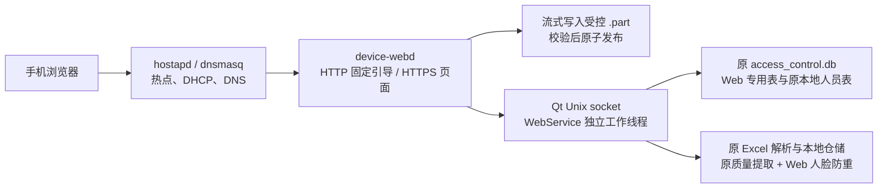

<!--
 @file README.md
 @brief 本地 Wi-Fi Web 功能的实施、构建、部署与验收说明。
 @author Du lin
 @date 2026-10-09
-->
# 本地 Wi-Fi Web 功能交付说明

本实现按 `docs/local_wifi_web_v1_plan.md` 和最新业务边界接入。手机连接热点，通过设备网页登录并上传视频、Excel 本地人员及人脸图片，浏览、下载和删除指定目录视频。独立 C++ 服务没有 Qt、SQLite 或 MQTT 依赖；统一 SQLite 的写入继续由 Qt 负责。



## 实施文件与原业务边界

| 位置 | 内容 |
| --- | --- |
| `server/` | 独立 C++17 `device-webd`，CMake 构建；HTTP/HTTPS、会话、白名单 API、Unix IPC、流式上传/下载 |
| `frontend/` | 参考工程的完整页面副本；保留导航和布局，连接基本文件与人员接口 |
| `../modules/web/` | Qt IPC、上传状态/目录操作、批次协调、路径和配额检查、Web 防重、导入互斥 |
| `../common/sql/web/` | Web 建表/迁移和账号、任务、批次、媒体、本地人员只读仓储，分别独立文件 |
| `deploy/` | 专用热点、HTTP/HTTPS、Qt Web 入口的 systemd/config 模板，不自动部署 |
| `tools/provision_account.py` | 工厂生成密码摘要，由 Qt 在空 `web_accounts` 时初始化 |
| `tests/` | 独立 Qt/SQLite/原 Excel 集成测试、原模板 XLSX 生成、浏览器验收 |

既有文件只增加以下接入点：`qt_ycest.pro` 引入 `web.pri`；`main.cpp` 增加可开关的 WebRuntime；`MainWindow.cpp` 接 Web 专属人脸校验与资料刷新；`FaceInferenceWorker.h` 增加新入口和信号；`PersonImportWorker.*` 增加 U 盘/Web 导入互斥。原 `dbstore.cpp`、Excel 解析器、本地/网络人员仓储、网络下发人脸实现、媒体播放实现均未修改。

播放、音量、截图、空调、电梯、远程开门、凭证编辑、设备设置/改密等页面全部保留，明确显示“本版本未接入”，禁用操作，不注册对应后端路由，也不发送 MQTT。网页上传完成不调用 `onDownloadedVideoReady()`；原播放器本身的目录/轮播行为继续由原逻辑决定。

新增源码和配置有文件说明；接口、关键状态及资源归属有注释。JSON 使用 `_comment` 元数据。第三方头文件/许可证保持原上游内容；依赖安装目录、构建结果和生成文件不修改注释，且不纳入源文件交付。

## 数据和导入规则

- 统一库：`/home/cat/face_media/access_control.db`。Web 表仅在 `web_schema.*` 迁移，不创建第二份人员库。SQL 在 Web 工作线程使用原按线程连接规则。
- 视频：`/mnt/UDISK/res/static/demoResources/images/video`，临时文件位于其 `_uploads/*.part`，同一文件系统校验、同步并重命名；正式文件不覆盖同名视频。
- 列表扫描真实目录，包含旧文件和 FTP 文件，隐藏临时文件；下载使用固定大小缓冲。删除保护当前下载及 Qt 进程实际打开的视频文件。
- 上传状态：`CREATED → RECEIVING → RECEIVED → VALIDATING → COMMITTING → READY`。错误/取消分别记录；已发布提交幂等，接收不能重传同一任务。断线查询原任务，再决定取消/新上传。
- 人员中间文件：`/home/cat/web-stage/imports/<batch-id>/`；批次创建登记完整清单，Excel/所选图片全部 READY 后才封存。只接受 `.xls/.xlsx`，直接使用原 Qt 解析器和 `importSpreadsheetPersonnel()`，保留表头、行警告、本地覆盖、网络重复及卡号/密码冲突规则。
- 人脸图片保持原名/原字节，按 `账号_序号` 匹配本批成功本地人员；不要求客户端目录。图片质量/提取及正式注册照保存复用原入口和 `replaceValidatedFaces()`。
- **Web 人脸防重使用网络下发同一个 `config.duplicateFaceCosineThreshold`，限制范围 `[0,1]`，没有新默认阈值或 Web 独立参数。** 核对有效本地、网络及本批人脸，自身更新允许，其他身份冲突拒绝；保存前重读图库复核。原 U 盘与网络下发行为不改。
- 人员按原逐人部分成功方式保存，结果列出新增/更新/失败/图片警告。进行中重启标记 `RECOVERY_REQUIRED`，禁止自动重放，避免累加原表中业务字段。应人工核对已入库部分后新建批次。
- 成功、部分失败、明确失败、放弃批次清理中间文件；不确定批次保留现场。启动恢复可核对未完成发布；不宣称进程重启测试等同于实际断电测试。

## 构建

实际 API 前缀为 `/api/v1`，响应 `{code:200,data:...}`；失败使用实际 HTTP 状态及 `message`。登录后使用 HttpOnly/SameSite=Strict/Secure Cookie；修改操作校验部署 origin 和内存 CSRF token。会话空闲 15 分钟、绝对期限 8 小时，长文件传输定期刷新活动期限；不在 localStorage 保存口令或登录令牌。

| 方法与路径 | 内容 |
| --- | --- |
| `GET /device/info`, `/health`, `/captive` | 公开基础标识、业务就绪、入口信息 |
| `POST /auth/login`, `GET /auth/session`, `POST /auth/logout` | 出厂账号登录、刷新恢复会话、登出 |
| `POST /uploads` | `kind/name/size` 创建任务；人员文件增加 `batch_id` |
| `PUT /uploads/:id/content` | 原文件字节，`application/octet-stream`、准确 Content-Length |
| `GET /uploads/:id`, `POST /uploads/:id/commit`, `/cancel` | 查状态、校验发布、取消未发布任务 |
| `GET /files`, `GET /files/:id/content`, `DELETE /files/:id` | 实际目录列表、下载、删除；标识绑定文件版本，拒绝旧列表误删 |
| `GET /persons`, `/persons/:id` | 原本地人员基础资料只读 |
| `POST /imports` | `manifest:[{name,kind,size}]` 登记一份 Excel 和所选图片完整清单 |
| `GET /imports/:id`, `POST /imports/:id/start`, `/discard` | 原批次状态、一次性导入、放弃 OPEN 批次/清理缓存 |

前端需要 Node/npm 仅在开发机使用，板上只部署 `dist`：

```sh
cd web/frontend
npm ci
npm run build
```

独立服务默认强制 HTTPS，需要 C++17、CMake ≥3.18、POSIX/pthread 和 **OpenSSL ≥3.0**。使用板端工具链或匹配 ARM64 sysroot 编译；Qt 工程原有 OpenSSL 不需要修改。Ubuntu 20 旧 sysroot 可能只有 OpenSSL 1.1，须为新 daemon 提供单独 OpenSSL 3 开发/运行环境，不能把主机库混入 ARM64，也不要替换原 Qt 的库。

```sh
cmake -S web/server -B build-device-webd -DCMAKE_BUILD_TYPE=Release
cmake --build build-device-webd -j2
ctest --test-dir build-device-webd --output-on-failure
```

交叉编译增加 `-DCMAKE_TOOLCHAIN_FILE=<现有板端工具链文件>` 和相应 `OPENSSL_ROOT_DIR`。测试程序须在匹配目标系统运行。

Qt 工程继续用原 qmake/板端构建方式，新模块已登记进 `qt_ycest.pro`，继续需要原 GStreamer/RGA/InspireFace/RKNN 等依赖；视频上传检查另需 `gstreamer-pbutils-1.0` 开发包及板端对应 GStreamer 插件。新增依赖未增加第二个 Qt 服务，也没有把 HTTP 库加入 Qt。

视频内容校验在 Qt Web 工作线程调用原 `gst_player_widget.cpp` 底层新增的 GStreamer Discoverer 接口，要求完整文件可解析且存在视频流；不可用时返回部署错误，不将非视频文件发布。此检查不播放或转码，不保证所有格式都能由板端硬件解码。Excel 压缩包和图片尺寸预检对 Web 上传设置资源上限，不改变原 U 盘解析器。

本机开发可用 `-DDEVICEWEB_TLS=OFF` 构建，但配置必须 `development_http=true`、`bind=127.0.0.1`、同一 `http://127.0.0.1:<port>` origin、`portal_port=0`。真实业务使用 daemon 同源提供构建网页；Vite 只做界面开发。Windows 构建仅验证独立服务源码/单元检查，真实 IPC/流式上传要求 Linux。

逐条可执行步骤见 [开发板运行步骤](BOARD_RUN.md)。Python 仅用于开发机出厂摘要生成及测试，不是板端运行依赖。

## 板端部署顺序

当前阶段先按 `BOARD_RUN.md` 前台手动启动和联调，不安装以下服务/drop-in，不改开机脚本。下面自动部署模板保留为后续参考，不属于当前操作步骤。

1. 使用现有板端环境编译 Qt 和 `device-webd`；确认原 Qt 回归正常、媒体挂载、目录权限和 GStreamer 插件可用。新版 Qt 直接部署到原 `/home/cat/face_media/MergedQtApp`，不放进 Web 目录。
2. 在 `/home/cat/web-stage` 下部署 `device-webd`、前端 `dist`、`web.json`、`tls/`、`imports/` 和热点配置；Web 专属文件均留在该目录。按实际 Qt 与 daemon 运行用户设置共享缓存权限，不复制开发机依赖或工具目录。
3. 出厂执行 `python3 web/tools/provision_account.py --username <出厂用户名> --output <工厂摘要路径>`，隐藏输入口令。把摘要安装为 `/home/cat/web-stage/factory-account.json`，仅 Qt 服务用户可读（0600）。没有硬编码默认密码，不重复覆盖已初始化账号。工厂 Wi-Fi 密码与网页口令分别配置。
4. 将匹配部署 origin 的证书链和私钥安装到 `/home/cat/web-stage/tls`（私钥 0600）。示例 origin 为 `https://192.168.50.1`，证书 SAN 必须包含该 IP；若采用域名则 DNS、证书 SAN、origin/Host 必须一致。
5. 复制并核对 `deploy/web.json` 到 `/home/cat/web-stage/web.json`；配置中的设备编号、热点名称、监听地址和路径是出厂部署值。浏览器或客户端不能传入任意服务器存放路径。
6. 将 `deploy/mergedqt-web.conf` 安装到**现有 Qt service** 的 `.service.d/web.conf`，保持现有 `ExecStart`。核对原用户/组，运行目录 `/run/mergedqt` 的组必须允许 daemon 访问；不要另起第二份 Qt。设置 `MERGEDQT_WEB_ENABLE=1` 才启用，关闭变量可回到原启动行为。
7. 安装独立 `device-webd.service`，核对 `cat`、路径、目录存在及媒体挂载顺序，再启动。service 只给新 daemon 低端口能力和目录写权限，不给数据库访问业务；示例限制 128 MiB/32 任务，仅是保护上限，实际 RSS/PSS 须板测。
8. 根据硬件能力配置专用 AP 网卡后，再安装/启动 `device-hotspot.service`；不直接在现有 STA 网卡上执行样例，不重启原全局网络服务。示例 `wlan1` 应与 hostapd/dnsmasq/env 三份配置一致，并由现有网络管理器排除管理；只提供 wlan0 的硬件须先确定 AP/STA 共存方案。

热点依赖 `hostapd`、`dnsmasq`、`iproute2`，驱动支持 AP/nl80211。`hostapd.conf` 的出厂占位密码必须替换，否则脚本拒绝启动。板端 AP 地址固定 `192.168.50.1/24`，手机由 DHCP 分配 `.20–.100`。脚本只添加指定网卡地址/启动自己的进程，不修改原默认路由或 MQTT。

HTTP 80 将探测/访问请求引导到固定 HTTPS 登录 URL，HTTPS 443 提供页面及接口。手机自动弹出取决于系统探测和证书信任；自签名证书无法靠重定向变成受信任证书，也不能劫持任意 HTTPS。生产须预置信任私有 CA/受信证书方案，并保留扫码/手动访问入口。DHCP 114 仅在目标 dnsmasq/手机支持且受信 CAPPORT HTTPS 就绪后启用。

示例配置和服务均未在开发机或真实板子自动安装/启动，避免修改用户现有运行环境。

## 验证与验收

2026-10-09 本机已经验证：前端生产构建（约 0.75 MiB）；独立服务 Windows C++ 编译及 CTest；Linux ARM64 POSIX 分支编译和 OpenSSL 3 HTTPS 分支交叉编译/链接；Qt Web 模块隔离编译和实际 SQLite、原 XLSX 解析/仓储测试；新桥接/校验/U 盘互斥源码的语法检查；实际 Chromium 全页面与文件上传验收。隔离测试使用临时数据库与文件，未读写板端数据。ARM64 链接检查使用独立工具/官方 Debian OpenSSL 3 库，其结果用于验证源码，不能视为匹配现有板端 sysroot 的交付二进制。

Qt 集成测试覆盖认证摘要/迁移幂等、路径/权限拒绝、原文件内账号重复/无效行、本地入库/网络重复/卡号冲突与部分成功、统一库、网络同参数阈值调节、自身/跨库/同批人脸冲突、原始清单缺图片拒绝导入、取消缓存、接收中断清理、不确定批次禁止重放、目录旧文件/临时文件过滤及删除。测试输入使用原模板必需列，不代替产品完整 Excel 用例。

运行隔离 Qt 测试：

```sh
python3 web/tests/make_fixture.py /tmp/web-fixture.xlsx
mkdir -p build-web-tests
cd build-web-tests
qmake ../web/tests/qt_web_tests.pro
make -j2
./qt_web_tests /tmp/web-fixture.xlsx
```

浏览器检查（安装 Playwright 库，使用已有 Chromium/Chrome）：

```sh
python3 web/tests/browser_check.py --dist web/frontend/dist --browser /path/to/chrome --output build-browser-check
```

浏览器测试针对生产静态构建，检查登录、全部保留路由、禁用控件、原字节上传、Excel+图片清单和刷新恢复。测试响应只在测试脚本中拦截，不进入交付前端；不能据此宣称真实设备链路或 HTTPS 已验收。

以下仍必须在实际 RK3566 上验收，当前环境没有板子及完整 Linux BSP：

- 完整 Qt 链接及原播放、识别、MQTT、U 盘导入回归；实际人脸 SDK 提取与多张照片的防重/质量结果。
- 独立 daemon 的生产 OpenSSL 3 编译/运行、Unix socket 权限、真实浏览器 Cookie/CSRF/上传/下载/删除全链路。
- 两种以上目标手机的 AP/DHCP、HTTP 自动入口、受信 HTTPS 和扫码备用入口。
- 视频/Excel/图片真实样本；并发 FTP 与播放、识别时配额、CPU、温度、内存及速度。
- Qt/daemon 分别重启、进程终止与**实际断电**、媒体拔出/只读/磁盘满的恢复；正在播放的视频删除保护。

构建工具和结果位于本机忽略目录 `.web-build-tools/`、`.web-build/`；交付源码不依赖这些绝对路径。不要把开发机编译的 Windows 程序部署到板子。
